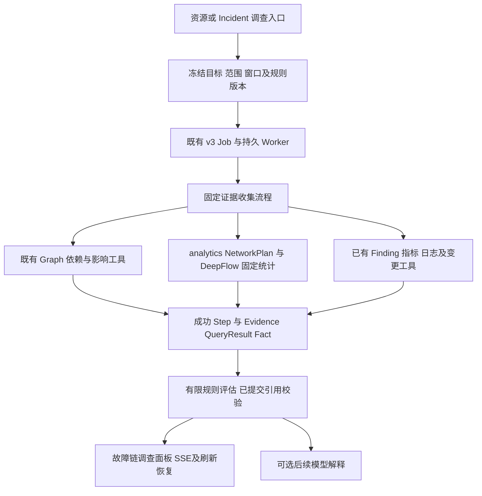

# 故障链调查增强：详细开发方案

日期：2026-10-14。

状态：Approved for development。用户于 2026-10-14 明确要求“完成开发工作”，授权见 [ADR-0041](../adr/0041-fault-chain-investigation-enhancement.md)。不授权生产发布。字段名、工具名与默认参数中标为“拟新增”的内容是开发设计，实际实现与验证进展另行记录。

## 1. 开发决定与交付目标

建议新增独立的非虚拟化增强专项，复用已有故障链、资源图、证据、持久调查与 DeepFlow 接入。交付目标是：操作者能够从资源或 Incident 出发，比较故障前、中、后的异常，检查有限上下游，逐条理解支持事实、矛盾事实和待补检查。

首期成功的标准不是“生成更长的诊断文字”，而是：

1. 窗口统计有明确口径和可核验的来源。
2. 上下游身份、关系和方向有依据。
3. 每条调查假设可以追溯到已提交的证据与计算结果。
4. 缺失、冲突、范围受限和来源降级直接可见。
5. 模型不可用时，已完成的观测与比较仍可查看。

本专项不修改 Incident Correlation 归并规则，不把助手假设自动转为正式 RCA，不生成或执行自动处置。

## 2. 仓库依据与已有能力

正式依据保持根目录 00～10 文档；尤其是《06 故障分析与 RCA》关于 Supporting、Contradicting、Missing、Degraded 的区分，以及 Correlation 与 RCA 的边界。阶段范围遵守 [AGENTS.md](../../AGENTS.md)、[ADR-0008](../adr/0008-defer-kubevirt-cdi-development.md)、[ADR-0040](../adr/0040-deepflow-live-l4-l7-development.md)。

已核对的接入点：

- [assistant_chain.go](../../internal/investigation/assistant_chain.go)：`ChainLink` 已有支持、冲突、缺口、下一步和关系摘要；只接受已提交的固定 Graph 工具关系，`assessment` 必须为 `hypothesis`。
- [DiagnosisAnswer.tsx](../../web/src/features/assistant/DiagnosisAnswer.tsx)：已有逐假设、逐链证据展示。因此界面工作属于联动与信息组织增强。
- [DeepFlow Adapter](../../internal/integrations/deepflow/adapter.go)：固定 L4/L7 模板、UID/容器生命周期验证、双端范围、来源复核、行/字节预算已存在。当前查询窗最多一小时，明细 limit 最多 200；现有 SQL 是限量明细查询。
- [relations.go](../../internal/integrations/deepflow/relations.go)：通信观测投影为 `communicates_with`，TTL 为 300 秒，不透明对端统计不投影关系。
- [analytics](../../internal/analytics/domain.go)：已有 QueryIntent、QueryResult、来源清单、窗口比较和服务端 Fact；目前没有 network dataset。
- [assistant_analysis.go](../../internal/app/assistant_analysis.go)：Worker 分析执行当前直接选择 `*analytics.Victoria`；新增网络统计需要显式接入此通道。
- [assistant_tools.go](../../internal/httpapi/assistant_tools.go)：`metrics.*` 和 `logs.*` 被路由到签名 Worker 分析 RPC；network dataset 必须补路由，不能落入控制面 SQL。
- [工具目录](../../internal/investigation/tools/catalog.go)：排障任务没有开放 `execute_analysis_query`，本专项需要有限开放 operational 分析工具，同时维持 audit 隔离。
- [assistant_answer.go](../../internal/investigation/assistant_answer.go)：已校验 QueryResult/Fact、Evidence 和关系引用；当前 Fact 只覆盖 `rows[*].value`，不能直接引用拟新增的分母和统计附项。
- [dispatcher.go](../../internal/investigation/dispatcher.go)、[investigator worker](../../services/investigator/src/investigator/worker.py)：当前普通调查依赖模型调用。提供确定性收集需要增加显式分支，不能仅靠 Prompt 要求模型先调用工具。

[最新进展](ai-assistant-development-progress.md)记录了开发环境真实 L4/L7 查询与机制验证；中文质量 FAIL、正常模型轮次可用性问题继续保留。本文不推断生产发行、其他协议或完整历史能力已经通过。

## 3. 分期范围

### 3.1 首期必须交付

- 单个集群、同一授权 namespace 内，当前身份连续的 Pod 端点调查。
- 已经过实际证明的 HTTP 协议状态/耗时统计；L4 重传与连接失败观测统计。
- 一跳上下游；最多展示现有合同允许的 8 条故障链关系。
- 明确窗口的基线、故障和可选恢复比较。
- 固定统计、有限规则、已提交证据引用与界面联动。
- 显式“收集调查证据”入口：不调用模型也能完成收集和展示。
- 常规自然语言排障可以调用同一统计与评估工具；解释效果独立验收。

### 3.2 后续独立增量

- 两跳调查、跨 namespace 双端授权与查询。
- Service/Deployment 级聚合：需要按时间确定历史成员集合，不能按名称拼接 Pod。
- 跨容器重启、Pod 重建的历史关系与统计比较。
- 经证明的连接成功率、重传率、更多 L7 协议与可靠 P95。
- 更长保留期与历史拓扑能力。

以上不作为首期前置。某项数据语义验证失败时，只关闭受影响的指标或规则，保留已经合格的统计与调查路径。

### 3.3 持续边界

KubeVirt/CDI 继续延期。Trace 保持 `CAPABILITY_DISABLED`；不引入 Jaeger/OTel、DeepFlow GUI、新图数据库或通用 RCA 框架。正式 RCA 和 ActionPlan 只读引用。运行验证沿用 192.168.0.63 的独立开发环境，不能自动改动 core/final 配置或进入 Bundle。

## 4. 用户流程与调查窗口

### 4.1 入口

在助手的资源排障与 Incident follow-up 中增加“收集故障链证据”。资源详情和 Incident 工作区跳转到这一既有助手入口，携带当前资源身份或 Incident ID。

表单要求目标、namespace、故障窗口；基线可默认生成，恢复窗口可选。Incident 时间只作为默认候选，必须显示所用时间与来源；人工确认的故障时间与平台发现时间分别保存。

存在同名多对象、目标未解析或引用身份失效时，沿用现有澄清与资源解析，不创建占位 Incident。

### 4.2 默认窗口

建议首期默认故障窗为用户选定的 10 分钟；等长基线位于故障窗之前，默认留 2 分钟间隔。记故障开始为 T、长度为 W、间隔为 G：

- 基线：`[T-G-W, T-G)`。
- 故障：`[T, T+W)`。
- 恢复：用户指定起点 R，使用 `[R, R+W)`；未指定时不生成恢复判断。

10 分钟和 2 分钟是初始交互建议，不是异常阈值。用户可调整，但仍受来源证明、保留期和一小时查询上限约束。相对时间冻结在 requestedAt，内部 UTC，界面使用会话时区。

新统计模板必须使用半开窗口 `time >= from AND time < to`。现有明细模板使用含终点条件，首期不默默更改旧模板；新旧口径明确区分。

### 4.3 窗口校验

- 基线与故障等长、无重叠，恢复窗必须已结束且可查询。
- 不得超出当前双端身份有效期、来源保留期或有效覆盖窗。
- 缺失基线只展示故障窗观测，不计算变化量。
- 缺失恢复只表示恢复未验证，不推断持续故障。
- 当前实时映射把容器 Running.startedAt 纳入身份有效起点；跨重启的旧窗不可按当前映射补查。
- 本次读取时间、源记录事件时间和统计窗口分别保存，不能用查询时间刷新旧关系。

## 5. 数据统计口径

### 5.1 先完成字段语义证明

使用锁定 DeepFlow 源码/字段定义和受控流量，确认：

1. L4 记录是否为周期增量、累计更新还是连接终结记录，重传字段能否直接求和。
2. L7 记录如何对应最终响应、是否存在请求/响应拆分、重复采集点和多次更新。
3. `pod_id_0/1` 的客户端/服务端语义，与采集位置和协议方向是否一致。
4. HTTP 协议 ID、响应码、耗时单位及无响应记录的含义。
5. 采样、丢弃、采集停止和写入延迟如何检测，查询完成是否意味着采集完整。

不能仅凭列名或样例结果完成资格认定。失败项关闭对应统计，不以更换显示名称掩盖误算。

### 5.2 拟新增 network datasets

每个 dataset 主指标保持单一单位，支持的 operation 逐项准入：

- `network.http-responses`：最终 HTTP 响应观测数量，单位 `responses`。只统计已验证的最终响应记录；不是端到端全部用户请求数。
- `network.http-5xx`：最终 HTTP 5xx 响应观测数量，单位 `responses`。4xx、协议状态错误和无响应单列质量信息，不混为同一业务失败。
- `network.http-5xx-rate`：`5xx 数 / 合格最终响应数 × 100`，单位 `percent`。分子分母必须取自相同查询、端点、采集策略和窗口；分母为零返回 no_data。
- `network.http-response-time`：合格完成响应的平均耗时，统一换算为 `milliseconds`。无响应不能作为零耗时；单独保留被排除记录数量。P95 在统计与采样语义证明后开放，不能对明细 LIMIT 样本冒充总体 P95。
- `network.tcp-retransmissions`：已证明可累加的重传观测数量，单位 `retransmissions`。不能用记录条数代替包量，也不能将重传等同于丢包。
- `network.connection-failure-observations`：符合当前固定失败状态条件的观测记录数，单位 `observations`。只有连接标识和记录终结/去重证明齐全后，才升级为失败连接数或连接失败率。

初始 operations 为 `aggregate`、`trend`、`compare`；`compare_percent` 仅对有意义且基线非零的指标开放。错误率前后变化优先表示为百分点，不能将“从 1% 到 3%”写成“增加 2%”。

### 5.3 聚合、重复与空数据

- 固定 Server/Querier 模板在授权过滤后聚合，不读取 LIMIT 明细做整体统计，不直接连接 ClickHouse。
- 每个统计计划固定协议、采集位置和去重策略。优先选单一已证明采集点；只有记录身份可靠时才合并多采集点。
- 若无法证明跨记录去重，输出“观测记录数”，关闭依赖唯一请求/连接口径的比率。
- QueryResult 的 exact 表示声明的观测总体及计算口径得到准确统计，不自动证明所有真实用户请求均被采集。
- 确认源覆盖正常但响应数为零时，可以显示“该窗无响应观测”；错误率和耗时仍为 no_data，不能显示业务健康。
- 采集停止、覆盖不足、丢弃/采样未知、backend partial、字节超限、截断或分母不可靠时，不生成精确变化结论。
- 统计项均附 population、观测策略、有效样本数、排除数及质量状态；界面展示口径，模型只引用服务端值。

### 5.4 统计与变化

- 数量：按合格记录与已证明增量计算。
- 平均耗时：`sum(duration) / validDurationCount`，不平均多个桶的均值。
- 错误率：先汇总分子与分母再相除，不平均各 Pod 或时间桶的错误率。
- 绝对变化：`故障值 - 基线值`；沿用现有 comparison 的 increase/decrease + 非负绝对值表示，不破坏现有 Row 非负合同。
- 相对变化：`(故障值 - 基线值) / 基线值 × 100`，基线零不计算。
- 趋势首期 60 秒桶，单窗默认 10 桶，最多 50 桶；适用事件时间未证明时标识时间质量，不应用先后规则。

## 6. 时间可靠性与身份

当前 DeepFlow Evidence 为 `TimeReliable=false`，不得直接改为 true。新增时间证明至少绑定 source revision、采集版本、时间字段语义、时钟偏差上界、采集/入库延迟上界和有效期。

受控验证在两端产生已知时间的独立事件，核对记录时间；时钟偏移和延迟升高应使证明失效。初始“先发生”规则使用保守不确定区间：包含时间桶宽度、事件时间语义误差及已验证时钟偏差；不得只比较两条秒级时间戳。

若 A 的异常发生区间最晚端仍早于 B 的区间最早端，才记录 before。区间相交为 same_bucket 或 uncertain；无时间证明为 unreliable。先后关系只是传播线索，仍不确认因果。

首期身份按 Pod UID、namespace UID、容器运行身份、双端有效期校验。历史记录只读回放已归档证据；当前关系 TTL 到期后不能重新标记为 fresh。若仅有当前关系、没有故障窗关系证明，单列 `historical_relation_unverified`。

## 7. 实现架构与持久执行



### 7.1 确定性收集模式

新增用户显式选择的 `evidence_only` 执行模式，限于 operational 的 `resource_troubleshooting` / `incident_followup`。TaskKind 不新增通用任务类型。

拟新增独立 `fault-chain-request/v1`，保存到不可变 TurnInput：目标、窗口、hop=1、用户选择范围及 executionMode。executionMode、窗口计划和规则版本绑定现有 InputDigest/ContextDigest，不能由自然语言或模型工具参数临时切换。AssistantTask、输入读取、JobAPI 与 provider 校验同步识别这一可信输入。

在现有 investigator worker 内分支执行有限的固定工具序列，继续使用官方 MCPBridge、JobAPI、租约续约、allocate/admit/settle 与现有 Complete。仍要求有效的配置身份、工作负载身份和 task 合同；此分支不发模型请求、不读取模型 API key、不把模型在线状态作为运行前置。

复用既有任务队列和 dispatcher，不创建第二个队列、调度器或自循环 Agent。若启动时 Holmes 导入/初始化导致模型离线仍阻断 evidence_only，必须将仅模型所需初始化移到解释分支，不能用特殊假模型解决。

### 7.2 固定步骤

1. 获取 assistant context，核对冻结请求与当前权限。
2. 查询既有依赖/影响工具，保留原工具名与独立 Step，供现有关系校验直接使用。
3. 在授权范围内选择目标及一跳候选。默认最多 4 条候选边，硬上限 8；候选选择先依据已提交 Finding，再用明确稳定次序。预算不足时不声称完成全局最异常排名。
4. 查询选中资源/端点对的 L4/L7 窗口统计，优先故障窗与基线，恢复及补充日志依剩余预算执行。
5. 仅使用已经发布、适合当前 task 的工具读取 Finding、日志、指标和变更。无 Incident 路径不得借用被禁用的 Incident 专属工具；缺少通用变更来源就保留缺口。
6. 调用拟新增 `evaluate_fault_chain`，只传同 Job 已提交的 Step 引用，由服务端读取并评估。
7. 提交确定性调查上下文和 AssistantAnswer。Summary 明确为调查观测/假设，所有 faultChain 项继续满足已有 hypothesis 与因果缺口条件。

解释作为后续普通轮次读取该上下文。模型解释失败不覆盖证据轮次、不把已完成收集改为失败；前端分别显示证据状态与解释状态。

### 7.3 预算与恢复

- 初始收集时间预算建议 60 秒，单源请求沿用现有超时上限；最终以 `min(专项上限, Job/政策剩余预算)` 为准。
- graphNodes、evidenceItems、toolCalls、rawQueries、resultBytes 全部进入现有账本。复合趋势/比较必须按实际后端子查询保留或结算预算，不得把多次请求藏在一次工具调用中。
- 单次 QueryResult 沿用最多 50 行，statistics 另设固定条目上限；上下文响应建议最多 64 KiB，并受 Job 剩余 resultBytes 约束。超限先减少可选样例或候选，不丢弃已发现的关键冲突；仍超限时如实返回 partial。
- 先预算再执行；能否覆盖 4 条边由实测成本决定。支持部分提交和具体未完成项，不提高现有模型 120 秒协议来掩盖过量收集。
- 每次调用带完整冻结窗口，重试参数不重新解析“现在”。已提交相同计划复用现有 allocation/QueryResult 持久结果；未提交调用不产生可引用事实。
- 接管后旧 generation 拒绝结算；固定流程从已提交 Step 恢复。取消后停止新调用，保留可授权读取的既有结果。
- 网络收集耗尽预算时，扩展现有排障 partial 收口，使其保留已提交网络 Facts、Evidence 和调查上下文；不能只覆盖 data_query 收口。

## 8. 服务端合同与接口

### 8.1 NetworkPlan 与 Worker 路由

在 analytics 新增私有 `NetworkPlan` 和有界执行器；底层复用 DeepFlow Adapter 的身份、来源、范围及 HTTP 调用，不复制成第二套 DeepFlow client。

计划编译冻结 dataset、metric、窗口、目标/对端、协议与固定观测策略，并绑定 source/qualification/scope/catalog 版本。执行前后复核权限、来源和 Graph owner 租约。多合格来源保持 AMBIGUOUS_SOURCE，不能随机选择。

Worker 对已知 catalog source 进行封闭分发：保留 Victoria 路径，增加 NetworkPlan 路径；不借本专项做通用插件执行器。API 用 catalog 中已知 source 路由，不仅靠未验证前缀。

### 8.2 QueryIntent 与 QueryResult

为现有 v1 合同增加经协商的可选网络字段，并同步所有 closed schema 与 provider 内联副本；旧请求/旧结果继续可读取。新旧运行组件不混用不支持的合同；如兼容检查表明此扩展不能安全保留 v1，则在 Task 0 固定新版本和显式版本路由。

拟新增 QueryIntent `networkSelection`：targetCanonicalId、可选 peerCanonicalId、固定枚举 direction。Canonical ID 长度按现有资源合同，不能塞入当前最大 253 字符的 Filter.value。两端选择必须是当前冻结范围的子集，不接受 backend Pod ID。

拟新增 QueryResult 字段：

- `networkContext`：端点 Canonical ID、协议、采集位置、population、去重策略、身份有效窗、覆盖/采样/时间质量及所用规则/证明引用。
- `statistics`：有界的 `{key, value, unit}` 附项，保存分子、分母、有效耗时数、排除数等，不与主指标混用单位。
- `derivationEvidenceRefs`：底层已归档或已提交统计 Evidence 的引用。

主 `rows` 仍表达单一 dataset 指标；一个计划围绕一个固定端点对和协议，不把含身份的 JSON 串放入 dimension。多边由调查上下文组合，不迫使通用 QueryResult 承担完整图结构。

BuildStoredQueryResult 与校验器需要为 statistics 数值生成带独立单位和明确列路径的 Fact；旧 `column=value` 引用保持。FactID 绑定计划与单元格位置，不允许模型提交替代值。依赖计数、率和耗时均由服务端计算。

新增 dataset/source/metric/unit 枚举时，同步 query-intent、query-result、analysis-catalog、source-capability、provider、Go/TS 生成合同。SourceManifest 不移除既有字段。

### 8.3 网络统计 Evidence

拟新增 `network-summary/v1` 作为 Evidence.Data 的类型化内容，含窗口、端点、观测口径、统计值和质量。通过现有 Evidence 归档/查询机制保存，不能仅在模型文字中留存。

签名 Worker 分析响应增加类型化统计 Evidence，API 验证 source revision、scope、来源身份及摘要后，经现有证据机制接收，并将引用放入成功工具结果。QueryResult、统计 Evidence 与对应 Step 的提交要防止悬空引用：只公开成功结算的结果，归档未完成沿用已有状态和降级语义，不伪造 archived_verified。

派生比较/规则 Evidence 的 `DerivationEvidenceRefs` 指向实际父证据，`IndependenceGroup` 沿用来源组。L4/L7 来自同一 DeepFlow 来源，不能被当作两个独立确认源。

### 8.4 故障链调查上下文

拟新增 `fault-chain-context/v1`，持久保存在 `evaluate_fault_chain` 成功 Step 中；首期不新增专用图表或结果数据库表。

内容包括：

- 目标、冻结范围、requestedAt、窗口、规则版本。
- 节点身份、已提交 relationDigest 与 graph revision/观测时间。
- 每条关系的调用方向及依据、观察方向、传播候选方向；未知方向显式 unknown。
- QueryResult/Fact/Evidence 引用，以及窗口统计与异常解释。
- 支持/冲突的 ruleId、reasonCode、父引用；缺口的 code、影响与建议检查。
- temporalAssessment：before、same_bucket、uncertain、unreliable。
- comparisonStatus：comparable、baseline_missing、identity_changed、coverage_insufficient、observation_policy_changed 等。
- contextStatus：complete/partial；complete 仅表示计划检查完成，不表示因果证明完整。

AssistantAnswer 可选 `faultChainContextRef` 指向已提交 Step/内容摘要；不让模型复制整份统计。最终校验确认所属 tenant、subject、conversation/turn、Job、当前可披露 scope 与父引用。旧 Answer 无该引用时继续使用现有视图。

### 8.5 拟新增接口/工具

- POST `/api/v1/assistant/conversations/{conversationId}/fault-chain-investigations`：显式创建证据收集轮次，复用会话 revision、幂等键、忙碌拒绝和 Job 创建。
- GET `/api/v1/assistant/conversations/{conversationId}/turns/{turnId}/fault-chain-context`：读取已提交上下文；每次检查本人会话、当前角色、目标、来源和全部父引用。
- `evaluate_fault_chain`：operational 排障工具，只接受已提交 Step ID 和请求引用，不接受模型传入 raw Evidence、SQL、评分、规则表达式或自由 from/to。
- 排障任务有限开放 `describe_analysis_dataset` / `execute_analysis_query`，只允许 operational 且 scope 匹配的数据；audit dataset 继续拒绝。

上述路径是提案，实施时纳入 [OpenAPI 唯一来源](../../api/openapi/platform-v1.yaml)，再生成客户端。固定收集流程仍经现有 MCP 网关调用已发布工具，不建立前端直连 DeepFlow 的旁路。

### 8.6 时间范围的合同衔接

现有 execute_analysis_query 校验主 timeRange 必须等于 requestedTimeRange，因此基线、恢复和子窗不能靠放松全局相等检查获得。

新增可信请求冻结 `allowedWindows`。专项调用的窗口必须精确匹配所声明的窗口或已定义半开桶，comparisonTimeRange 也校验；普通问数/排障保留原窗口规则。模型不能任意添加更早历史、更大范围或未来恢复窗。

## 9. 异常关联与候选规则

规则为有限、版本化、可回放的领域谓词；不提供表达式语言和相关系数即因果的通用评分器。规则版本随请求冻结。阈值采用已配置业务阈值；无配置时只给异常变化描述，不默认认定故障。

建议联调用的起始阈值可设最少 100 个响应、5xx ≥5% 且较基线上升 ≥3 个百分点、耗时 ≥2 倍且绝对上升 ≥100ms。它们仅用于冻结测试场景；上线阈值必须基于目标服务基线/SLO 单独确定，不写成平台通用故障标准。

### R1：下游应用异常线索

A→B 存在合格调用方向，故障窗 5xx 或耗时升高，且 B 有自身异常或 B→其他依赖异常：支持调查 B 及其依赖。若只有 A→B 的 503，仍无法区分 B 自身、代理或其他下游原因，列出缺口。

L4 完整且相同路径没有异常，只降低符合该规则预期的传输层解释；不能据此宣布网络问题已排除。

### R2：传输异常线索

同端点/观测策略的重传或连接失败观测显著增加，并与 L7 变化同窗：支持调查传输路径。时间证明合格且先后区间严格分离时，增加“传输异常先于响应异常”的线索。不得输出“已证明丢包导致业务失败”。

### R3：资源或共同依赖线索

已有图证明共享 Node 或依赖，多个授权资源有同窗异常，且同范围 Node/资源异常证据存在：给出共同资源候选。仅同时异常而缺少关系/自身证据时不输出共同根因。

### R4：变更关联线索

已提交的变更事件先于异常，目标身份和时间窗一致：作为关联背景。无 Incident 路径缺少已发布变更工具时标记缺口。仅时间接近不能证明变更导致故障。

### R5：恢复一致性

完整恢复窗中指标回到已配置阈值/基线容差，且相关健康异常消失：记录“观察到恢复迹象”。覆盖不足或没有后窗时恢复未验证，不自动关闭 Incident。

### R6：竞争解释与冲突

每个候选写明预期事实。覆盖完整且对该预期确实矛盾的证据才进入 conflicts；不同协议、不同端点、不同采集位置的正常数据不能跨口径反驳。保留全部合格关键冲突，不因排序删掉。

候选排序采用固定规则优先级、事实是否满足、数据质量和稳定 ID；前端显示依据，不输出伪概率。所有传播候选保留 hypothesis，当前 validator 强制的 missingEvidence 不移除。

规则评估必须负责引用的语义校验：证据不仅要存在，还要匹配该候选的端点、协议、窗口、采集策略及谓词。现有 validateSupportConflict 只验证引用存在且互斥，不能代替此检查。新统计异常保存在调查上下文，不自动生成正式 Finding 或改变其 occurrence。

## 10. 前端设计

在既有助手页面新增三个联动区域，保持证据入口与旧回答兼容：

1. **调查概览**：目标、窗口、来源能力、计划完成程度；一跳节点/边，区别调用箭头与传播假设箭头。循环关系不强行绘制成 DAG。
2. **时间比较**：所选边的请求/响应观测数、5xx、耗时和 L4 统计；基线/故障/恢复原值、差值、分母和质量。时间轴标出可读取的 Finding、日志异常和变更。
3. **证据面板**：支持、冲突、缺口分组；展示原因、观测时间、来源、规则、原始 Evidence/Fact 与下一步检查。

交互要求：

- 点击节点/边、比较值或事件，互相定位相应证据。
- 缺数据不连成零线，不透明对端不显示身份或建立节点。
- 调整窗口创建新轮次；旧轮次保留原计划与来源。
- 缺口按钮仅映射到已发布只读检查；范围不足先进入现有范围编辑，不能自动扩大授权或资源选择。
- 当前范围只选中目标 Pod 时，不能为了展示上下游自动解除 resource scope。要么显示可授权的目标统计，要么由用户选择已有权限内的调查范围。
- SSE 仅公开成功提交检查；模型解释为独立状态。刷新、取消和接管后数据一致。
- 键盘可选择节点/边与证据，窄屏改为纵向列表，不要求拖拽才能调查。

拟新增组件：`FaultChainPanel`、`NetworkWindowComparison`、`FaultChainTimeline`、`ChainEvidencePanel`。复用 AssistantEvidence、QueryResultView、现有资源链接和 useConversationStream。

## 11. 权限、保留与退化

### 11.1 权限

每个计划的双端须通过 tenant/cluster/namespace/resource 实际授权。查询前过滤，返回后校验，聚合后仍不泄露范围外身份。首期新模板继续双端同 namespace，不改旧模板范围条件。

来源撤销、角色变化、资源身份失效、会话归属变化和 Graph owner 变化按现有机制拒绝；重读历史不是新的来源准入。历史引用必须逐项检查当前可披露性。管理员不因维护入口获得运维正文读取权。

### 11.2 保留

上下文 Step、QueryResult、统计 Evidence、父证据形成明确依赖闭包。复用现有法律保留与清理机制，补上下文→QueryResult/Step/Evidence 依赖解析；不能只保存上下文引用而允许父结果先删。

默认沿用现有保留期限，不因新增调查自动无限保留。无需单独结果表；如果证据保护引用或 DB 检查约束需要扩展，新增向前迁移，编号实施时分配。不可修改已有迁移和旧物料准入摘要。

### 11.3 退化结果

- 来源不可用：保留其他来源观测，列出 source_unavailable。
- 无数据：保持 no_data，不输出正常。
- 截断/采样不明：partial，不输出精确变化和关键反证。
- 时间不可靠：可显示已声明时间口径的观测，先后关系 unreliable。
- 身份变化/基线过期：当前窗可用时展示当前观测；比较不可用。
- Graph 过期：可展示独立目标统计，传播链缺少有效关系。
- 预算耗尽：保留已经提交的结果，未执行项逐条列出。
- 模型超时：证据轮次保留，解释轮次单独失败。

## 12. 任务拆分与依赖

按八个可评审增量实施。前一个门禁通过后再开展依赖它的任务；不要求各增量均可单独对外上线。

### P0：字段与合同冻结

- T0.1：锁定 L4/L7 记录、方向、终结、采样及去重语义，完成独立正常流量计数。
- T0.2：验证时间字段、延迟和时钟偏差，定义时间证明；失败时冻结 unreliable 降级路径。
- T0.3：冻结 dataset、单位、Fact 扩展、network-summary/context/request、窗口与预算合同。
- T0.4：启动时新增范围 ADR，确定兼容策略和具体开发 namespace；本方案状态仍为 Proposed。

完成条件：可复现字段证明、冻结合同 Fixture、明确不能提供的统计。字段证明是准确统计的硬前置；时间证明失败不阻断无先后结论的调查。

### P1：固定统计 Adapter

- T1.1：在 DeepFlow Adapter 增加版本化聚合模板与固定协议/采集策略。
- T1.2：验证双端过滤、半开边界、增量/去重、溢出、源 partial、采样及空数据。
- T1.3：产生类型化 network-summary 与质量元数据；保留原查询路径。

完成条件：独立计数一致，无明细截断冒充总体的路径。

### P2：analytics 接入

- T2.1：NetworkPlan、固定执行器与 dataset/source capability。
- T2.2：Worker 签名 RPC、API 路由与来源歧义处理。
- T2.3：QueryResult statistics Facts、Evidence 归档及持久引用。
- T2.4：网络 aggregate/trend/compare 的数值和单位验证。

完成条件：来源配置和窗口资格不足时拒绝；真实 API→Worker→Querier→持久 Fact/Evidence 可回放。

### P3：证据收集模式

- T3.1：显式入口、冻结 allowedWindows、幂等与忙碌拒绝。
- T3.2：investigator 内 evidence_only 固定流程，复用 MCP/JobAPI。
- T3.3：子查询预算、部分提交、取消、SIGKILL 接管和已提交复用。
- T3.4：工具/OPA/task 准入与新输入绑定；模型离线无模型请求。

完成条件：模型服务停用时仍完成目标证据收集；旧 generation 无法提交。

### P4：有限规则与上下文

- T4.1：evaluate_fault_chain 与 R1～R6 的明确谓词和证据解释。
- T4.2：关系、实体、Evidence/Fact/Step 引用校验与时间区间判定。
- T4.3：context 持久读接口、AssistantAnswer 引用与保留依赖闭包。
- T4.4：无 Incident、循环关系、竞争候选与缺口降级。

完成条件：同一冻结输入得到相同结论；伪造关系、事实、时间或跨 Job 引用被拒绝。

### P5：界面闭环

- T5.1：概览、比较、时间轴与证据面板联动。
- T5.2：范围编辑、新轮次、旧轮次查看、SSE 与刷新。
- T5.3：键盘、窄屏和退化显示；旧 Answer 回归。

完成条件：每个判断与数值都可追溯，关键冲突和缺口无需追问即可看到。

### P6：自然语言接入

- T6.1：operational 排障有限开放统计/评估工具。
- T6.2：provider schema、历史上下文和 Prompt 只引用已提交结果。
- T6.3：解释独立轮次及模型失败状态，保留既有质量失败记录。

完成条件：模型不得改窗口、身份、规则或统计值；机制与中文帮助性分别报告。

### P7：真实专项验收与开发收口

- T7.1：执行下节受控流量和故障场景，保存独立 golden、实际命令、日志与回执。
- T7.2：核对独立开发环境源码/镜像绑定、回滚与能力开关。
- T7.3：更新专项进展与运行手册，给出通过/失败/未验证项。

完成条件：范围内功能与必要机制真实通过。生产来源、中文质量、发行物料和 Bundle 仍为独立放行项。

依赖顺序：`P0 → P1 → P2 → P3 → P4 → P5 → P6 → P7`。界面可在合同冻结后用明确标注的 Fixture 提前开发，但不能用 Fixture 替代真实接口/来源验收。

## 13. 验证场景与合格判据

### 13.1 计算正确性

1. 合格最终 HTTP 响应 1000 条，其中 50 条 503：统计应为 1000、50、5%。1000/50 为联调 golden，不代表已完成测量。
2. 基线错误率 1%、故障 5%：绝对变化 4 个百分点；相对变化 400%。
3. 基线零：显示原值与绝对变化，不输出无穷大或 100%。
4. 不等量时间桶：错误率按分子分母加总；耗时按样本数加权，拒绝均值的均值。
5. 大于旧明细 limit 的流量：聚合仍符合已声明总体；多采集点和周期更新不重复计数。
6. 窗口边界的记录只属于一个半开桶；无响应记录不成为零耗时。

### 13.2 调查帮助性

- 正常：显示有效观测，不构造故障原因。
- 仅 HTTP 503：支持响应异常，保留具体原因未确定。
- B 响应变慢、A→B 同窗变慢：提供调查 B 的线索，不能仅据此确认 B 根因。
- 重传/连接失败增加并伴随响应异常：提供传输方向线索；丢包未直接观察则明确缺口。
- A 同时依赖 B/C，其中一条正常、一条异常：保留竞争解释与合格冲突。
- 多 Pod 共享 Node 异常：只有真实关系与 Node 证据齐备时提供共同资源候选。
- 有变更但其他证据不匹配：不能只凭时间接近归因。
- 恢复窗完整/不完整：分别报告恢复迹象/恢复未验证。

### 13.3 身份、时间、权限和恢复

- 同名 Pod 重建、容器重启、删除对象、基线越过身份有效期或保留期。
- 时钟偏移、采集延迟、时间桶重叠：顺序变为 uncertain/unreliable。
- 来源撤销、角色撤权、跨 tenant/namespace、单目标范围外对端。
- 来源超时、Graph 过期、采集停止、丢弃/采样未知、无流量。
- 工作进程 SIGKILL、租约过期、旧 generation 迟到提交、相同参数重试。
- 中途取消、预算耗尽、刷新恢复、模型停用/超时。
- 保留/清理闭包：上下文可保留时父引用不能提前删除；删除后不能出现悬空可见数字。

合格要求是身份/单位/引用正确，退化不伪装正常，传播不伪装因果；不能以“返回 200”“工具 PASS”替代这些语义检查。

### 13.4 容量与时延

在同一冻结流量下分别测量单边、默认 4 边与上限 8 边的原始查询次数、返回字节、端点映射成本、数据库/Querier CPU 与 P50/P95 时延；再加入并发调查，验证取消、超时和其他调查的隔离。测试必须包含大于旧明细 limit 的窗口。

60 秒是建议收集预算，不是已实测时延。若默认范围无法在已有资源预算内稳定完成，应减少默认边数、优先检查项或统计桶，而不是放宽来源资格、内存上限和超时来宣称通过。容量结论只适用于实测的开发数据范围。

### 13.5 实施时的验证入口

优先覆盖受影响包与合同，再运行真实集成；不为每个纯展示分支复制实现型测试：

```sh
# 在 platform/ 中，使用仓库锁定工具链执行。
go test ./internal/integrations/deepflow ./internal/analytics ./internal/investigation/... ./internal/assistant ./internal/httpapi ./internal/app
make test-contract
make generate
make check-generated
make check-runtime-source
pnpm --dir web test
pnpm --dir web build
```

上述命令是开发完成后的建议检查，本文编写时未执行业务测试。还需新增对应 provider/固定流程 Python 回归与真实 PostgreSQL、签名 MCP、OIDC/API 浏览器验证。新测试的 live 前置必须列清楚，跳过不能计通过。前端同时验证 API 真实路径和范围隔离；原 SP-08 暂不验收范围不自动恢复。

## 14. 发布、回滚与工作量判断

新增默认关闭的专项能力开关，分别表达统计可用、调查可用与模型解释可用；不因通用 L7=true 推断所有统计/规则已合格。

发布顺序为合同/必要向前迁移 → Worker/Adapter 与统计资格 → API/工具 → investigator 固定流程 → 前端 → 独立开发范围启用。存在 closed schema 差异时保持开关关闭，不能让新 API 与旧 Worker 混跑新请求。

回滚先关闭新入口和新工具准入，停止新收集，保留不可变历史结果。所有已部署读取组件必须理解历史新字段；若旧二进制不能读取，新请求禁用后保留兼容读取版本，不直接降级删除数据或回退迁移。生产签名镜像与离线物料另行构建和验收，不复用变更前的准入摘要。

这是一个跨 Adapter、analytics、调查运行、证据合同和前端的中等规模专项。主要不确定性在记录去重/采样、时间证明和 evidence_only 的生命周期接入；P0 完成后才能可靠估算工期。排期以八个验收增量为单位，不把它估作只改页面的两三天任务。

最终交付物：冻结合同与来源证明、固定统计模板、确定性收集模式、有限规则、可回放上下文、联动界面、真实场景验收报告、运行/回滚说明。首期开发完成与模型质量/生产发行通过分别记录。

## 2026-10-15 功能开发收口更新

节点/关系/比较值/健康事件到持久统计、Fact、Evidence 的界面定位，以及原缺口绑定的已发布只读检查执行，已补齐。后续检查独立 evidence_only 轮次，不覆盖原证据、不扩权、不通过当前快照填造历史证明。实现和必要机制验证见[功能报告](../evidence/fault-chain-ui-20261015/README.md)。来源、实际模型、真实 OIDC 浏览器、签名 RPC 和容量验收尚未全部通过；P7 与整体专项未完成。

单链路真实来源及签名统计阶段现已通过，见[最新报告](../evidence/fault-chain-source-20261015/README.md)。本次新窗口与最终连续两次运行证明趋势、400% 相对变化、零基线降级、归档、持久 Fact/Evidence 和授权读回；多调用方、非零重传、实际模型、OIDC 浏览器和容量等仍未据此完成。


## 2026-10-15 多调用方真实验收更新

同一授权 namespace 的真实两调用方采集、正常/异常竞争解释，以及两条链路都异常时的共同依赖缺口保留已通过最终源码绑定验收；详见[本轮报告](../evidence/fault-chain-multicaller-20261015/README.md)。已读回各调用方到同一 Node 的原生关系及 Node/共同下游独立健康 Step，持久统计、归档和授权撤销验证通过。R3 正向仍缺可靠网络时间与同窗共同资源自身异常，保持不可用；不将本轮两个场景升级为共同根因、完整专项或容量验收通过。
