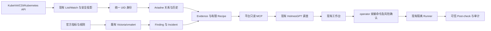

# KubeVirt 全部设计功能实现与远程验证方案

日期：2026-10-19。状态：Proposed，仅方案编写；尚未恢复 KubeVirt/CDI 开发、部署或运行验收。

编写时源码 HEAD：`04cae431c50d98f175a826623f130287eb35f7da`。工作区存在其他任务的修改，本方案不将这些修改纳入自身交付，也不据此认定运行版本。

## 1. 目标、依据与启动边界

完成根目录 00～10 正式设计中涉及 KubeVirt 的资源认知、健康检测、异常收敛、证据组织、确定性 RCA、智能调查、影响分析、人工命令处置、界面和离线交付。验收对象是平台设计的完整运维闭环，VM/VMI/DataVolume 生命周期是底座准入条件之一。

正式设计依据如下；本文细化实现顺序、远程环境和证据要求，不修改正式文档，也不降低其中的最终验收标准。

- [00 最终技术方案](<../../../00-智能运维平台最终技术方案-开源复用复审版 (1).md>)：第 2.2、8、10、11.4、19、44～46 章，规定上游复用、身份、关系、权限和放行边界。
- [01 产品说明书](../../../01-智能运维平台1.0产品说明书-正式版.md)：第 5、7、13 章，规定资源、工作台、VM 启动/网络与硬件影响场景。
- [02 PRD](../../../02-智能运维平台1.0产品需求规格说明书-PRD-正式版.md)：FR-014、FR-032，以及适用于虚拟化的通用功能、UI、接口、安全、性能和 ACC 要求。
- [03 总体架构](../../../03-智能运维平台1.0总体技术架构设计-正式版.md)：第 7、13、17、23.2、24 章。
- [04 详细设计](../../../04-智能运维平台1.0详细设计说明书-正式版.md)：第 7.3、12.2、13 章及通用执行、审计边界。
- [05 领域与数据模型](../../../05-智能运维平台1.0统一领域模型与数据模型设计-正式版.md)：第 4、6 章及领域对象、租户隔离、保留规则。
- [06 故障分析与 RCA](../../../06-智能运维平台1.0故障分析与RCA设计说明书-正式版.md)：第 17～22、28 章，四类 VM Recipe、跨层候选与评估方法。
- [07 接口协议](../../../07-智能运维平台1.0接口与协议设计说明书-正式版.md)：Graph、Finding、Evidence、工具合同及第 18.15 节。
- [08 图谱与证据模型](../../../08-智能运维平台1.0资源图谱与证据模型设计说明书-正式版.md)：第 8.3、10.1、19、20、24、38～39 章。
- [09 智能体与工具](../../../09-智能运维平台1.0智能体与工具调用设计说明书-正式版.md)：第 29、47 章及调用授权、预算和只读边界。
- [10 编码实施方案](../../../10-智能运维平台1.0具体编码实施方案-最终版.md)：Task 2.1/2.6/2.8/2.9、4.1～4.3、5.4、6.3、SP-07、SP-08、SP-09。

当前继续执行 [AGENTS.md](../../AGENTS.md) 和 [ADR-0008](../adr/0008-defer-kubevirt-cdi-development.md)。用户本次要求编写方案，不构成恢复实施授权。P0 完成前不得安装 Operator/CRD、创建 VM/VMI/DataVolume、修改 disabled 合同或运行 live VM PoC。

恢复实施时，以后续明确授权记录为准，新增 ADR 记录恢复范围、远程目标、集群级安装影响、运行验收范围及仍延期的环境；在两个 AGENTS.md 中同步引用。保留 ADR-0008 的历史决定和旧 PoC 失败，不将旧记录改为成功。根目录 00～10 保持只读。

## 2. 当前基础与实际缺口

### 2.1 远程环境基线

本次通过用户指定的 `ssh mssc-direct` 完成只读检查，时间为 **2026-10-19 15:25:59（Asia/Shanghai）**。该别名使用 root，经 `10.10.10.1` 直连接入 `10.10.10.2`，对应此前使用的 `192.168.0.63` 开发主机。执行前须确认别名和目标身份仍匹配。

| 项目 | 本次观察 | 对方案的影响 |
| --- | --- | --- |
| CPU/架构 | x86_64，16 个逻辑 CPU | amd64 为第一条真实运行验证线 |
| 内存 | 总计 15,258 MiB，可用 9,492 MiB | 只作为瞬时余量；每次测试前重新核对请求量和运行负载 |
| KVM | `/dev/kvm` 可访问，GET_API_VERSION 返回 12 | 可进入硬件虚拟化 PoC；尚未证明 VMI 能运行 |
| 内核 | `7.0.0-38-generic` | 纳入 QEMU/libvirt、设备特性与迁移兼容验证，不能只看 Kubernetes 支持矩阵 |
| Kubernetes | `v1.36.3`，唯一节点 `mssc` Ready | 可开展单节点开发验证，缺少跨节点迁移目标 |
| 存储 | 六个 StorageClass 均为 `kubernetes.io/no-provisioner` | 需专属测试 PV；未证明共享 RWX、CSI 与磁盘快照能力 |
| 相关 CRD | 未发现 KubeVirt/CDI、NAD、VolumeSnapshot 相关 CRD | 尚未部署虚拟化；多网络等选定依赖需另行准入 |

本会话前一轮曾观察到多个平台 API/Worker、DeepFlow Pod 未 Ready；本次未重验这些业务实例。P1 必须重新核对用于联调的独立实例，不把 Node Ready 等同于平台闭环可用，也不擅自修复或替换其他任务的实例。

10 月 19 日其他安装验证曾因 Bundle 解包、内存/磁盘压力及失联中断，见[原始阻塞记录](../evidence/unified-amd64-20261019/remote-load-blockage-20261019.json)。本次连接恢复不证明原导入或安装成功。复用任何物料前先读取原进程与回执；大包解包显式使用有容量的磁盘目录，不使用 RAM-backed `/tmp`，不自动重复重操作。

### 2.2 现有代码可复用，但虚拟化链路尚未接通

- [版本矩阵](../compatibility/kubevirt-kubernetes-matrix.yaml)已锁定 KubeVirt `1.9.0`、CDI `1.63.0` 的候选来源；[Component Catalog](../../bundle/component-catalog.yaml)中的两者仍为 candidate，只有 ARM64 物料锁，依赖闭包和许可证等准入尚未完成。
- [旧 PoC](../../test/e2e/kubevirt_poc_test.go)限制 OrbStack、ARM64 和显式 emulation，不能直接作为远程 amd64 测试。保留其失败记录，新增远程用例复用必要的公共检查，不把旧测试改成虚假通过。
- [资源身份](../../internal/resource/resolver.go)目前按 `k8s`/`hardware` 分支解析稳定身份；KubeVirt 域需要接入共享 Resolver。
- [CoreRequiredGVRs](../../internal/integrations/kubernetes/informer.go)未包含虚拟化资源；现有 List/Watch、投影、QPS、Lease 和历史存储继续复用。
- [图查询过滤](../../internal/graph/list_filters.go)尚不接纳 virtualization 查询域；当前对部分 Kind 的分类不能代替正式 `kubevirt` 域支持。
- [调查工具目录](../../internal/investigation/tools/catalog.go)中的 `query_kubevirt` 为 disabled；[能力接口](../../internal/httpapi/investigation_capabilities.go)也固定报告延期。
- [故障链输入](../../internal/investigation/fault_chain_context.go)仍限制 Pod、Node、PVC；VM 调查需要同步修改请求合同、Go/Python 调用链、来源资格及界面，而非只增加工具名。
- [Post-check 适用范围](../../internal/action/postcheck_support.go)目前不接纳 KubeVirt 域，需要补可信的原生对象与 Recipe 检查。
- 官方规则、must-gather、外部 MCP toolset 已有来源/Fixture 锁定线索，见 [inspection-reuse-lock](../poc/inspection-reuse-lock.yaml) 与 [third_party manifest](../../third_party/manifest.yaml)；这些仅是候选基线，不是运行准入。
- Finding/Incident、Evidence/Archive、有限 Recipe、RCA、调查 Job/Step、OPA、预算、命令 Runner、审计和 Web 已有主路径，后续按真实缺口扩展。

## 3. 全部功能覆盖清单

KVR 编号仅用于本专项追踪，不替换正式需求编号。每项最终都要绑定实际实现、合同、测试、UI/API 入口、运行 Profile 与证据；未满足环境条件的项不能计作完成。

| 编号 | 正式设计功能及依据 | 实施内容 | 阶段 |
| --- | --- | --- | --- |
| KVR-01 | 10 Task 2.1/2.6；NFR-040～042 | 发现 KVM/版本/GVK/架构；锁定 KubeVirt/CDI 兼容组合及完整物料 | P1～P2 |
| KVR-02 | 00/10 离线交付；SEC-009 | virtualization/full Profile、准入、签名、离线安装、重装与回退 | P2、P8 |
| KVR-03 | FR-014、INT-005 | VM、VMI、Migration、DataVolume、CDI 及 virt-* 组件事实采集 | P3 |
| KVR-04 | FR-020/021；05 §4 | UID 身份、冲突/未解析、同名重建、跨源映射和历史兼容 | P3 |
| KVR-05 | FR-022～024；08 §8.3 | VM/VMI/launcher/Node、DV/PVC、NAD、Migration 源/目标关系及溯源 | P3 |
| KVR-06 | FR-010/011/030/034、DATA-002～005 | 资源列表/详情/健康、状态与变更历史、覆盖、新鲜度、安全投影 | P3、P7 |
| KVR-07 | FR-032；00 §8.1/8.2；10 Task 5.4 | 官方 metrics/recording/alert rules、Conditions/Events、vmalert 真实执行 | P4 |
| KVR-08 | FR-032；00 §8.3；04 §12.2 | 按需非特权诊断；OpenShift/原生 K8s 分流；高权限采集人工执行 | P4、P6 |
| KVR-09 | FR-040～060 | Finding 生命周期、去重/迟到/重放、Incident 收敛/时间线/恢复/重开 | P4 |
| KVR-10 | FR-070～083；05/08 Evidence | 支持/反证/缺口、来源退化、归档、重放、有限诊断图 | P3～P5 |
| KVR-11 | FR-090～094；06 §17～19 | vm-start-failure、vm-network、vm-storage、vmi-migration 四类版本化 Recipe | P5 |
| KVR-12 | FR-120/121；ACC-002/003/004 | 网络/存储/Node/NIC/DIMM 跨层影响，区分直接、间接和仅依赖资源 | P3、P5 |
| KVR-13 | FR-100～113；07 §18.15；09 §29 | 只读 query_kubevirt 与语义上下文；上游 MCP toolset 准入或有证据的回退 | P5 |
| KVR-14 | 01 §5；既有助手专项 | VM/VMI/DV/Migration 问数、排障、解释、追问与冻结历史引用 | P5、P7 |
| KVR-15 | FR-130～145；ACC-012～014 | ActionPlan 建议、操作者亲输命令、确认/step-up、幂等、未知结果、Post-check/回退 | P6 |
| KVR-16 | FR-001～003、UI-001～004；10 SP-08 | 总览、资源、健康、图谱、Incident/Evidence/RCA/调查、处置和能力状态 | P7 |
| KVR-17 | FR-150～163、SEC-001～010 | 来源与配置治理、双角色、租户/范围隔离、审计、防注入/越权、保留 | P1～P8 |
| KVR-18 | NFR/OPS/ACC；10 SP-09 | 准确性、性能、退化、生命周期、兼容性、Runbook 与需求追踪收口 | P8 |

“全部设计功能”同时保留两类边界：不新增 GPU/SR-IOV、桌面控制台、VM 编排门户、快照备份产品或新 Analyzer/Graph/Agent 框架；正式方案涉及的网络附件、诊断、迁移与跨层影响不能因当前环境缺失而删除。若选定正式场景实际需要额外组件，按相同来源、许可和运行门禁准入。

## 4. 实现结构与数据原则

沿用现有模块化单体与独立 Investigator，不新增服务层、图数据库、队列或并行数据仓库。

统一原则：

1. 事实来自已注册且当前授权有效的来源。UID、来源 revision、事件时间、观察时间、覆盖状态分别记录，不能用 resourceVersion 数值计算时间。
2. 指标/日志继续保存于 Victoria 后端；只归档必要片段及引用。健康、关系和变更历史复用已有存储，缺字段时才增加 forward-only migration，不复制全量 VM Spec。
3. 规则输出确定性 Finding/有限候选；模型解释已提交事实并建议补证，不计算权威统计、不修改范围或自行确认正式 RCA。
4. 上游先复用：官方规则 → Metrics/Conditions/Events → must-gather → 只读工具；仍有明确缺口时才补有限业务映射。每项写明选入路径、版本、Fixture、许可和退出方式。
5. 每个增量同步修改必要的调用方、Schema、生成客户端、配置/Chart/RBAC、Fixture 与 UI。不得只解除某个 disabled 标记；未受影响的现有模块不重写。

## 5. P0：恢复范围与实施入口

**进入条件：** 用户后续明确批准恢复虚拟化开发阶段。本次方案不执行此阶段。

记录恢复决定及以下范围：

- 第一目标为 `ssh mssc-direct` 的独立 amd64 开发环境；明确是否允许在当前开发集群安装集群级 CRD/Operator。专属 Namespace 只能隔离测试对象，不能隔离 Operator/CRD 的集群影响。
- 开发涵盖 KVR-01～18；真实验证依第 7 节环境逐步完成。第二节点、共享存储、硬件事实源、OpenShift 与 ARM64 环境未具备时分别 pending，不伪装验收。
- core Profile 的 KubeVirt/CDI 默认 disabled 保持；只有显式选择并满足准入的 virtualization/full Profile 才启用。非虚拟化工作不因此被强制依赖虚拟化。
- 不恢复 Trace、PyRCA、生产部署、Kylin/kubeadm、生产 HA/灾备或无关硬件诊断开发。虚拟化与既有硬件事实/网络证据的必要关联按本方案实现。
- 高权限基础组件安装由被授权的部署入口执行；这不向 Investigator、自动 Diagnostic Job 或日常查询账号授予主机权限。

**产出：** 后续恢复 ADR、边界引用及逐项授权范围。没有该记录，后续 P1～P8 只保留计划状态。

## 6. 开发阶段与退出条件

### P1：环境、版本与上游复用资格

**工作内容：**

1. 重新读取远程源码/运行制品、集群 UID、节点、KVM、CRI/CNI、路由、DNS、AppArmor/SELinux、存储和当前负载。先确认原安装/导入进程状态及测试资源归属，不重复旧操作。
2. 分别核对 Kubernetes/KubeVirt 版本支持、KubeVirt/CDI 组合依据、CPU/内核与 QEMU/libvirt、CNI/网络绑定、存储模式。版本矩阵支持与 KVM ioctl 成功均不能代替 VM 运行证据。
3. 从现有 KubeVirt `1.9.0`、CDI `1.63.0` 候选开始复核，精确 patch、来源与 amd64 digest 以实际准入结果为准。发现不兼容时先形成具体版本裁决，不硬装、不自动升级目标 Kubernetes。
4. 复核现有 rules `v0.0.6`、must-gather `v4.2.0`、MCP toolset `v0.0.67` 的冻结源码及适用范围。已有 Fixture 结果继续保留；需要更换时产生新锁，不用最新 README 证明旧版本能力。
5. 定义测试专属目录、Namespace、标签/installation-id、StorageClass/PV、身份、来源和配置版本。VM 测试采用单次最小 guest、串行运行；其内存/CPU 请求依锁定 guest 要求和实际余量制定，不以宿主可用内存等同于 Kubernetes 可分配余量。
6. 选定用于本专项联调的稳定平台实例，检查数据库、身份、来源、模型、归档和采集。新代码与旧长驻镜像分别记录，不覆盖其他任务实例来“统一版本”。

**复用/修改入口：** `internal/profile/{detect,resolve,validate,kubevirt_compatibility}.go`、`bundle/component-catalog.yaml`、`third_party/manifest.yaml`、`docs/poc/{inspection,graph}-reuse-lock.yaml`、相关 Profile/Schema。

**退出条件：** 形成可执行的版本/权限/资源清单；不支持或未知组合在创建任何虚拟化对象前失败；共享资源或环境调整有明确归属和授权。

### P2：amd64 物料、受控 PoC 与安装闭环

**工作内容：**

1. 锁定 Operator、控制面、virt-handler/launcher、CDI importer/cloner/upload 等实际依赖闭包，以及 PoC guest 镜像、virtctl 和必要辅助物料。以选定 manifest/运行路径枚举，不只记录两个 Operator digest。
2. 补齐 amd64 来源、文件级许可/notice、SBOM、漏洞结果、源码和构建/发行物对应关系；保留 ARM64 原锁及失败，不跨架构复用 digest 或宣称两架构同等通过。
3. 区分候选 PoC 与正式交付：candidate 仅能在恢复授权后的隔离开发准入流程中验证，使用单独且可追溯的离线测试物料清单，不进入发行 Bundle。通过生命周期、来源/许可/依赖等门禁后才转 qualified 并进入正式包，避免以“先进入正式包”作为 PoC 前置。
4. 扩展既有安装/导入机制处理选定 virtualization/full Profile；执行独立验签、全部物料校验、驱动探测和可恢复安装步骤。遇到已有不兼容实例只报告冲突，不能接管、覆盖或卸载。
5. 新增远程 amd64 PoC：读取实际 Server/GVK/版本 → 安装已选组件 → 校验控制面 → 离线导入 guest 至 DataVolume/PVC → VM/VMI 真正 Running/Ready → guest 存活、网络及专属磁盘写读 → 重启后读回 → 停止/再次启动 → 删除测试对象并检查清理。空白 DV Succeeded 或 Pod Running 不作为 guest 成功。
6. 当前机器使用已验证 KVM 路径，不因启动失败静默转 emulation。网络至少验证 Pod 默认网络与测试 Service；NAD/多网络另用已准入 Multus/插件验证，不默认安装所有网络插件。
7. 保留失败事件、准确断点与资源 UID。只清理本次拥有的测试对象；删除 Operator/CRD 前检查其全部实例和使用者，仍有任何共享使用时保留。PV 数据、审计/Evidence、历史物料按原保留策略处理。

**拟新增：** `test/e2e/kubevirt_remote_poc_test.go`、远程 PoC 报告；仅在存在可复用逻辑时抽取旧 PoC 的版本/物料检查，不让远程用例依赖 OrbStack 上下文。

**退出条件：** 一条完整 amd64 VM/VMI/DataVolume/guest 网络和持久磁盘生命周期成功；控制面、运行态、物料和清理证据分别可核对。正式 Profile 安装资格另需全部供应链门禁。

### P3：资源采集、身份、图谱与历史

**工作内容：**

1. 对显式启用的虚拟化来源，动态发现并白名单接入 VM、VMI、VirtualMachineInstanceMigration、DataVolume、KubeVirt/CDI 状态及必要 Events。组件健康复用 Deployment/DaemonSet/Pod/Service 的真实身份及关联，不建立仅靠名字拼接的第二套实体。
2. 扩展共享 Resolver 的 `kubevirt` 域，VM/VMI/Migration 均使用 metadata.uid。DataVolume 拟纳入同一虚拟化域，保留实际 `cdi.kubevirt.io` apiGroup；此映射在合同与 Fixture 中固定，PVC/PV/Node/Pod 保持原身份。若发现已持久化的旧域身份，先盘点引用并制定显式兼容映射，禁止静默重编号或按名称合并。
3. 复用现有 List/Watch、QPS≤20/burst≤50、410 重建、删除 tombstone、Lease fencing、来源覆盖与历史。required GVR 按启用 Profile 计算；虚拟化源退化不使独立 core 资源失效。
4. 固定安全投影：保留运行策略、必要资源请求、条件/原因码、VMI 调度节点、迁移源/目标/阶段、卷与网络引用等。排除 cloud-init/userData、Sysprep、磁盘认证、SSH key、任意环境/命令、Secret 正文和包含凭据的 URL。自由消息与日志按数据类别和既有脱敏路径处理。
5. 在 Ariadne/现有适配器中补有限关系：VM owns VMI / VMI instance_of VM；VMI runs_as launcher Pod、scheduled_on Node；VM/VMI uses DV/PVC/NAD；DV 对应 PVC，沿原 PVC/PV/SC/CSI 路径；Migration migrates VMI、source_node/target_node Node。方向不同的视图不重复计数。
6. 关系须来自已证明的 UID 引用、精确 ownerReference/标签语义或版本化字段映射；名称引用先在同作用域解析实际 UID，记录解析依据。缺失/冲突保持 unresolved，不以 Pod IP、VM 名称或 MAC 单独作为长期实体身份。
7. 复用 Hardware→Server→Node 关系，将 NIC/Bond/DIMM 影响延伸至 VMI/VM。DeepFlow 动态边保留原时间、TTL 与身份证明；masquerade/NAT 场景下不能把 launcher Pod 流量直接等同于 guest 流量。
8. 扩展资源列表/详情/过滤/总览、健康与变更历史、关系查询和影响接口。跨 Namespace/集群级 Node、KubeVirt/CDI 状态每次独立授权，不能借用 Worker 安装权限。
9. VM→VMI→Pod→Node 超过一次 depth=2 查询时，复用既有受限原生路径计划；若不足，增加一个版本化有限 Graph Plan 及合同。所有步骤共享总节点/边/时间预算，禁止提高全局 depth 或让前端拼接无界遍历。

**拟实现入口：** `internal/integrations/kubevirt/{informer,projector}.go` 作为共享 Kubernetes Client 的薄适配；扩展 `internal/resource`、`internal/graph`、`internal/app/sp04_*`、既有观察/变更路径。仅有无法复用的字段才新增存储。

**退出条件：** 原 UID 正确投影，关键关系和删除/迁移重建正确；权限、覆盖与历史缺口可见；core-only、旧结果读取和已公开 Canonical ID 不回退。

### P4：官方规则、诊断、Finding 与 Incident

**工作内容：**

1. 按目标版本选择官方 VM/VMI/Migration/控制面指标、recording rules 和 alert rules，固定源码路径/规则标识、标签、依赖、评估周期和版本。先探测复用现有 vmalert，否则使用已准入的离线物料；不新增规则引擎或第二套 Victoria。
2. 验证真实 scrape、录制规则、告警 firing/resolved 到平台 Finding/Incident 的完整链路。缺指标、标签不兼容、评估器不可达、覆盖中断都报 degraded，不能当作正常或用手写告警样例替代 live firing。
3. 覆盖 VM/VMI 状态异常、启动/调度失败、Migration 失败、DataVolume 导入/绑定失败、virt-api/controller/handler 与 CDI 异常，以及相关网络/存储异常。期望 Stopped 的 VM 不因无 Running VMI 报故障；DV 成功不推断 VM 健康。
4. 不要求安装完整 Alpha observability-controller；只抽取经目标版本验证的规则/实现，前置不满足时回退目标 KubeVirt 自带规则，并保留裁决。
5. 原生 Kubernetes 按需运行非特权只读 collector，复用 Job、身份、超时、取消、清理与 Archive。OpenShift 保留独立 `oc adm must-gather/--vm-incident` 适配与测试，当前无环境时明确 runtime pending。
6. dmesg、dmidecode、主机 PSI/NFS、ghost records 等采集逐项评审适用性和数据类别。需要 privileged/hostPID/主机挂载的 `O0 + D3` 采集仅由 operator 经 P6 执行；自动流程和模型不能启动。固定上游能力缺口清单，不整体复制全部脚本。
7. 映射至既有 FindingEnvelope、Evidence、Inbox/Outbox、去重/再发生/乱序/迟到和 Incident 状态机。既有自动恢复机制只在可信恢复谓词满足时生效；模型或仅指标改善不驱动恢复。

**拟新增：** `internal/inspection/kubevirt/{rule_adapter,collector_adapter,mapping}.go` 与必要 Fixture；扩展现有 app 装配、抓取配置、规则交付及来源资格。

**退出条件：** 真指标经真实执行器产生/恢复至少一类告警；所有异常类别有正向、正常反证与退化覆盖；非特权 Job 按需退出，高权限自动执行数为零。

### P5：四类 Recipe、跨层 RCA、问数与只读调查

四类 Recipe 复用现有注册、候选、Evidence 与确认引擎，按需要使用现有版本化 Registry，不另建 VM Analyzer 框架：

| Recipe | 必需上下文与候选 | 必测反证/限制 |
| --- | --- | --- |
| `vm-start-failure/v1` | desired=Running、VMI 状态、调度事件、候选 Node 资源/affinity、DV/PVC/NAD、virt-handler/控制面；区分资源不足、CPU 不兼容、卷未就绪、附件无效、控制面问题 | 期望停止、条件已恢复、无授权 Node、缺历史、同名替换；Pending 本身不确认具体根因 |
| `vm-network/v1` | VM/VMI/launcher/Node、绑定方式/NAD/Service；合格 DeepFlow 网络事实、Node/NIC/Bond、已有硬件健康；区分 VM 配置、Node 网络和物理 NIC 候选 | 正常链路、NAT 映射不明、重传与丢包区别、跨采集点重复、时间不可靠；不能凭 IP 或相关性确认 NIC 根因 |
| `vm-storage/v1` | DV/PVC/PV/SC/CSI、导入/挂载/附加事件、适用日志与延迟；复用既有 PVC/CSI 谓词 | DV Succeeded/PVC Bound 不证明 guest I/O；缺 CSI、延迟无基线、凭据错误正文脱敏；本地卷用例不冒充 CSI 成功 |
| `vmi-migration/v1` | 原 VMI、Migration UID/状态、源/目标 Node、CPU/亲和性、网络与可迁移卷；区分不可迁移、目标不可调度、传输/存储失败 | pending/取消/超时/失败/成功分开；单节点拒绝不冒充跨节点失败或成功；失败后源 guest 继续运行的反证 |

其他工作：

1. 为每个候选固定 required/optional Evidence、支持/冲突/缺口、时间与来源资格、确认/排除谓词。正式 RCA revision、人工确认与助手辅助观察继续分离；模型判断和共现不进入确认谓词。
2. 将 ACC-001/002/003/004 的 VM 路径接入诊断图与影响分析；物理 NIC/DIMM 来源缺失时保留候选和缺口，不以 Node 指标冒充 Redfish/IPMI。
3. 实现现有 `query_kubevirt` v2 的实际只读路由及输出，保留资源白名单、当前范围、D0/D1、默认 3 秒、64 KiB 和 maxRawQueries 预算。模型不持目标 kubeconfig，不开放 exec、console、写 VM、SSH 或任意 URL 查询。
4. 六类设计语义视图——VM、VMI、storage、network、migration、component health——优先通过现有语义 API 和 query_kubevirt 承载；确需新增公开工具时先完成合同与调用方评审，不为名称清单复制六套实现。
5. 对冻结的外部 MCP KubeVirt toolset 实测只读模式、工具白名单、InvocationContext/OPA、租户/Namespace/资源范围、预算和审计。若无法在平台边界内执行，保留禁用与裁决，使用现有平台语义 API；不另造通用 KubeVirt MCP Server。
6. 版本化扩展现有调查请求、Binding/resolve、来源能力、历史/变更/Findings、Go 固定计划、Python `fault_chain.py`、Holmes 工具 Schema 与结果投影，支持 VM/VMI/DV/Migration。API、Go Worker、Python 和 UI 按同一合同发布；旧任务仍可读，旧 Worker 不领取新版本任务。
7. VM 的启动/迁移/存储变化、健康与适用指标接入既有 analytics；冻结 UID、作用域、窗口、来源 revision 和指标标签映射。Pod 指标只表示 launcher/宿主侧事实，不能直接称为 guest CPU/内存或 guest 网络。
8. 复用现有会话、Job/Step/Fact/QueryResult/Evidence、取消/接管、预算和解释/追问路径。新读取产生新 Step；解释引用原已提交证据，旧读取不能冒充本轮执行。
9. 保持 [ADR-0042](../adr/0042-frozen-network-relation-read.md) 的冻结网络关系与范围约束。新增 VM 原生路径不自动开放跨 Namespace 网络调查；模型 Profile 只使用已验证窗口，不统一回退到旧 16K，也不借此增加来源字节/调用预算或外网权限。

**主要入口：** `recipes/`、现有 Candidate/Recipe 引擎、`internal/investigation/tools/catalog.go`、`internal/httpapi/{investigation_tools,assistant_tools,assistant_source_capabilities,assistant_binding}.go`、`internal/investigation/fault_chain_*`、`services/investigator/src/investigator/{fault_chain,assistant_binding,holmes_adapter}.py` 及对应 Schema/客户端。

**退出条件：** 四类 Recipe 均可真实调用和重放；至少一条真实 VM 调查能从界面到来源、Evidence、模型解释与追问；工具拒绝路径和证据闭包通过，模型质量与确定性机制分别报告。

### P6：人工命令处置与可信 Post-check

1. 复用原 SP-07 ExecutionProfile、Ansible/固定 Runner、目标签名、OPA、本人风险确认、必要 step-up、幂等派发、原始输出/SSE、审计与结果对账。仍只有 operator 与 platform_admin 且不继承，不增加虚拟化专属角色或第二人审批。
2. 建议可包括 VM 启停/重启、迁移检查、配置修正、诊断命令；实际命令输入框初始为空，由 operator 亲输。模型建议不能变成执行句柄、自动计划或一键写 VM API。
3. 按经评审的精确目标、命令类型和 GVR 开放测试 ExecutionProfile；写操作、迁移/停机/删除与主机采集分别分类，禁止通配集群管理员权限。删除和变更存储必须验证影响范围与数据保留。
4. 扩展 `PostCheckApplicability`、对象读取和既有 Recipe 后检查，使 VM/VMI/DV/Migration 可验证原目标 UID、真实期望状态与必要网络/磁盘事实。退出码 0 不等于故障恢复；同名新对象只有显式执行关系和新身份核对后才能纳入检查。
5. 保留 resolved/not_resolved/inconclusive 三类 Post-check 结果；execution_unknown 仍是独立执行状态，不能混入后检查枚举。无合格来源或缺 guest/网络/磁盘证据时不宣称 resolved。VM 迁移成功也不自动确认原 Incident 根因。
6. 验证重复请求不二次执行、连接中断/Worker 崩溃后 execution_unknown 对账、不重发不确定命令、临时权限/Job 清理，以及可执行的具体回退步骤。
7. 高权限只读 collector 使用独立的限时、限节点、限采集项 Profile，完整记录风险、数据类别、输出脱敏和权限撤销；不得为安装 Operator 的需要而放开此路径。

**退出条件：** 至少一条 VM 人工处置与可信后检查真实闭环；未经确认/必要 step-up 的成功执行数为零，重复派发数为零；未知结果和不可逆动作有明确停点。

### P7：现有 Web 功能完整接通

在原页面增量实现，不另建虚拟化管理门户：

- 总览与健康分布：VM/VMI/DV/Migration 数量、适用状态、异常与来源质量。期望停止、迁移中、未知和源退化分别表达。
- 资源中心：过滤、详情、Conditions/Events、卷/网络、迁移源/目标及组件健康，按当前授权过滤。
- 资源/诊断/影响图：VM→VMI→launcher→Node、DV/PVC 和硬件关键路径；显示来源、版本、时间、置信度及缺口；保持 depth/nodes 预算与键盘操作。
- 故障工作台：Finding/Incident 时间线、支持/反证/缺失 Evidence、候选与正式 RCA revision、影响分类和原始证据定位。
- 助手：VM 类型目标澄清/选择、冻结窗口、收集/解释/追问、来源 Step/数值定位、取消、partial/degraded/不适用状态。
- 处置：建议与实际命令分开、风险确认、step-up、执行输出、未知结果、Post-check 和回退。
- 能力与管理：来源/配置发布和撤销、kubevirt/cdi 的真实运行与验证状态、组件许可证/兼容信息。没有资格时保持原因可见，不能仅因存在 CRD 显示“已验证”。

**主要入口：** `web/src/features/{resources,graph,assistant,investigation}` 中实际存在的页面、命令处置组件、`web/src/components/CapabilityStatus.tsx`、总览及生成客户端；实施时先枚举实际调用方，再确定文件，不预建空目录。

**退出条件：** 使用真实身份、API 与来源完成浏览器闭环；键盘、焦点、非颜色状态和敏感字段展示符合既有要求。mock/transport Fixture 只算对应 UI 验证。

### P8：需求收口、准确性、交付与运维

1. 将 KVR-01～18 和相应正式 FR/UI/INT/DATA/SEC/NFR/OPS/ACC 逐项映射到既有 feature matrix/检查机制，补实现、测试、UI、Profile 和实际证据。缺失映射先补现有机制，不新造一套追踪系统。
2. 冻结包含正常、故障、反证、冲突、来源缺失及 unresolved 的虚拟化数据集。按 Incident 划分 train/dev/holdout；两名领域专家标注、第三人裁决，模型/Prompt/规则/工具/镜像冻结后盲测，报告样本数及 95% 置信区间，不由智能体代填人工通过。
3. 执行第 8 节准确性与 SLO 门禁，分别报告真实单机、双节点、硬件、OpenShift、ARM64、正式规模的覆盖。缺环境不阻断独立代码增量，但不能形成“全部设计功能验收通过”。
4. 形成已 qualified 物料的正式签名包，验证 core 不默认启用、virtualization 显式激活、full 按已准入 DeepFlow 能力组合；不自动恢复 Trace/PyRCA。原独立 bootstrap 信任入口、完整验签/校验保持。
5. 在专属干净环境验证公网出口被阻断、发布引用为空缓存、完整离线安装、升级/重装、存储/身份/审计保留及回退。清缓存和清资源只作用于本任务拥有且已确认安全的范围，不能清共享节点缓存来制造“冷装”。
6. 升级必须有目标精确版本支持证据、CRD/VM 字段与存储兼容检查、备份/恢复及运行 VM 影响评估。不能把 Helm rollback 当作 CRD 或 guest 磁盘回滚；不支持降级时停止原地降级，用已演练恢复路径。
7. 编写版本化 Runbook：安装/冲突/卸载、控制面故障、guest 启动与网络/存储诊断、迁移失败/取消、来源退化、权限撤销、unknown 对账、Evidence/审计保留、升级与恢复。沿用平台自监控，增加适用的同步延迟/规则评估/采集失败指标，不引入第二套监控。

**退出条件：** 覆盖清单、原始回执、准确性/安全/性能报告、兼容与物料清单、Runbook 和 Go/No-Go 一致；所有未通过项逐项 pending/preview/disabled，禁止仅以 make check 或制包成功宣告整体完成。

## 7. 远程验证环境分工

| 环境 | 最小条件 | 可以证明 | 不能替代 |
| --- | --- | --- | --- |
| E0 源码与 Fixture | 本地/远程的锁定工具链；外部服务测试只在远程 | 身份、Schema、规则、权限拒绝、回放、兼容和 UI 合同 | guest、迁移、真实来源、冷装与模型质量 |
| E1 当前远程单节点 | mssc-direct、KVM、专属 PV/Namespace、稳定的测试平台实例 | VM/VMI/DV/guest 生命周期、默认网络、本地磁盘、调度/导入失败、规则、只读调查、人工处置 | 真实跨节点迁移、共享存储/CSI、物理硬件故障、生产 HA |
| E2 双节点开发环境 | 至少两个可调度且 KVM/CPU 兼容节点、合格迁移网络、实际所用卷的可迁移存储 | 迁移成功/失败/取消、源/目标关系、迁移中故障与后检查 | 同一物理主机上嵌套两节点不能证明独立主机故障域或 HA |
| E3 附加网络/存储 | 准入的 Multus/NAD/插件、实际 CSI 与适用共享存储；按场景组合 | NAD 关联与配置异常、真实供给/挂载/性能问题、PVC 型迁移 | 静态 RWO 本地卷不能替代真实 CSI/RWX 路径；无需求不引入快照系统 |
| E4 硬件联合环境 | 可授权读取的真实 Redfish/IPMI/已有 NIC、Bond、ECC/CPER 事实 | ACC-002/003 的 NIC/DIMM→Server→Node→VMI/VM 关联与候选 | 合同 Fixture 或 Node 指标不能证明真实 BMC/硬件闭环 |
| E5 OpenShift/ARM64 | 分别具有相应平台、版本、物料和运行条件 | OpenShift 诊断分支、ARM64 单 VM 与交付支持 | amd64 成功不代表 ARM64；原生 K8s 不代表 oc 路径 |
| E6 正式规模/生产阶段 | 独立环境及后续阶段授权 | 目标规模、兼容维护、HA/灾备等各自门禁 | 本文不授权生产实施，单机结果不作线性外推 |

E2 优先使用第二台独立开发主机。同一主机内新建虚拟节点仅可作为另行明确的受限实验，须验证嵌套 KVM、资源与网络且单独标注结果；不将其设为默认方案，也不为此自动安装第二套虚拟化管理系统。

常规 PVC 热迁移按所选版本的官方要求准备共享 RWX 存储和可用迁移网络；其他存储迁移方式只有在选定版本、feature gate、实际卷路径单独验证后才可进入适用矩阵，不能把文档中存在功能当作当前环境支持。

## 8. 验收用例与证据

每个用例保留：源码/镜像/合同/Recipe/配置版本、Profile、集群/Namespace/资源 UID、当前授权与来源 revision、故障/基线/恢复窗、原始命令和退出码、必要事件/日志、Step/Fact/QueryResult/Evidence/Audit 引用、预期/实际结果及清理回执。凭据、原始敏感 Spec 和未脱敏输出不进入 Git 或公开报告。

| 用例 | 核心断言 | 环境 |
| --- | --- | --- |
| V01 版本/架构/KVM 冲突 | 未支持/未知版本、错 digest/架构、设备不可用在创建前拒绝；不静默 emulation | E0/E1 |
| V02 真实 guest 生命周期 | DV 导入、VM/VMI Running/Ready、guest 可达、磁盘写读、重启持久、启停/清理 | E1 |
| V03 身份与同步 | 同名 UID 替换、List/Watch 重复/乱序、410、删除、Lease 旧写拒绝、来源覆盖 | E0/E1 |
| V04 关键图与影响 | VM/VMI/launcher/Node、DV/PVC/NAD、Migration 源/目标；范围逐步授权、旧边失效 | E0/E1/E2/E3 |
| V05 真实规则执行 | 指标 scrape、recording、firing/resolved、Finding/Incident 可查询；缺指标不报健康 | E1 |
| V06 ACC-001 启动失败 | 资源/调度/CPU/存储/附件/控制面候选、支持/反证/缺口和正式确认边界 | E0/E1/E3 |
| V07 ACC-004 VM 存储 | DV/PVC/PV/SC/CSI、事件/日志/指标及 guest I/O；区分本地卷与真实 CSI | E1/E3 |
| V08 VM 网络 | guest 与 launcher/Node 流量语义、默认网络/Service、NAD、正常反证、身份/时间不足 | E1/E3 |
| V09 真实迁移成功 | 同一 VMI 的原源/目标 UID、Migration 完成、guest 连续服务、关系更新和后检查 | E2 |
| V10 迁移异常 | 不可迁移、目标不足、取消/超时/失败、源 guest 状态；单节点拒绝单列 | E0/E1/E2 |
| V11 ACC-002/003 跨层 | 真 NIC/内存硬件事实、Node/VMI/VM 关系、影响及反证；不凭相关性 confirmed | E0/E4 |
| V12 诊断分流 | 原生只读 Job、超时/取消/清理、OpenShift 分支、高权限自动调用被拒绝 | E0/E1/E5 |
| V13 Finding/Incident 语义 | 重复/迟到/再发生、恢复/重开、Merge/Split、Timeline；模型不改状态 | E0/E1 |
| V14 只读 MCP 与治理 | toolset 真实资格、跨租户/Namespace/资源越权、重放/撤权、预算/超限/敏感输入 | E0/E1 |
| V15 VM 调查与问数 | 真实来源、冻结 UID/三窗、历史/变更/指标语义、模型解释/追问、原页面引用定位 | E1，跨层另需 E2/E3/E4 |
| V16 退化与接管 | 断源/Watch 缺口/无权限/模型离线/无效输出/取消/接管；已提交结果保留、重读重新授权 | E0/E1 |
| V17 人工命令闭环 | 确认/step-up/策略、精确目标、重复零执行、unknown 对账、可信后检查/回退 | E0/E1，迁移另需 E2 |
| V18 Web 全路径 | 真实 OIDC、总览→资源→图/故障→证据→调查→人工处置；键盘/焦点/状态可读 | E1 |
| V19 供应链与离线 | candidate 禁入正式包、篡改拒绝、独立验签、闭包物料、无公网/冷装、Profile 组合 | E1 专属干净安装环境 |
| V20 版本与数据生命周期 | 旧结果/Canonical ID 不变、来源撤销、Archive 恢复、保留/legal hold、升级/重装不丢引用 | E0/E1，其他平台另需 E5 |
| V21 准确性 | 独立标注、冻结 holdout、分故障域样本数/置信区间和阈值 | E0 加相应真实来源环境 |
| V22 SLO/容量 | 适用 P95、10 调查并发、Finding 压力、无无界队列及来源退化 | E1 开发回归；正式规模为 E6 |

故障注入仅作用于测试专属对象和已授权路径；共享宿主机、真实网卡、物理内存、共享控制面/存储不做破坏性注入。需要主机失效或硬件故障的正向用例使用专属环境或已存在且身份/时间合格的真实故障材料，证据类别分别报告。

### 8.1 准确性和性能阈值

沿用正式设计，不降低门槛：

- Entity Resolver：黄金数据零错误合并；确定性映射召回率 ≥99.9%。
- 关键 Graph Relation：Precision/Recall 均 ≥99%；VM→VMI→Pod→Node 关键路径 Recall=100%。
- Deterministic Finding：Precision ≥95%，Recall ≥90%。
- 可判定 Incident 的 RCA Top-3 命中率 ≥80%，结论 Evidence 引用率=100%；无法判定和排除样本单独报告。
- 未经本人风险确认/必要 step-up 的成功执行数=0，重复请求导致的重复执行数=0。
- Finding 可查询 P95≤5 秒；Finding 入库到 Incident P95≤30 秒；资源变化到图可查 P95≤60 秒。
- depth≤2、nodes≤200 的图查询 P95≤1 秒；非原始大查询的语义 Evidence P95≤5 秒；10 个 Investigation 并发不破坏 Finding/Incident SLO。
- 正式规模仍是 10 集群/1,000 Node/20 万资源，100 Finding/s 持续 15 分钟；在独立验收环境执行。单机只形成声明负载下的回归结果，不能替代正式容量、月可用性、HA/灾备证据。

### 8.2 完成状态与检查方式

实现、Fixture、真实来源、模型机制、中文质量、准确性、发行和生产资格分别记状态。V02/V09 等 live 用例 skip、无环境或仅 Fixture 通过，均不是对应运行验收 PASS。KVR-01～18 的全部源码/合同路径及相应回归完成后，可标“源码功能完成”，不能只凭四类 Recipe 接通作此声明；所有适用 live 与准确性/交付项通过后，才可标相应环境的虚拟化能力集通过。

实现期间运行当前 Makefile 中适用的 `make check-local`、生成一致性、相关 Go/Python/Web 回归；先读实际环境变量和前置条件，再在远程执行有外部服务的 integration/live/browser 用例。新增非平凡逻辑至少有一个有意义的小回归；不为文档或简单开关维护复制测试，不无差别重复全仓审计。

## 9. 增量交付与依赖顺序

建议每项形成可独立评审的变更，测试和必要调用方与功能同批交付：

1. **P0 恢复记录**：用户批准后提交范围 ADR/边界引用；本方案本身不替代该记录。
2. **P1～P2 底座**：版本与来源、amd64 测试物料、受控安装/PoC；失败时先解决真实环境根因。
3. **P3 事实与图**：身份→采集/安全投影→关系/历史→查询/能力；保持 core 回归。
4. **P4 异常与证据**：真实指标/规则执行→Finding/Incident→按需诊断。
5. **P5 四类 Recipe 与调查**：先启动/存储，再网络/迁移；合同、Go/Python、来源与 UI 入口同步到位。E2/E3/E4 缺失时继续实现和独立用例，记录对应 live pending。
6. **P6 处置**：风险/策略/范围→Runner→可信后检查/unknown 对账→回退；不因调查只读能力通过而自动开放命令权限。
7. **P7 浏览器闭环**：各增量即时接入原页面，最终走一次真实完整用户路径。
8. **P8 发布收口**：需求/准确性/安全/性能、完整离线交付、生命周期和 Runbook；再形成有证据的 Go/No-Go。

主依赖为 P0→P1→P2→P3→P4→P5；P6 依赖 P3/P4 的可信目标与原生检查，P7 随功能推进，P8 汇总全部证据。未部署虚拟化时可做恢复授权范围内的 Schema/源码/Fixture 增量，但 live PoC 未通过前不激活其运行能力或发布为已验证功能。

## 10. 停止条件、回退与待补条件

以下情况停止相应操作，保留已经完成的独立工作：

- 未恢复授权、目标身份/资源归属不清、将影响其他使用者：停止创建或变更，先补清范围。
- 版本/架构未知或冲突、来源/许可证/依赖闭包不合格：停止相应物料准入与部署，不跳过校验。
- 无 KVM、guest 启动/网络/磁盘失败：保留事件与原因，修复适用根因；不能用控制面 Ready、空白 DV 或软件模拟替代既定 KVM 验收。
- 预算不足、历史/时间/身份/来源不可靠：返回具体缺口/partial/unresolved，不扩权、放宽因果谓词或编造过去状态。
- 需要主机/共享服务调整、新节点、存储或额外凭据：先形成明确需求及影响，再按授权执行；不自动重启、扩容或清理其他实例。
- 运行制品或合同不一致：暂停新任务，按现有排空/租约机制同步版本；保留原 Step、证据和执行记录，不让旧 Worker 消费新合同。

应用回退先停止新增虚拟化采集/调查/执行入口，保留历史读取与 Evidence/Audit/引用闭包；回退经过验证的 API/Worker/Python/UI 与配置版本。新持久字段使用向前兼容或停止旧写，不能删除历史数据来配合旧程序。默认 core-only 路径仍可工作；安装组件是否保留或卸载由归属/实例/版本支持判断，不以应用回退自动删除 CRD、VM 或磁盘。

完整运行验收尚待补齐的外部条件：**第二可调度 KVM 节点及迁移路径、实际选用的共享/CSI 存储与 NAD 网络、可授权的硬件事实源、适用 OpenShift 与 ARM64 环境、人工标注/复核及独立规模验收环境。** 各项只阻断对应证据，不从最终设计中消失。

## 11. 上游核对入口

以下入口于 2026-10-19 核对；实施时对实际选定版本冻结来源，滚动文档不能替代版本化测试。

- [官方 Kubernetes 支持矩阵的仓库冻结来源](https://github.com/kubevirt/sig-release/blob/47f8f09611f29fa2596fd9875a5794a8388da948/releases/k8s-support-matrix.md)：KubeVirt 1.9 与 Kubernetes 1.34～1.36 的支持交集；不等于 guest 或生产准入。
- [KubeVirt 安装与主机要求](https://kubevirt.io/user-guide/cluster_admin/installation/)：KVM/设备、特权基础组件、容器运行时以及主机内核与 QEMU/libvirt 兼容性。
- [Live Migration](https://kubevirt.io/user-guide/compute/live_migration/)：跨节点迁移、常规 PVC/RWX 与网络限制、迁移状态及取消。
- [CDI](https://kubevirt.io/user-guide/storage/containerized_data_importer/)：DataVolume/导入路径；实际版本组合仍按仓库锁定来源与运行结果裁决。
- [Kubernetes MCP Server](https://github.com/containers/kubernetes-mcp-server)：外部工具集核对入口；以已冻结 commit 的能力、安全参数和实际 Gateway 验证为准。

本方案交付仅新增本文；未修改正式设计、延期决策、源码、Profile、组件准入状态或远程资源。
