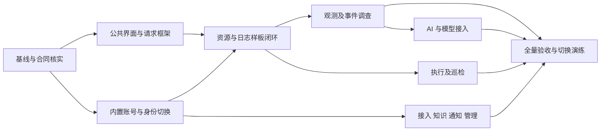

# 智能运维平台 V1.2 高保真复刻与后端接入实施方案

版本：1.0。日期：2026-10-21。状态：已完成本文范围的源码核对与方案自审，供后续启动实施使用。

本次交付仅为实施方案及清单，不代表开始业务开发、数据库迁移、远程操作、组件安装或生产发布。下文接口、表名和新增目录凡标注“拟定”者均未实现。

## 一、实施目标与范围

### 1.1 最终目标

1. 以现有 V1.2 内置账号版 HTML 为视觉和交互基准，在正式 React 前端完成 1:1 复刻。
2. 覆盖 22 个菜单页面、458 个基准切片、54 种页面或业务表单，保留页面、弹窗、抽屉、查询结果、加载、错误、权限和取消等状态。
3. 复用已实现的业务服务、API、持久化、Worker、调查、模型及执行路径；经核查确实缺失的能力，按本方案补齐。
4. 每项能力达到视觉、交互、接口、持久化、权限和实际运行六项验收要求后，才标记完成。
5. 使用平台内置账号，不保留用户可选的 OIDC、Keycloak、企业目录或外部登录入口。工作负载 PKI、mTLS、SPIFFE 和 OpenBao 继续承担原有机器身份与凭据职责。

### 1.2 保持的产品决定

- 产品名称为“智能运维平台”。不恢复运营分析，不新增“公共能力”一级产品菜单。
- 模型配置仅显示服务地址、模型 ID、访问凭据、上下文长度四项。高级运行约束由平台管理，不转嫁为新增必填字段。
- 集群配置目标与顶部运维数据集群分别表达；管理员权限不自动包含运维数据权限。
- 当前告警与历史告警分别展示；故障状态不替代来源告警状态。
- AI 问数、资源排障、证据查看和转入人工处置保持完整闭环。模型建议不能自动填入或执行实际命令。
- 故障案例与操作手册归属统一知识库，类型、发布版本、索引和检索引用分别保存。
- 保持桌面设计，不在本项目中增加手机布局。

### 1.3 实施边界

- 遵循[仓库边界](../../../AGENTS.md)与 [ADR-0008](../../adr/0008-defer-kubevirt-cdi-development.md)。KubeVirt/CDI、VM/VMI/DataVolume、完整 Trace 和既有延期或禁用能力不因“补齐缺失功能”而恢复。
- 根目录 00～10 正式文档保持原状。认证替换、模型连接合同、观测入口等跨合同调整，在正式实施时新增 ADR 或版本化合同，不重写历史决策。
- 既有 AI/故障链专项入口和历史证据继续有效；历史测试通过不自动证明本轮制品通过。
- 本地进行文档、代码编辑、编译及允许的单元/合同检查。运行联调、数据库、Kubernetes 和正式业务浏览器验收沿用 `192.168.0.63` 独立开发环境，实施前重新核对其当前状态；不使用本机 OrbStack，不操作生产或其他任务实例。
- 原型交付时的本地浏览器检查只验证设计参考，不扩大正式项目的运行授权。

## 二、基准与交付物

### 2.1 固定基准

- 本轮核对的正式仓库 HEAD：`3339876e72bd4f4d5e2d321afa62440b886c3130`。启动实施时记录新的 commit/tree 和工作区变化，不将此值当作永久最新版本。
- 设计包：[V1.2 切片包](../../../../ui-handoff/ops-platform-v1.2-20261020/README.md)。源 HTML 的 SHA-256 为 `c6651e1d77732287b7130e3d4afc004ec4f3561f70fd22b263d5da929d5b4fdc`，来自既有 manifest，不新增另一份设计基准。
- 458 个切片已完成原型重放及浏览器检查；683 项原型回归断言通过。它们是原型证据，不是正式 React、生产来源、内置账号后端或真实模型质量验收。
- 主验收画布为 1440 × 960 CSS px，缩放 100%。1920 × 1080 作为补充布局检查；正式视觉比对固定操作系统、浏览器、字体、语言、时区和设备像素比。
- 既有 `previews/*.png` 是缩略预览，不能直接作为 1440 × 960 的像素黄金图。

### 2.2 本目录文件

- [tasks.csv](tasks.csv)：39 个任务包、输入、输出、依赖、责任角色、改动范围及通过条件。
- [slice-map.csv](slice-map.csv)：458 个切片逐条分配主任务、关联任务、接口族、候选代码及六项验收状态。
- [contracts.csv](contracts.csv)：逐操作列出已存在的合同和拟新增/扩展操作，明确状态。
- [baseline.json](baseline.json)：核对时的代码与设计基准、覆盖数和范围说明。
- [review.md](review.md)：方案自审发现、修正与尚需实施验证的事项。
- [validate-plan.py](validate-plan.py)：校验任务依赖、458 项映射、接口标识、相对路径及基准数量；不运行业务测试或连接环境。

## 三、代码现状与差距裁决

### 3.1 已有主路径，优先复用

1. 正式 Web 已有 React、TypeScript、React Router、TanStack Query、Ant Design、Cytoscape、CodeMirror、xterm 和 Playwright；沿用锁定版本，不以复刻为由重建工程或升级依赖。[package.json](../../../web/package.json)、[router.tsx](../../../web/src/app/router.tsx)。
2. 资源目录、规范标识、关系和影响范围已有 API、图授权和页面。视觉重构与能力复用分别处理。[resource_handlers.go](../../../internal/httpapi/resource_handlers.go)、[ResourceDetailPage.tsx](../../../web/src/pages/ResourceDetailPage.tsx)。
3. 证据查询已有来源选择、租户/资源范围、时间、返回量、字节和预算检查。独立观测工作台需要扩展查询结果形态，不能假设已有接口覆盖全部原型字段。
4. Finding/Incident、证据、根本原因版本、调查任务、人工命令风险评估、执行输出和后置验证已有路径。[sp05_handlers.go](../../../internal/httpapi/sp05_handlers.go)、[action_handlers.go](../../../internal/httpapi/action_handlers.go)、[investigation_handlers.go](../../../internal/httpapi/investigation_handlers.go)。
5. AI 会话、轮次、流式事件、结构化结果、范围重绑、归档及保留、来源/正式版本引用已有实现。继续使用 HolmesGPT、官方 MCP、既有 Job/Step、租约和预算，不另建 Agent 循环或模型调用客户端。
6. 集群/来源登记、角色绑定、配置草稿/校验/发布/启用和审计已有部分完整合同。[source_handlers.go](../../../internal/httpapi/source_handlers.go)、[tenant_handlers.go](../../../internal/httpapi/tenant_handlers.go)、[config_handlers.go](../../../internal/httpapi/config_handlers.go)。

### 3.2 已确认的合同差异

1. 现有前端路由为 `/findings`、`/incidents`、`/admin/*` 等；原型为 `/events/*`、`/jobs/*`、`/access/*`、`/settings/*`。需要页面路由映射与旧链接兼容，不能直接替换后端 API 路径。
2. 当前 API 启动构造 OIDC 认证器，Web 请求使用 Bearer；登录、首次改密、内置用户 CRUD 不是现有功能。再次验证与原提供方会话也有耦合。[api_runtime.go](../../../internal/app/api_runtime.go)、[AuthProvider.tsx](../../../web/src/auth/AuthProvider.tsx)、[stepup.go](../../../internal/auth/stepup.go)。
3. 当前模型 Profile 限定 `/v1` 地址、内网/回环/集群域名、固定摘要、任务能力和准入状态；API/Worker 启动时冻结 Profile。动态四字段接入不能只增加数据库行就宣称现有 Worker 已切换。[profile.go](../../../internal/modelprofile/profile.go)、[sp06_runtime.go](../../../internal/app/sp06_runtime.go)。
4. 现有证据查询并未提供完整日志工作台的查询任务、分桶、筛选、字段展开及个人历史合同；内部 analytics 能力也不是浏览器可直接调用的公共 API。
5. 现有智能调查创建合同主要接收触发版本/类型，原型提供的公开步骤、预算和调查重点不能未经合同扩展直接提交。用户输入只能收紧服务端策略，不能扩大准入上限。
6. 当前 `/command-executions` 仅有创建合同，尚无全局列表 GET；后置检查现有合同为 GET，读取 Worker 自动验证报告。人工重新发起验证需独立创建尝试，不得将 GET 当成启动操作。
7. AI 会话详情已有 GET，但没有原型重命名需要的 PATCH；该写操作单列拟新增，个人历史/归档继续复用。

### 3.3 重点补齐的产品闭环

以下在当前公开合同和页面中未见与原型一一对应的完整闭环，列为“拟新增/待现状核实”，不据此删除已有底层实现：

- 业务服务与责任归属；故障认领、转交、评论、后续任务和告警关联修正。
- 一次性巡检用户任务、只读巡检计划与持久化调度、作业模板。
- 统一知识正文/版本、导入处理、索引、检索测试、AI 固定版本引用。
- 通知渠道、投递路由、回执、重试、静默与维护窗口。
- 多集群组件检查、缺口计划、受控按需部署及数据资格复验。
- 模型连接管理、连接测试和实际运行版本路由。

P0 阶段必须沿 API → 处理器 → 服务 → 数据库/Worker → 调用者继续核实。存在能力但缺公开合同的，按适配处理，不重复建设；发现任务不需要的附加能力，不加入本项目。

## 四、总体技术方案

### 4.1 前端结构

继续使用 `platform/web`。在已有 `layout`、`components`、`features`、`pages`、`auth`、`api` 结构内扩展，不新建第二套长期运行的前端。

- 公共框架：238 px 侧栏、70 px 顶栏、集群切换、账号、面包屑和独立侧栏滚动。
- 视觉层：迁移原始颜色、字体、间距、圆角、SVG、表格与图表样式。将全局选择器限定在平台根容器内，保持等效样式，防止污染编辑器或终端。
- 控件层：原型专用薄组件优先；Ant Design 仅在主题和样式可准确匹配时复用。不得因组件默认样式不同而随意改变已确认设计。
- 业务层：复用既有调查、证据、AI、执行等组件中的请求、解析和安全边界；界面结构按切片调整。
- 接口层：修改 OpenAPI 后运行既有生成器；生成文件不手工修改。[orval.config.ts](../../../web/orval.config.ts)。
- 状态层：URL 保存可分享的集群、资源、筛选、页码/游标和时间范围；表单草稿、选中项、抽屉和图表视图为界面状态；服务端状态由 Query 管理。
- 不把完整原型脚本、`DB=seed()`、模拟定时回执、演示登录或其内存密码校验放入正式构建。

### 4.2 路由与兼容

22 个菜单路径按设计包保留。资源详情采用可逆编码的规范标识或后端提供的稳定资源引用，不能把含斜杠的 canonical ID 直接拼到路径中，也不能继续使用 `r-gateway` 等演示 ID。

旧 `/findings`、`/incidents`、`/incidents/:id`、`/resources/detail`、`/admin/*` 按明确路由映射转到新页面，保留集群、对象和范围参数。无权限显示受限状态，资源不存在显示不可用；不回退到其他同名资源。旧认证回调属于认证替换删除范围，不作为另一种登录入口保留。

### 4.3 API 与身份、范围

- 页面只调用平台同源 API，不从浏览器访问模型、VictoriaMetrics、VictoriaLogs、DeepFlow、Redfish 或 Kubernetes 凭据地址。
- 认证后的请求上下文继续使用服务端角色、tenant、subject、集群、namespace、canonical ID、UID 和来源 revision。用户提交的角色、租户或资格字段不构成授权。
- 缓存键至少包含身份/授权版本、运维集群、命名空间、资源、来源版本、时间、筛选。配置页面使用独立 `configCluster`，不与顶部运维集群混用。
- 切换账号、撤权、集群或来源变化时，清理敏感缓存、断开旧 SSE、取消请求并拒绝迟到响应；命令评估、确认和待执行草稿重新核验。
- 写操作复用现有幂等合同和 `expectedRevision` 等版本约束。更新后的同一次用户意图重试复用幂等键；不同内容不得复用旧键。
- 保持既有响应包络与 requestId；前端做小范围数据映射，不为统一外观重写全部 API 包络。
- SSE 续传重新鉴权、绑定对象和事件游标；日志/证据正文作为文本显示，不按 HTML 执行。

### 4.4 状态语义

分别保存和呈现：登记状态、网络/凭据连通、组件就绪、数据资格、数据覆盖、运行任务状态与业务结论。

- HTTP 请求被接受不等于任务已完成；`202` 进入任务状态查询或流式观察。
- 无匹配、无来源、权限不足、覆盖不足、过期、协议不支持、超时和取消分别处理。
- 用户请求取消与后端实际终止分开；已经执行的外部动作不会因取消自动回退。
- 命令退出成功不自动恢复 Incident；规则停用、静默或转交不改变原告警事实。

## 五、阶段、任务和进入条件

任务明细以 [tasks.csv](tasks.csv) 为准。阶段是本项目工作分组，不替代原 SP 阶段验收结论。所有功能当前均为本轮“待实施/待接入”，不将原型通过状态带入正式验收。

### P0：基线与合同核实（4 项）

1. 固定代码、设计包、已有工作区变化和运行环境实际制品；保留历史证据。
2. 为 458 个切片逐条核实处理器、合同、存储、Worker 和调用者。复合切片明确一个主任务与关联任务，不重复计交付。
3. 完成账号主体保留、观测查询、模型运行路由、再次验证、未知/不可用状态与补充交互决策。
4. 建立专属联调身份、数据范围、目录和服务版本清单。现有环境只读核对，不自行替换其他服务。

**G0 通过条件：**458 项映射无遗漏；39 项任务依赖有效；拟新增接口与已有接口无误标；模型合同及账号回退边界明确；安全必需补充状态已登记。未核实项有具体任务和阻断范围，不用“后续再看”关闭。

### P1：公共界面与请求框架（4 项）

1. 完成设计令牌、基础控件、页面、表单、表格、确认窗口、抽屉、消息和嵌套浮层。
2. 完成新导航、旧链接兼容、集群范围、返回和草稿保护；点击后保持侧栏滚动及焦点。
3. 迁移请求层、身份作用域缓存、错误映射、幂等和 SSE，保留原有请求取消和迟到响应保护。
4. 在远程固定浏览器环境建立从原始切片 HTML 渲染得到的正式黄金图与状态定位规则。

**G1 通过条件：**公共组件覆盖宽/窄弹窗、抽屉再开弹窗、滚动表格、长内容和键盘焦点；每种基础状态至少有可复用组件用例。黄金图不取自新实现本身。

### P2：内置账号与身份切换（5 项）

1. 新增用户、凭据、服务端会话、身份映射及必要的再次验证迁移；实现受控首管理员初始化。
2. 完成登录、退出、首次/本人改密、会话恢复、过期与撤销；接入原有 RequestContext、角色和 RLS。
3. 完成内置再次验证与必要多因素能力，替换外部会话依赖，保持高风险操作原有保证。
4. 完成用户管理、独立授权、历史主体保留及最后可用管理员保护。
5. 同步改造 API/Worker、Web、CLI、安装/校验、Chart、环境配置和冷启动；验证无旧身份服务时仍可工作。

**G2 通过条件：**不依赖外部身份服务的新安装能初始化、登录、读取和授权；停用/改密/撤销立即影响后续请求；跨租户/集群/namespace 拒绝；旧审计、会话、调查和执行历史仍按正确主体可访问。未通过 G2，业务 UI 可做隔离测试，不能声称已完成真实原生登录接入。

### P3：资源与日志样板闭环（4 项）

1. 接通运行总览、资源目录/详情、关系拓扑及作用域选择。
2. 复用受控证据/analytics 能力，补独立观测查询合同、结果持久化及范围检查。
3. 完成日志输入、加载、结果、字段/原始内容、时间筛选、个人历史、空态和错误态。
4. 跑通登录 → 授权集群 → 真实资源 → 明确日志来源 → 查询 → 详情 → 复用条件的闭环。

**G3 通过条件：**SL-049 及同组状态来自实际后端；重载可读取规定保留期内结果；来源失效或撤权后不能读取旧结果；两个集群同名资源不串数据；切换范围时旧响应不污染新页面。

### P4：观测、资源归属与事件调查（5 项）

1. 接通指标、网络和硬件健康；保留缺失采样、覆盖不足与未验证资产声明。
2. 补业务服务与责任归属，引用稳定资源身份，不替代 Kubernetes Service。
3. 将 Findings 映射到当前/历史告警，保留来源标识、发生/恢复与观测时间。
4. 补故障协作与告警关联修正，复用现有状态、证据、时间线和根因版本。
5. 调整调查工作台与预算合同，接通公开步骤、停止、历史、引用和异常恢复。

**G4 通过条件：**资源/事件/证据/调查端到端定位一致；新增协作信息持久化并记录操作者；无充分证据不生成确定根因；预算只能在服务端允许上限内收紧。

### P5：AI 与模型接入（3 项）

1. 将已实现 AI 返回结构映射为统计卡、趋势、列表、排障、证据、澄清、部分结果和失败 UI。
2. 接通个人历史搜索、重命名、归档删除、范围重绑、停止、续传和固定版本引用。
3. 实现四字段模型连接管理与运行版本选择，处理当前冻结 Profile 与动态接入差异。

**G5 通过条件：**至少一条已准入模型通过真实会话/工具调用链；切换模型只影响新任务，已有任务保留固定版本；越权历史不可读；模型连通、任务能力和回答质量分别记录，不把已有 partial 或质量失败改为通过。

### P6：人工执行与巡检（4 项）

1. 完成实际命令、风险评估、确认、再次验证、排队/输出/取消/验证与历史列表接入。
2. 补受控模板及参数验证，只生成预览，不自动执行或填入实际命令。
3. 补用户发起的只读巡检任务与固定报告，复用检查适配器，不把后台原生巡检直接当成用户任务 API。
4. 补持久化计划、调度、启停、手动触发、历史与重启恢复。

**G6 通过条件：**篡改命令/目标/版本/确认摘要被拒绝；取消与执行回执一致；双 Worker 和重启不重复派发同一调度实例；报告不会随资源当前状态变化而改写。

### P7：接入、知识、通知与管理（6 项）

1. 集群/来源登记、组件只读检查及能力回执。
2. 缺口连接、受控部署、前置验证、任务观察及数据资格复验。
3. 规则关联、通知路由、静默/维护、投递、失败与重试。
4. 知识正文、版本、导入处理、索引。
5. 检索测试、固定版本原文与 AI 引用。
6. 诊断策略、执行配置、部署信息和审计复刻与接口适配。

**G7 通过条件：**每个缺口都有真实持久化和处理路径；检查不写入目标集群；部署需要独立目标安装权限；知识只有已发布且可访问版本参与新检索；通知静默不删除来源事实；管理接口服务端校验角色及再次验证。

### P8：全量验收与切换演练（4 项）

1. 458 个基准切片及已登记补充状态全部有视觉与交互结果、证据和差异处置。
2. 真实多集群、多来源、模型、执行链路和重启/撤权/超时/断流联调；模型质量独立验收。
3. 完成原生账号全栈升级、冷启动、身份映射、写入边界和回退演练。
4. 输出本轮制品、合同、迁移、配置、验收矩阵、已知限制和回退说明，形成开发环境交付候选。

**G8 通过条件：**没有未处置的范围内功能缺口或阻断级问题；“已实现、已接入、已运行验证、质量通过”各有证据。生产发布仍需单独的实际环境条件和既有授权，不由本文自动触发。

## 六、内置账号详细设计

### 6.1 数据与主体

- 拟定用户表包含不可变 user_id、登录名、显示名、状态、凭据版本和强制改密标记；凭据与会话材料不在列表/详情/审计中返回。
- 为迁移用户建立经核对的 `user_id → principal_subject` 映射，保留既有业务 subject 值；新用户生成稳定不透明主体。按租户约束唯一性，不按显示名或同名登录名自动继承权限。
- 本轮产品使用受控初始化确定的默认组织，不新增登录组织选择。登录名在安装实例内唯一；登录前置查找使用服务端确定的组织上下文，登录后从成员关系派生 tenant，不接受任意客户端 `X-Tenant-ID` 改变会话组织。已有多组织主体按显式映射保留，未迁入的范围不得自动暴露。
- 不重写不可变审计或已提交证据；旧会话、调查、执行、幂等记录及个人历史继续使用已核对主体。外部身份原始字符串作为历史标识保留不意味着运行时仍依赖提供方。
- 普通业务 RLS 不用于未认证请求自行声明租户的密码查找；通过受限认证入口/数据库函数校验，再由服务端成员关系构造上下文。
- 账号移除采用停用/归档，保留引用。凭据变更、账户状态、角色变更、会话撤销有独立版本，访问与敏感写入均重新核对。

### 6.2 密码、会话与再次验证

使用项目已有密码学能力评估 Argon2id；参数在实现时按运行容量校准并版本化，不复用原型浏览器内存密码校验。[OWASP 密码存储](https://cheatsheetseries.owasp.org/cheatsheets/Password_Storage_Cheat_Sheet.html)

服务端保存随机会话验证材料及过期/撤销状态，浏览器使用同源、HttpOnly、正式 HTTPS 下 Secure、合适 SameSite 的 Cookie。登录轮换会话，写操作增加 CSRF 校验、受控 Origin 检查和既有幂等约束；会话材料不写入前端持久存储。[OWASP 会话管理](https://cheatsheetseries.owasp.org/cheatsheets/Session_Management_Cheat_Sheet.html)

- 首次改密期间只开放受限改密和退出接口，不授予完整业务会话。
- 登录错误不泄露用户是否存在；失败速率限制和恢复流程必须可测试。
- 高权限管理和执行保留原有再次验证强度；需要多因素时由内置能力完成，不能用“已确认”勾选或伪造认证等级替代。
- 再次验证记录绑定用户、当前本地会话、验证时间/方式、授权及凭据版本，保留绝对/空闲过期、撤销和事务内检查。风险确认另行绑定实际命令、目标和固定配置版本。
- 单独登记内置动态口令设置/挑战、恢复和会话到期等设计补充状态；不将缺失安全交互隐藏在原型演示勾选背后。

### 6.3 全栈切换

API、Web、Go/Python Worker、CLI、安装入口、Schema、Chart、网络策略和校验脚本按一个兼容版本集合交付。移除目标安装对旧身份镜像和配置的强制依赖。安装首管理员只允许一次受控成功，不保留公开默认生产密码或开放注册。

切换前排空未派发任务并记录运行任务；旧登录和再次验证材料失效。已运行任务按服务端生命周期处理，不伪称注销等于取消任务，不重新派发已完成外部动作。

## 七、关键模块的接口、数据与任务设计

### 7.1 独立观测工作台

拟定 `/api/v1/observability/queries` 查询族，只有现有证据合同不能完整表达所需状态/结果时新增；优先复用授权、模板、预算、编译、来源适配器和归档。不得通过创建虚假 AI 会话来承载手动查询。

- 输入：来源登记 ID、资源规范标识/UID、绝对半开时间窗、时区、受支持模板、结构化筛选及预算；来源、集群与资源归属由服务端交叉验证。
- 普通运维人员通过受控能力投影获取可选来源，不依赖管理员来源登记列表；响应仅给可查询 ID、类型、操作、版本和资格/覆盖，不暴露凭据引用、连接秘密或未授权来源。
- 输出：查询 ID、实际范围、来源 revision/资格、覆盖、统计、样例/行/字段、缺失、截断、警告和结果有效期。快照与后续实时重查分开。
- 日志时间分桶由后端对实际查询总体计算，不能从返回的少量样例计数推导总量或错误率。相邻查看只在受控结果/游标范围内进行。
- 存储：拟定观测查询、结果和个人历史记录，附属证据尽量复用现有归档；结果所有者、租户与范围每次读取重检。缓存和过期结果不能绕过当前资格。
- 对受支持的快速查询可同步返回；可能超预算/需后台处理时使用持久任务及受控状态读取。两种路径使用同一结果合同，不由浏览器定时器伪造进度。
- 查询取消、来源撤销、资格过期、并发版本变化保留明确状态和审计；预算包括网络调用数、窗口、行、字节与超时。

### 7.2 资源、总览与事件

- 总览数量由服务端在授权范围内聚合，不能在前端取第一页后计算总量。
- 拟定业务服务记录引用稳定资源标识，责任人须为可选择的内置成员；资源删除/重建不自动绑定旧 UID。
- 当前/历史告警优先映射现有 Finding 事实及生命周期。P0 明确它与原型告警概念是否等价；必要时补投影，而非复制第二份相互矛盾的事实库。
- 故障协作新增归属/评论/任务/关联事件，带 revision、操作者、时间和审计；赋值/转交、故障状态、告警恢复分别存储。
- 关联告警时核对租户、集群、资源与原故障关系；修正记录可追溯，不篡改来源原文。
- 时间线只显示服务端发生或被记录的事件，不能用页面加载时间补成历史事实。

### 7.3 AI 与模型四字段接入

- 复用现有会话/轮次/事件/QueryResult/Fact/Evidence/正式版本引用。新界面保持数字、证据、假设与解释质量的区别，部分结果可访问但不能标记完整成功。
- 原型“删除会话”对应归档，保留已引用证据、审计与法律保留规则；不改为级联物理删除。
- 模型连接记录拟定单独管理四项用户配置；API Key 进入 OpenBao，页面只回显“已配置”及可选择的受控引用，更新不返回原文。
- 保存后执行有界真实连通、鉴权、模型存在、任务协议和能力检查；上下文自动读取有依据时才填充，手工确认不能扩大实际能力。无法验证上限时记录限制，不能声称已测得。
- **连接通过不自动等于运行准入。**当前 Profile 包含权重/许可证/评测/准入证据及地址限制，不能由四项输入或一次成功 HTTP 响应伪造。已准入目录中的模型由平台自动关联材料；未知模型明确保持未获运行准入。界面不增加这些必填字段。
- 本方案保留现有门禁；若产品要求任意外部 URL 填四项即可立即执行，须单列 ADR 调整允许地址、合同及验收，并用真实证据满足新规则，不能在实现中悄悄移除校验。
- 动态选择需要 API、Go Worker、Python dispatcher 在任务创建时共同冻结并验证同一 Profile 引用，配置新版本不能改写旧 Job；不能只更新 Web 列表。
- 普通运维人员的模型选择通过授权能力投影获取可运行的安全选项，不调用管理员连接列表；同时核对相应 Worker 能否加载固定版本。没有可用运行实例时显示不可用，不因连接记录存在而允许提交。
- 沿用官方模型运行链。未知协议、网络拒绝、超时、上下文越界、工具调用不支持和模型输出不合格分别处理；连接质量和中文问数/排障质量分别验收。

### 7.4 人工执行、模板与巡检

- 执行链复用风险评估/确认、再次验证、固定配置、幂等、任务、输出与后置验证。表单改变后立即使旧确认失效，服务端仍重新检查。
- 新增执行列表 GET 时沿用所有者和当前目标授权分页，不能直接把全租户执行表返回给任意运维账号。保留现有自动后置检查的 GET；原型人工复验新增独立验证尝试及报告，不覆盖既有固定报告，也不再次派发命令。
- 模板只允许既定操作及字面量参数，参数以受控结构传输，不能自由拼接 shell 字符串后跳过评估。
- 用户巡检任务持久化范围、检查项、检查版本及创建者；各项分别保存成功、失败、不可用、未执行，最终报告为固定快照。
- 计划保存时区、执行周期、范围和版本；停用只阻止后续触发，已有任务另行取消。默认不补跑停机期间积压时段，记录漏触发/跳过，需补跑时由明确操作创建新任务。
- 每个调度槽位按租户、计划版本和计划时间建立唯一派发记录，使用现有持久 Worker/租约模式及接管围栏。不得将浏览器定时器当调度器，也不引入独立新队列平台。
- 双 Worker、重启及网络失败测试关注“不会重复派发同一实际动作”，不宣称跨外部系统的绝对 exactly-once。

### 7.5 多集群接入与缺口处理

流程：集群登记 → 只读检查 → 分类缺口 → 关联已有来源或确认受控部署 → 任务完成 → 实际采样/标签隔离/覆盖核验。

1. 检查项目来自平台所需资源、指标、日志、网络及硬件能力，不把模型、身份和数据库要求为每个业务集群重复部署。
2. 每个检查项保存目标、来源版本、检查方法/权限、观察时间和依据。无权限、不可达、协议不兼容、缺服务与缺采集端分别输出，不将失败都当“未安装”。
3. 发现已有组件不自动获得凭据、运维权限或数据资格。来源注册必须显式关联受控凭据、租户/集群/namespace 映射并验证。
4. 检查动作只读。安装动作单独鉴权，使用目标集群的有限安装权限和受控 Bundle/镜像/Chart；平台管理员身份本身不等于可安装任意目标。
5. 复用 Bundle、离线物料和安装驱动前，先验证其支持指定远程目标及 namespace 隔离；不把当前平台安装器直接指向任意业务集群。
6. 安装只处理明确缺失的组件或采集端，不接管、重装或删除既有第三方组件。记录资源/存储/架构/镜像/网络检查、人工确认、步骤回执和失败后保留状态。
7. 部署完成仍显示“采集待验收”；有效来源证明、真实采样、覆盖和隔离通过后才提升具体数据操作资格。

### 7.6 规则、通知与知识库

**规则与通知：**明确“来源规则关联”和“产生新来源告警”的边界，优先接已有事实与规则，不增加通用表达式引擎。静默/维护只影响路由或通知，保留告警、故障和审计。通知配置、待投递、回执、重试独立持久化，密钥用受控引用。测试只投递到指定隔离接收端。外部已接收但回执丢失时记录结果不确定，重试可能重复通知，不能伪称严格一次投递。

**知识库：**正文、文档类型、cluster、版本、状态、处理任务和索引版本持久化；正文附件复用已验证存储能力。导入限制类型/大小并按文本处理，不执行文档脚本。发布版本不可变，归档不参加新检索；历史引用读取固定版本并重新授权。

先按已确认检索语义实现可解释、可复现的检索；使用现有 PostgreSQL 能力前核对中文分词与索引需求。不得将简单字符串包含匹配标为语义检索，也不为未知需求引入新的向量平台。若要求语义检索，P0 明确兼容实现、模型、许可与独立验收。AI 只读检索工具沿既有 MCP/Job 路径接入，不另建模型循环。

## 八、数据、合同和迁移要求

1. 先更新 OpenAPI/Schema、统一生成 Go/TS 等产物，再实现或接入；既有消费者有变化时做兼容测试。接口清单的拟定路径在 P0 允许调整，但必须同步任务、切片映射及测试。
2. 数据库仅新增前滚迁移，实际编号在实施时分配，不预占并行任务可能使用的下一编号，不修改已应用迁移。
3. 拟新增实体族：原生账号/凭据/会话/主体映射；观测查询/结果；业务服务/资源引用；故障协作；模型连接/测试；巡检/计划/派发；组件检查/部署任务；通知配置/回执；知识文档/版本/索引。能复用现有实体时不重复建表。
4. 每族落实 tenant/owner/cluster、RLS、最小数据库权限、唯一幂等约束、revision、审计、引用/保留、删除与过期规则。历史结果读取重检当前权限。
5. 模型密钥、集群凭据、日志与文档正文、执行输出的存储及导出遵循原数据分类和脱敏边界；不把浏览器存储当服务器数据库。
6. 长任务落实租约、接管、心跳、取消、幂等与恢复围栏；外部副作用已发生而状态未知时保留不确定，不自动重试造成重复处置。

## 九、逐切片与真实运行验收

### 9.1 每片六项状态

每个切片分别记录 `visual`、`interaction`、`api`、`persistence`、`authorization`、`live`，初始均为待验收。只允许具体理由的“不适用”，不可用“不适用”掩盖缺失后端。总体完成必须所有适用项通过，且有关联证据。

### 9.2 视觉基准

1. 从固定源 HTML/定格页在正式测试环境重新渲染基准图；主画布 1440 × 960，真实全分辨率，不使用缩略预览。
2. 同一环境加载正式 React，使用稳定数据和等效状态重放。静态视觉测试可使用明确隔离的接口 Fixture，真实联调另行验证，正式构建不内置这些回执。
3. 页面比较布局、字体、图标、边距、控件、图表、固定/滚动定位；浮层比较内容、宽度、遮罩、层级、焦点、头尾吸附及内部滚动。
4. 长页面额外保存完整内容或分段位置；AI 消息内部滚动、日志长行、侧栏、抽屉及弹窗底部操作区不得遗漏。
5. 仅允许明确登记的动态值区域差异；不得屏蔽整张图、整块内容或关键状态。首批基础切片校准像素容差，不能用统一“大百分比差异”通过 1:1 验收。
6. 既有依赖中已有 Playwright，可采用其视觉断言；参考和实际截图必须在相同环境产生。[Playwright 官方视觉比较](https://playwright.dev/docs/test-snapshots)

### 9.3 交互与接入检查

- 按 SPEC 的进入步骤检查按钮、表单、搜索、排序、分页、返回、打开/关闭、脏草稿、键盘、重复提交、成功、失败、取消和重试。
- 业务作用域测试至少包含两个集群同名资源、两种 namespace、管理员无运维权限、运维人员无管理权限、个人历史隔离、撤权/改密后的旧请求与旧 SSE。
- 真实来源检查必须绑定 resource UID、来源 revision/qualification、实际时间窗及覆盖；Fixture 不授予真实来源资格。
- 调查/AI/执行记录 API 与 Worker 制品、模型 Profile、Step/Fact/QueryResult/Evidence/执行 ID，回答质量与机制可用性分开。
- 数据库测试验证迁移、角色/RLS、重启读取、并发版本、幂等、过期/保留和删除引用；不能只断言 HTTP 200。
- 共享组件测试复用，458 个状态用参数化清单驱动视觉及必要交互；关键跨页闭环独立测试，不生成 458 套重复业务逻辑。

### 9.4 缺陷和证据

- 阻断级：越权、凭据泄露、错误目标执行、重复外部动作、数据不可恢复丢失、无法登录/恢复或伪造业务成功；未解决不得过阶段门。
- 重要级：关键操作/状态缺失、错误统计/来源、浮层遮挡操作区、主流程布局偏离；相关功能不得验收通过。
- 一般级：不影响操作的局部视觉差异，逐项记录并修复；验收者明确接受时保留差异，不自动改黄金图消除告警。
- 每个结果至少保存切片 ID、任务 ID、代码/设计版本、环境、数据类型、实际状态、截图/差异、接口请求 ID 和测试日志。敏感材料采用受限证据引用，不写入公共 CSV 或截图。

## 十、切换、回退与运行交付

### 10.1 切换前

记录实际代码/镜像、数据库迁移、配置、源资格、运行任务和身份映射；制作并验证可恢复备份。在独立环境演练原生冷启动与旧数据升级，确认 API、Worker、Web、CLI、安装入口匹配后再安排实际切换。

### 10.2 两个回退边界

1. **尚未产生原生账号与新业务写入之前：**可停止候选部署，恢复明确的旧版本集合及受控快照；此为受控迁移演练回退，不是产品保留双登录选项。
2. **已产生新账号、改密、撤销或新增业务写入之后：**不允许只回滚旧 Web/API 或恢复旧身份凭据。优先回退到兼容原生数据的已验证版本，或前滚修复。恢复整库快照涉及切换后写入丢失和撤销状态倒退，须明确停写、影响与补偿并按实际授权执行，不能自动作为普通回退动作。

数据库变更采取可恢复的前滚方式。运行中的任务保留执行身份、版本和副作用记录；回退不得重新派发、篡改历史或让已撤销用户重新取得访问。

### 10.3 候选交付内容

- 正式前端及静态资源、Go/Python 运行制品、OpenAPI/Schema 与生成客户端。
- 前滚迁移、原生初始化/升级工具、部署配置、离线闭包和平台需要的检查脚本。
- 22 菜单/458 基准切片/补充状态的交付矩阵、差异、运行证据和已知限制。
- 原生账号操作、来源接入、巡检调度、组件缺口、模型兼容与准入、故障处置、知识管理和回退说明。

生产发布、HA/容量、离线发行和既有阶段正式验收按照各自门禁处理；开发环境的本项目通过不替代这些结论。

## 十一、实施组织与估算

- 以 `tasks.csv` 中一个可独立验收任务为最小交付包，附关联切片、合同、迁移、测试和回退说明；禁止提交只完成外观而没有对应状态的“空接入”。
- 责任角色是工作划分，不代表已分配人员，也不表示本轮已授权新建任务或启动多智能体。开发者按任务依赖领取，复核人检查关键边界及证据。
- 先完成 P0，依据“可复用/适配/新增”、合同数量、真实数据和迁移风险估时；不能按截图张数线性估算或在核实前承诺固定工期。
- 每个阶段报告完成任务、六项验收、实际缺口及下一阶段阻断。范围内遗漏回到对应任务补齐，不随意缩减功能；新增产品范围单独登记。

## 十二、最终完成判据

1. 22 个菜单均有正式路由和真实功能，458 个基准切片及必要补充状态没有无责任任务项。
2. 所有适用的六项验收通过；真实后端没有继续依赖原型假数据或固定成功回执。
3. 内置账号完整替换，历史主体与授权可追溯，高风险再次验证保持保证。
4. 模型、来源、组件、任务和业务状态语义准确，未知和失败不被美化成可用。
5. 至少完成真实多集群范围隔离、观测、AI/调查、人工执行与独立验证、巡检调度、知识引用、组件缺口和通知闭环。
6. 不恢复虚拟化/Trace 延期能力，不修改历史事实，不把原型验证、机制通过和模型质量混为同一结论。
7. 制品、迁移、运行说明、切换与回退证据齐全，进入既有交付门禁；生产发布仍按实际授权进行。

