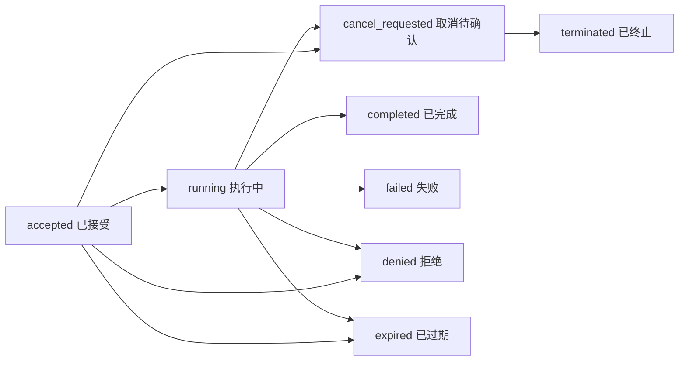
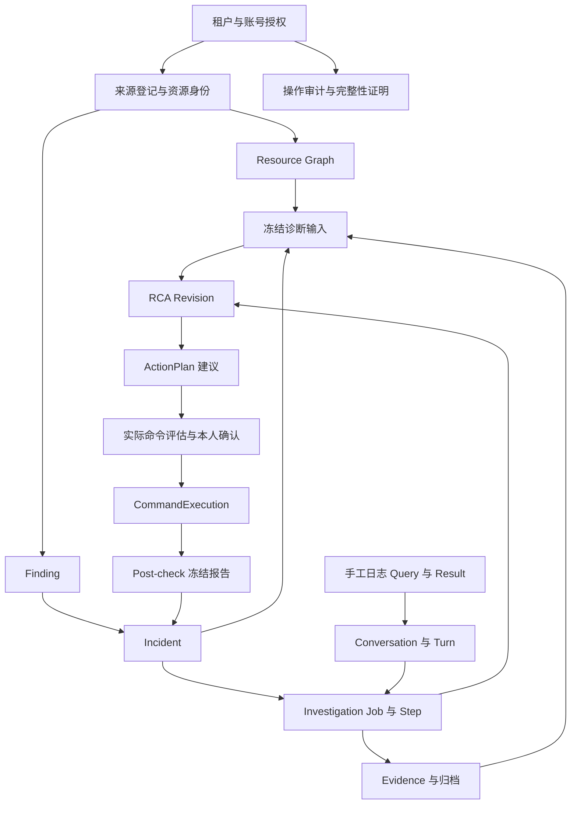

# 智能运维平台详细产品设计方案（实际代码基线）

文档日期：2026-10-30（Asia/Shanghai）。

适用对象：产品、交互、前后端开发、测试与交付人员。

产品口径：智能运维平台 1.0 的非虚拟化能力，以及当前 V1.2 界面改造中已进入实际代码的增量。V1.2 在本文中指界面与账号改造基准，不表示产品 1.2 已经完整发布。

源码基线：`platform/` 仓库 HEAD `082f87d66c5b1336b4cd32c48ebbe59e4093144b`，加编写时已有的未提交工作区修改。本文描述当前文件内容，不能仅用该提交重建全部现状。

文档性质：依据实际代码整理的产品设计与验收输入，不替代根目录 00～10 正式方案，不改变既有 ADR，不构成功能验收或生产放行声明。

## 阅读导览

- 产品目标、角色与边界：第 1～3 章。
- 导航、通用交互与登录：第 4～6 章。
- 总览、资源、拓扑与日志：第 7～10 章。
- 告警、故障、证据、RCA 与调查：第 11～14 章。
- AI 问数、自然语言排障与故障链：第 15 章。
- 人工命令处置与验证：第 16 章。
- 平台管理、审计与数据设计：第 17～19 章。
- 交付、验收与补齐顺序：第 20～22 章。
- 代码与历史证据索引：第 23 章。

## 1. 设计依据与事实等级

### 1.1 依据的使用方式

业务最终目标以根目录正式方案为依据；当前授权范围以根与平台 `AGENTS.md`、ADR-0008 及后续专项 ADR 为依据；实现事实以当前路由、页面、服务和 Contract 为依据。历史运行记录只证明记录中的源码、制品、环境与场景。[S01](../../../AGENTS.md)[S02](../../AGENTS.md)[S03](../adr/0008-defer-kubevirt-cdi-development.md)[S04](../../README.md)

本文使用以下标记：

- **已接通**：当前路由能进入具体页面，且页面存在真实接口调用或可追到业务实现的调用链。仍需满足运行配置、权限和来源条件。
- **服务已实现，页面未开放**：有接口或共享业务能力，独立菜单仍不可用；不能按完整产品页面交付。
- **受条件限制**：运行开关、模型 Profile、来源资格、可信时间、归档或执行配置可能阻止实际使用。
- **待补齐**：当前可见实现或已有记录不足以满足设计闭环，需要后续工作；本次仅记录。
- **延期/禁用**：有明确边界，不因本文列出而恢复实施。

“代码存在”“页面可达”“当前环境启用”“场景运行通过”“完整产品验收”“生产放行”是六个不同结论。本文只从代码确定前两类事实，并引用已有运行记录说明条件。

### 1.2 本次核对范围

核对了 Web 导航、路由、身份守卫、主要业务页面与组件，公开 OpenAPI 与相关 JSON Schema，Go 业务域及 API/Worker 组装，Python 调查器的工具边界，以及对应测试入口、功能清单和最新 UI 改造记录。采用从入口向实现追踪的静态核对，未逐行审计全仓，也未重新执行业务运行验收。

原型交付包含 22 个菜单页面和 458 个切片。这些数字属于原型覆盖范围，不能直接作为正式前端完成率。当前路由中仍有多个 `UnavailablePage`，具体见第 4 章。[S05](../../../ui-handoff/ops-platform-v1.2-20261020/README.md)[S06](../../web/src/app/navigation.tsx)[S07](../../web/src/app/router.tsx)

### 1.3 最新运行记录的使用边界

2026-10-29 r48 记录说明：任务预览环境已经接通 Kubernetes 当前单运行容器的实际日志；模型任务仍只开放 `data_query`；该预览环境未启用 SP05。该记录没有证明两个真实集群、完整视觉、持续日志归档或整栈重启全部通过。[S08](../plans/ui-v12-replication-20261021/evidence/gpt-native-logs-r48/README.md)[S09](../plans/ui-v12-replication-20261021/progress.md)

因此：

1. 下文的 Finding/Incident/RCA/调查工作台是源码产品能力，不能据此声称它们在最新任务预览中均可使用。
2. 日志到助手的范围交接已经进入代码，但资源排障会话仍可能被模型任务准入阻止。
3. 旧功能矩阵与早期验收报告不覆盖此后全部工作区修改；遇到冲突时，应追到当前实现与对应轮次的证据。

## 2. 产品定位、目标与范围

### 2.1 产品定位

平台面向 Kubernetes 与物理基础设施运维，将资源身份、异常、指标、日志、网络及硬件证据组织到同一故障处理过程，帮助操作者完成发现、调查、人工处置和结果验证。

核心价值是让一次判断能够回答：**哪一个资源、哪一段时间、依据什么证据、结论可靠到什么程度、谁执行了什么、恢复是否得到验证。**

平台复用已有指标、日志、网络与硬件系统。资源目录提供运维所需的安全投影；问数提供经过授权和固定口径的查询；助手提供只读调查；实际修改仍由操作者本人输入并确认命令。[S10](../../../01-智能运维平台1.0产品说明书-正式版.md)[S11](../adr/0003-manual-command-remediation.md)[S12](../../web/src/auth/guards.tsx)

### 2.2 核心用户任务

1. 值班操作者发现当前范围的重要异常，快速进入故障工作台。
2. Kubernetes 运维人员从 Pod、Node、Deployment、Service 或 PVC 定位资源、关系及证据。
3. 硬件运维人员核对服务器与部件异常及其和 Kubernetes 的映射证据。
4. 操作者用自然语言查询历史异常、资源数量、本人执行情况和已准入的观测统计。
5. 操作者核对规则和模型提出的假设，补充证据，再本人输入处置命令。
6. 平台管理员维护账号、授权、来源、签名策略及执行边界，核查审计链。

第 2、3 项是人员分工，不增设登录角色。

### 2.3 成功标准

产品成功按可验证行为衡量，不在本文虚构改善比例：

- 从总览或告警进入故障后，能定位到稳定资源身份及可信时间范围。
- 每个根因候选能追到证据、来源、图版本和分析版本；缺失与冲突可见。
- 数据查询能解释总体、样例、单位、分母、覆盖和部分结果。
- 模型失效时，仍能读取已保存的规则分析、资源和证据。
- 修改命令或目标后，旧风险确认与身份验证证明不能继续派发。
- 不确定执行结果保留不确定，恢复结论依赖执行后的可信证据。
- 权限收窄能阻止后续读取、工具调用及异步任务披露。

建议后续验收记录定位耗时、有效调查比例、证据可复查比例和重复派发次数；这些是建议采集的产品指标，不是已实现的管理看板。

### 2.4 当前保留的边界

- KubeVirt/CDI 的开发、部署、VM/VMI/DataVolume 生命周期及专有界面延期；core 中保持 disabled/unverified。最终虚拟化需求保留，只有用户明确恢复阶段才实施。[S03](../adr/0008-defer-kubevirt-cdi-development.md)
- 网络 Trace 补全保持禁用；平台自身日志/指标/Trace 的可观测性不等于业务网络 Trace 补全。[S13](../../internal/integrations/deepflow/capabilities.go)
- PyRCA 未作为默认运行能力开放，不把统计趋势描述为故障或容量预测。[S14](../adr/0020-sp05-pyrca-disabled-gain-decision.md)
- 不加入第二人审批、自动执行模型命令或自动回退。[S11](../adr/0003-manual-command-remediation.md)
- 不将本轮设计扩展为业务代码 APM、Guest OS 业务运维、通用 ITSM、CMDB 替代或生产 HA/灾备实施。

## 3. 用户、角色与授权设计

### 3.1 两种独立角色

**operator（运维操作员）**

- 在授权集群、命名空间和资源范围内查看总览、资源、日志、Finding、Incident、证据和根因分析。
- 创建并管理本人调查、问数和排障会话；读取他人或历史主体数据须遵守单独的归属规则。
- 提交本人实际输入的命令，完成风险确认和必要的 step-up。
- 管理员角色不自动包含这些权限。

**platform_admin（平台管理员）**

- 维护平台账号、分别授予角色和 operator 范围。
- 维护来源、策略、配方、工具、执行配置及法律保留。
- 查看授权审计记录和管理员审计域问数。
- 获得管理角色不等于获得运维数据读取或命令执行权限。[S12](../../web/src/auth/guards.tsx)[S15](../../web/src/pages/admin/UsersPage.tsx)

一个账号可分别拥有两种授权。界面按其实际授权展示导航；服务端对每个请求再次授权。页面隐藏不作为安全边界。

### 3.2 范围与身份规则

资源操作至少绑定租户、集群 UID、稳定资源 UID，以及命名空间适用性。资源名字用于识别和搜索，不能代替身份；同名重建的 Pod 是新资源。[S16](../../internal/resource/canonical_id.go)[S17](../../internal/integrations/kubernetes/projector.go)

运维集群选择与配置集群选择分开。配置可见性不扩大运维可见性。切换集群时清理对象、游标、查询和迟到响应；存在未提交草稿时，先完成界面已有的放弃/保留选择。[S18](../../web/src/app/ClusterContext.tsx)

operator 授权支持集群与命名空间范围；集群级资源必须有相应授权。当前用户表单中，填写命名空间子范围时要求只选择一个集群，避免把 namespace 名字跨集群混用。[S15](../../web/src/pages/admin/UsersPage.tsx)

### 3.3 历史主体映射

从旧身份迁移到内置账号时，管理员通过已核验清单建立明确映射，不按相同名称自动继承。

- 映射允许在当前权限仍覆盖历史范围时读取旧会话与相关材料。
- 旧 owner、Job、输入、范围和分析摘要保持原值。
- 映射不复制旧角色，也不授予向旧会话追加消息、取消、归档或改写绑定的权限。
- 历史只读页面应明确提示，并引导新建本人会话继续工作。
- 读取及 SSE 事件披露仍核对当前授权；撤销映射或当前角色后不能继续读取。[S19](../../web/src/pages/admin/SubjectMappingsPanel.tsx)[S20](../../internal/investigation/authority.go)

## 4. 信息架构与菜单开放状态

导航依据 `navigation.tsx`，可达性依据 `router.tsx`。下列“开放”仅表示有实际页面组件。[S06](../../web/src/app/navigation.tsx)[S07](../../web/src/app/router.tsx)

### 4.1 工作空间

- `/overview`：运行总览，operator，已接通。
- `/assistant`：智能助手，operator，已接通，具体任务按模型与来源能力开放。

### 4.2 运行与处置

**资源管理**

- `/resources`：资源目录，operator，已接通。
- `/resources/detail`：资源详情，从对象深链进入，已接通。
- `/resources/topology`：关系拓扑，operator，已接通。

**监控与观测**

- `/observe/logs`：日志查询，operator，已接通。
- `/observe/metrics`：指标查询独立页面未开放；已准入的数据集可由助手查询。
- `/observe/network`：网络观测独立页面未开放；部分 DeepFlow 工具和统计能力在服务/助手中实现。
- `/observe/hardware`：硬件健康独立页面未开放；硬件适配、证据与诊断能力按来源条件提供。

**事件响应**

- `/events/alerts`：故障告警，operator，已接通。
- `/events/incidents`：故障处理列表，operator，已接通。
- `/events/incidents/:incidentId`：故障处理工作台，operator，已接通。

**运维作业**

- `/jobs/commands`：独立命令执行中心未开放；实际处置从故障工作台进入。
- `/jobs/inspections`：独立巡检任务中心未开放；后台 Inspection 不等于该页面已完成。

### 4.3 经验沉淀

- `/knowledge/cases`：故障案例库未开放。
- `/knowledge/runbooks`：操作手册库未开放。
- `/knowledge` 跳转案例入口；仓库中的 Markdown Runbook 不等于产品内已实现知识库检索。

### 4.4 平台配置

**接入管理（platform_admin）**

- `/access/clusters`：集群接入编辑页面未开放，后台存在集群管理接口。
- `/access/sources`：数据来源页面已接通；现有界面重点支持读取、启停与按修订回滚。
- `/access/models`：模型服务配置页面未开放；模型 Profile 在运行配置中存在。
- `/access/readiness`：复用能力与来源页面，已接通；其运行集群范围依赖当前身份实际候选，纯管理员场景需单独验收。

**系统管理（platform_admin）**

- `/settings/permissions`：内置用户、角色授权与历史主体映射，已接通。
- `/settings/policies`：策略/配方/工具的草稿和版本治理入口，已接通，当前编辑形态偏技术配置。
- `/settings/execution`：执行配置发布与精确版本退役，已接通。
- `/settings/deployment`：部署信息，已接通，以读取为主。
- `/settings/audit`：操作审计，已接通。
- `/settings/audit/assistant`：管理员审计问数，已接通，受模型能力限制。

### 4.5 账号与兼容入口

`/login`、`/auth/first-password`、`/account/security` 分别承担登录、首次改密和账号安全；OIDC 回调保留。`/capabilities` 保留 operator 能力入口。旧 `/findings`、`/incidents`、`/admin/*` 路径按路由映射跳转，并保留查询参数。[S07](../../web/src/app/router.tsx)

未开放菜单必须保留明确的版本说明和合理替代入口，不能显示模拟数据、假成功或可点击但无结果的业务按钮。

## 5. 全局交互与视觉规则

### 5.1 页面结构

延续当前桌面工作台：侧栏分组导航、顶部身份和集群上下文、面包屑、页面标题及主要操作、筛选区域、主体结果与对象抽屉。列表、详情和工作台使用同一资源标识与状态文案。[S06](../../web/src/app/navigation.tsx)[S18](../../web/src/app/ClusterContext.tsx)[S21](../../web/src/layout/AppShell.tsx)

当前设计令牌采用紫色主色、深色导航、浅灰工作区和白色内容面；字体基准 13px、控件高度 36px、圆角 10px。令牌中侧栏宽度 238px、顶部高度 70px；最终布局以实际样式和组件为准，不凭令牌值宣称像素验收通过。[S22](../../web/src/design/tokens.ts)

继续复用 Ant Design、现有 v12 控件、抽屉、图组件、CodeMirror 命令编辑器及终端输出组件，不另建一套视觉系统。

### 5.2 通用页面状态

每个数据区域至少区分：首次加载、正常数据、可信空结果、无授权范围、403 拒绝、来源/模块未启用、服务失败、历史结果过期、部分/过时结果。[S23](../../web/src/components/QueryState.tsx)[S24](../../web/src/api/client.ts)

行为规则：

1. 未知计数显示“未知”；错误与未启用不能显示为 0。
2. 部分结果保留已取得内容，同时展示覆盖、截断与缺失原因。
3. 无权限后不能继续显示前一身份的对象详情或缓存导出内容。
4. 写入超时先查询持久记录和当前版本，不能直接宣称失败后再创建一份。
5. 修改筛选清理游标；切换对象清理抽屉、选择和与旧对象绑定的状态。
6. 取消按钮只能说明请求已提交；终止是否完成由持久回执决定。
7. SSE 断线不等于后台任务终止；提供重连、持久步骤和最终结果恢复路径。

### 5.3 时间、单位与可信度

服务端保存精确绝对时间；用户输入和显示须注明时区。已有 Finding 列表使用 UTC+08:00 输入，资源排障自定义窗口标注 UTC，不能一律假设所有控件都使用本地时区。

观测查询采用半开窗口 `[from, to)`，展示时保留原始精度，不先格式化再回传。中文“今天/昨天”按冻结的 IANA 时区计算自然日，“最近 N 小时”按请求锚点计算；遇到多个时间段不能任意选一个。[S25](../../internal/assistant/time_intent.go)

图表必须写明对象、指标、单位、窗口和样本口径。候选分数不是故障概率；网络观测数不是去重业务请求数；样例分布不是日志总体分布。

### 5.4 可访问性与复杂内容

状态同时提供文字，不能只用颜色。表单字段有名称，键盘可访问主要操作；图谱节点提供键盘操作与列表阅读方式。长 UID、规范标识和摘要支持完整查看，常用界面优先显示人能识别的名称，技术细节按需展开。

弹层应保留标题、焦点与明确关闭入口；复制和导出要显示实际成功/失败。本文不将现有局部组件测试等同于全部页面的无障碍验收。

## 6. 身份与账号安全设计

### 6.1 登录和会话

当前同时保留 OIDC 和内置账号模式，按部署配置选择；内置模式绑定固定部署租户，不能在登录表单中任意选择租户。[S26](../../internal/httpapi/native_auth.go)[S27](../../web/src/auth/AuthProvider.tsx)

**登录字段**：登录名、密码；设备标识由客户端提供。提交期间阻止重复提交；离开页面取消待完成请求，避免迟到成功覆盖新身份。

**状态与跳转**：

- 未登录：进入登录页；OIDC 模式进入组织身份流程。
- 首次/重置密码：只取得 `first_password_only` 会话，进入首次改密页。
- 需要重新绑定 MFA：强制进入账号安全页。
- 普通 operator：首页为运行总览。
- 仅 platform_admin：首页为数据来源。
- 未授权角色：显示当前身份与授权受限信息，不能自动授予权限。

内置模式源码默认空闲超时 30 分钟、绝对超时 12 小时；已知账号密码失败阈值 5 次、锁定 15 分钟，另有部署级入口限流。这些是当前默认参数，不是所有部署不可更改的 SLA。[S26](../../internal/httpapi/native_auth.go)

用户名不存在、密码错误和账号不可用使用统一登录失败文案；网络、服务故障及限流单独反馈，避免把服务繁忙计作密码错误。

### 6.2 首次改密

输入新密码和确认密码，遵守服务端密码要求；账号管理现有表单采用 12～256 字符范围。成功后按服务端会话状态继续登录流程。初始密码、哈希及恢复码不进入普通列表、审计正文或持久浏览器缓存。[S15](../../web/src/pages/admin/UsersPage.tsx)[S28](../../web/src/pages/FirstPassword.tsx)

### 6.3 MFA 与 step-up

账号安全页提供 MFA 状态、TOTP 绑定、密码与动态码验证、恢复码验证和有权限的管理员 MFA 重置。[S29](../../web/src/pages/AccountSecurity.tsx)

产品规则：

- 绑定完成前不能显示 MFA 已启用；以服务端验证结果为准。
- 恢复码仅在服务端返回的专门完成步骤显示，按一次性秘密处理。
- 重新验证针对具体操作及其目标摘要；修改命令、目标、配置版本或管理请求内容后须重新验证。
- 挑战过期、版本冲突、取消或切换账号后清理旧挑战。
- OpenBao 或加密服务不可用时停止受保护操作，不通过浏览器模拟成功。
- MFA 重置与恢复后的重新绑定要求由服务端强制执行。

### 6.4 退出与撤销

退出清除本地身份并请求服务端撤销；服务器未确认时显示“撤销待确认”，保留针对旧会话的重试。后续登录不能抹掉未确认记录，迟到的旧退出重试不能注销新账号。[S27](../../web/src/auth/AuthProvider.tsx)

账号停用、密码重置、撤销会话和角色收窄分别使用账号/凭据/会话/授权版本。页面、API 和异步 Worker 都必须按适用版本复检，不能只依赖登录时快照。

## 7. 运行总览详细设计（PD-OV）

### 7.1 目标和布局

帮助值班人员决定先处理什么。按“当前集群—计数—健康分布—重点故障—能力/来源”组织，不把首页变成全部监控图表集合。[S30](../../web/src/pages/OverviewPage.tsx)[S31](../../internal/httpapi/overview.go)

### 7.2 内容与字段

- 当前授权集群及刷新观测操作。
- 计数：告警记录总数、活动告警、open 故障、严重 open 故障、本人运行中调查、故障记录、可见资源、当前集群、可见节点、已观测硬件服务器。
- 健康分布：硬件、Kubernetes、网络、存储四类资源的总数及健康状态分布。
- 重点故障：仅当前范围内 open 且严重度为 critical/warning 的记录，严重优先，最多 5 条。
- 每条重点故障展示故障入口、主资源、严重度、状态、开始/持续时间，以及可授权的冻结 RCA 摘要。
- 观测元信息：来源、采集时间、新鲜度、图版本、部分结果与告警说明。

### 7.3 操作规则

健康分类和健康状态点击进入带同一集群/领域/健康筛选的资源目录；故障点击进入工作台。硬件计数仅使用合格硬件来源。网络资源“健康”只表达资源对象状态，不证明链路质量。

`openIncident` 表示 open 状态计数，不能直接改称“所有未关闭故障”。运行中调查是“本人”口径，不能表述为全租户调查总量。

### 7.4 异常和验收

资源观测失败时，资源与健康显示未知，但保留能独立查询的告警/故障记录。验收应检查首页与详情筛选范围一致、没有权限外计数、无来源不补零、重点故障排序稳定、无可信时间不展示精确恢复时长。

## 8. 资源目录与详情设计（PD-RES）

### 8.1 资源目录

入口 `/resources`，按当前运维集群读取资源安全投影。[S32](../../web/src/pages/ResourcesPage.tsx)[S33](../../internal/httpapi/resource_handlers.go)

**筛选字段**：搜索词、资源领域、类型、命名空间、名称、健康、标签；排序、方向、每页数量和游标写入 URL。搜索当前覆盖名称、类型和稳定 UID，大小写不敏感，最大 256 个 Unicode 字符；`name` 保留精确匹配语义。

**候选规则**：类型与 namespace 候选来自同一授权图快照，不受当前页条数或当前业务筛选截断；不能暴露无权限 namespace。集群级资源选项只有在实际授权范围存在时出现。[S34](../../internal/graph/list_filters.go)

**列表字段**：名称、类型、资源领域、健康、命名空间/集群级标记、来源、最近观测、稳定 UID与规范标识。读取时间、图版本、新鲜度、部分结果在元信息或展开区显示。

**分页规则**：每页 5/10/20/50，默认 10；筛选变化清游标。重置清筛选、游标和排序，保留当前集群和每页条数。

### 8.2 速览、选择和对比

- 速览根据规范标识重新读取当前对象，不能只弹出旧列表缓存。
- 当前对比支持本页选择 2～4 个资源；对比前按当前条件精确重新读取这些 ID。
- 任一成员失权、消失或不再匹配时拒绝沿用旧对比；关闭重开重新核对。
- 跨页全量选择、无限资源对比和批量变更不是当前已实现能力。

### 8.3 资源导出

导出固定点击时本页 ID，重新授权读取后生成 CSV。包含名称、类型、领域、健康、namespace、来源、规范标识、资源/集群 UID、观测/读取时间、图 owner epoch/generation、请求 ID、新鲜度、部分覆盖、本页数量和点击时匹配总数。[S32](../../web/src/pages/ResourcesPage.tsx)

下载必须写明“本页”，不能当作全部命中资源。服务失败、成员变化或失权时不下载旧缓存。文本按纯文本转义，避免电子表格把名称/标签解释为公式。

### 8.4 资源详情

入口 `/resources/detail?clusterUid=...&canonicalId=...`。先在当前集群精确核对根对象，再读取关系，不能把关系结果第一个节点误作根资源；根被拒绝或缺失时不回退到别的对象。[S35](../../web/src/pages/ResourceDetailPage.tsx)

四个页签：

1. **资源概况**：身份、名称、类型、集群、namespace、UID、健康、时间、脱敏属性、标签，以及来源版本与覆盖说明。
2. **关系与影响**：复用关系组件，区分邻居和影响查询，支持根资源、深度、节点详情与高级图查询。
3. **指标与证据**：提供携带该资源和当前范围的已有观测/证据入口；可见链接不表示所有独立观测页面已开放。
4. **关联事件**：用完整规范 ID 查询 Findings/Incidents，各自分页，当前每页最多 20 条。

跳日志时保留 canonical ID；没有当前合格日志来源时禁用新查询并说明原因。SP05 未启用时关联事件显示模块未启用，不用数据库 0 行伪装为空列表。

### 8.5 数据安全与对象范围

Kubernetes 资源仅展示白名单投影，不读取 Secret 内容，不将容器环境变量、命令、任意 annotations 或 managedFields 当作普通资源详情披露。[S17](../../internal/integrations/kubernetes/projector.go)

目录的“硬件/网络/存储领域”是产品分类，不改变 canonical ID 的底层域。同一资源可能参与多个关系场景，不能由产品分类推出额外授权。

### 8.6 验收场景

同名不同 UID、跨集群同名、仅 namespace 授权、精确资源授权、无匹配筛选、来源失败、重建后旧深链、对比时撤权、本页导出时变化、切换集群的迟到响应分别验证。硬件 BMC 是否满足“独立资源”要求仍需按第 22 章专项核对。

### 8.7 硬件资源与跨层映射

当前可追到的主要硬件运行路径是只读 Redfish：PhysicalServer 及 CPU、DIMM、NIC、Disk、PSU、Fan 部件投影进入同一资源图。服务器身份核对硬件 UUID 等稳定信息，部件由父服务器身份和 Redfish member ID 标识，不按重复序列号或名称随意连接。[S96](../../internal/integrations/redfish/inventory.go)

硬件详情展示制造商、型号、序列号、位置、容量/核心数/速率等实际取得且在白名单内的属性。健康从原生状态映射为 normal/degraded/critical/unknown，BMC 不可达、身份冲突、部件不完整和 fixture_only 均保留降级说明。

服务器与 Node 的 hosts 等映射须有可信身份依据；硬件部件所属关系与该映射用于有限跨层影响分析，不从“同名主机”推出故障传播。Redfish 查询不接受用户提供的任意 OData 路径、动作或凭据，写能力保持 disabled。[S96](../../internal/integrations/redfish/inventory.go)

当前硬件清单是观测快照；查询历史库存需要归档，不能把当前 BMC 返回当作过去状态。IPMI/SMART 等来源类型可登记，也不能替代各自适配和实际运行验收；独立硬件健康页面及 BMC 独立资源要求仍按现有缺口处理。

## 9. 关系拓扑设计（PD-GRAPH）

### 9.1 入口和查询

`/resources/topology` 从当前授权集群选择根资源；候选分页读取。精确核对根后查询邻居，当前工作台提供 1 或 2 层深度，上限为 200 节点、400 边。[S36](../../web/src/pages/TopologyPage.tsx)[S37](../../web/src/features/graph/ResourceGraphExplorer.tsx)

### 9.2 内容与交互

- 图节点展示名称、类型、健康，完整身份和属性在详情中读取。
- 图边区分归属、部署、使用、映射或通信关系，并展示能取得的来源信息。
- 提供图/列表展示、缩放、重置、图例、键盘节点访问及详情抽屉。
- 根、深度等上下文写入 URL，刷新后恢复查询意图。
- 节点详情重新读取，不能直接披露旧图缓存中的全部属性。
- 达到节点/边预算或存在权限外关系时明确标记局部图，不把省略关系画成完整闭环。

### 9.3 当前图与诊断图的区别

资源拓扑显示当前投影；Incident 中默认显示此次 RCA 冻结的诊断快照。用户可切到“当前资源关系（独立查询）”，但这不更新旧 RCA、不重解释旧因果。[S38](../../web/src/pages/IncidentWorkspace.tsx)

归属、依赖和通信只证明关系。要把某条关系提升为故障传播解释，必须有第 12～15 章的证据与时序约束。没有完整 Trace 时不绘制端到端业务调用链作为事实。

### 9.4 验收条件

指定根无权限/缺失不自动换根；图和列表身份一致；撤权后不保留详情；预算截断可见；不同窗口和版本不能静默合并；独立数据库/集群关系核对与视觉验收分别记录。

## 10. 日志查询工作台设计（PD-LOG）

### 10.1 产品定位与前置条件

日志工作台是独立于 AI 会话的持久观测查询。当前公开执行实现只接受 Pod 的 `logs.records/v1` 固定模板，不能因为 Schema 预留 metrics/network 就宣称手工指标/网络查询已实现。[S39](../../internal/observationquery/domain.go)[S40](../../internal/observationquery/service.go)

前置条件：已登录 operator、当前授权集群与 Pod、当前合格来源、可用绝对窗口、来源及凭据版本匹配。日志页面不依赖模型调用。

### 10.2 布局和表单

顶部：标题、查询历史、来源刷新。

查询区：资源对象、数据来源、观测窗口、查询/取消操作。窗口从合格来源或保存的历史窗口选择，保留原始 RFC3339 精度。

结果区：查询状态、资源和固定窗口、来源资格、总体/样例/当前显示数、覆盖说明、样例时间桶、字段侧栏、可排序日志列表、查询检查、样例导出、AI 排查入口。

详情：日志时间、级别、脱敏内容、可用结构化字段和原始脱敏文本；查询检查展示保存请求、预算、来源版本、覆盖与摘要。[S41](../../web/src/pages/LogsPage.tsx)

### 10.3 当前支持的两类来源语义

**Kubernetes 当前容器原生日志**

- 需显式启用 PodLogs，默认不开放 `pods/log` 权限。
- 只准入当前有一个运行容器且身份可核对的 Pod。
- 核对 Pod UID、namespace UID、容器名、container ID、重启次数、启动时间与来源版本，先用零行探针验证实际日志权限。
- 来源资格当前为短期动态资格，源码返回有效期 30 秒，单窗口上限 1,800 秒；需要新窗口时刷新来源并重新选择。
- 直接按需读取当前容器，来源读取最多 64 KiB；不使用 follow，不读取 previous，不保证轮转前日志。
- 总体数量没有测量，结果保持 `partial`、`population.basis=not_measured`；空样例也不能解释为该时段没有日志。[S42](../../internal/observationquery/kubernetes_logs.go)

**已准入的 VictoriaLogs 统计与样例能力**

- 共享服务可组合合格的统计与样例能力，按来源声明窗口、版本与资格验证。
- 只有可信统计证明才显示精确总体；返回样例与总体始终分开。
- 历史导入快照只代表其固定窗口，不等同持续采集；退出当前 runtime 的来源不能仍作为新查询候选。
- 最新 r48 预览使用原生日志，不能把早期快照总体数套用到当前来源。[S08](../plans/ui-v12-replication-20261021/evidence/gpt-native-logs-r48/README.md)[S40](../../internal/observationquery/service.go)

### 10.4 查询预算与过滤

公开 Decode 约束：固定 Pod、namespaced 身份；`groupBy` 为空；服务端级别过滤只接受一次 `level eq error/warn/info/debug`。样例最多 20 行、结果预算 128 KiB、请求执行预算最多 8 秒、固定最多 2 次来源调用；Contract 允许的总窗口不超过 24 小时，实际还要取来源更小限制。[S39](../../internal/observationquery/domain.go)

关键词检索、时间桶点击和样例排序作用于已返回脱敏样例；不能表述成服务端全量搜索。侧栏级别重新查询走保存请求并改级别条件，属于新的持久查询。

### 10.5 查询生命周期

上图表达主要结果路径，具体竞态由持久状态和租约裁决。`cancel_requested` 不是已终止；任务完成与取消竞争时以最终回执为准。页面关闭不自动创建一个“取消成功”。[S43](../../internal/observationquery/repository.go)

### 10.6 历史、恢复与过期

每次查询保存 owner、租户、请求、资源/来源身份、绝对窗口、预算、revision、状态和结果引用。历史按本人及当前范围分页；当前记录默认保存 30 天。[S43](../../internal/observationquery/repository.go)

读取历史或结果时重新核对当前授权、资源身份、来源版本、凭据与资格。30 天保存期限不意味着 30 天内无条件可读；Pod/容器更换、来源退出或权限撤回均可能阻止读取。过期返回明确的失效状态，不展示缓存正文冒充有效结果。

### 10.7 样例统计、导出和 AI 交接

- 时间桶当前按返回样例做 5 分钟分桶；柱子合计最多是样例数，空桶不证明来源没有日志。
- 区分来源总体、返回样例、当前筛选样例和导出数量。
- 导出前再次 GET 持久结果，仅导出点击时可见脱敏样例，包含 queryId、digest、UID、来源修订与固定窗口。
- 403、410、来源复检失败或对象切换后不下载旧缓存。
- AI 入口传递 `clusterUid + logQuery`，助手重新读取结果并锁定资源、namespace、来源及窗口；创建前再次核对。
- 不自动发送消息，不自动把页面样例升格为正式 Evidence；资源排障任务未准入时保留门禁。[S41](../../web/src/pages/LogsPage.tsx)[S44](../../web/src/pages/AssistantPage.tsx)

### 10.8 核心验收

验证双 UID/容器更换、来源资格过期、pods/log 拒绝、半开窗口精度、脱敏、空样例与未知总体、返回上限、取消晚到、刷新后的原结果不变、历史恢复、权限撤回、导出二次授权与 AI 门禁。真实原生日志和持久生命周期 Fixture 必须分别出具证据。

## 11. Finding 与 Incident 设计（PD-EVENT）

### 11.1 业务对象区分

**Finding** 是某来源报告的标准异常事实，包含资源、规则、症状、严重度、发生/观测时间及来源。重复上报通过指纹、Inbox/Outbox 与幂等处理，不以模型自由文本直接生成可信故障事实。[S45](../../internal/finding/domain.go)

**Incident** 是平台收敛后的处理上下文，关联一个或多个 Finding、时间线、资源、证据、RCA Revision、调查及处置。它有独立状态和 revision，不等同单条告警。

### 11.2 故障告警列表

入口 `/events/alerts`，默认每页最多 50 条。[S46](../../web/src/pages/FindingsPage.tsx)

- 筛选：当前集群、状态 firing/resolved、严重度、来源系统、完整资源标识和观测起止时间。
- 行内容：异常摘要、资源名称/完整身份、严重度、状态、发生与观测时间、来源及关联证据。
- 展开核对异常、来源、证据和可用的关联故障信息。
- 来源不可靠时间单独披露；不能拿接收时间冒充真实发生时间。

### 11.3 故障处理列表

入口 `/events/incidents`，默认每页最多 50 条。筛选含状态、严重度、RCA 状态、完整资源标识与故障开始时间。

列表帮助区分“有异常尚未认领”“已确认正在处理”“已恢复待关闭”和“历史已关闭”。当前列表主要提供读取与进入工作台；后台支持的状态变更、合并和拆分不能自动算作已有完整界面。[S46](../../web/src/pages/FindingsPage.tsx)[S47](../../internal/incident/domain.go)

### 11.4 收敛与状态规则

当前 Incident 领域常量包括：关联窗口 10 分钟、重开窗口 30 分钟、恢复稳定窗口 5 分钟。自动恢复还要求相关异常已恢复且来源健康；常量本身不证明所有到达顺序已验收。[S47](../../internal/incident/domain.go)

实际 `CanTransition` 白名单：

- open → acknowledged / mitigating / suppressed / resolved。
- acknowledged → mitigating / suppressed / resolved。
- mitigating → suppressed / resolved。
- suppressed → open / closed，并有活动异常和抑制到期约束。
- resolved → closed；resolved → open 虽出现在领域白名单，人工状态接口明确拒绝，须由新的可信 occurrence 触发重开。
- closed 为终态。

变更要求当前 revision、理由与当前授权；标记 resolved 需要证据。抑制要设置未来截止时间，当前最长 30 天。[S47](../../internal/incident/domain.go)

**已发现的合同差异**：Schema 与列表筛选包含 `investigating`，当前 `CanTransition` 未为其定义进出路径。产品暂不能提供“进入 investigating”的有效按钮。后续须统一领域状态、合同、筛选和验收；本文不自行补业务代码。

### 11.5 合并与拆分

服务端提供 merge/split/transition 接口。产品规则应保留原记录、来源、理由、关联时间线、版本与审计，不能覆盖或丢失已形成的分析和执行归属。当前主要页面未接出完整操作表单，列为后续界面闭环项。

### 11.6 验收条件

重复投递不重复建同一事件；乱序、迟到恢复、抑制到期、新 occurrence 重开、并发 revision 冲突可解释；同名资源不会串案；权限必须覆盖所披露的关联 Finding，不能只检查 Incident 主资源。

## 12. 故障工作台与证据设计（PD-WORK）

### 12.1 工作台结构

入口 `/events/incidents/:incidentId`，页首展示状态、记录版本和故障编号，提供“自然语言追问”与返回列表。[S38](../../web/src/pages/IncidentWorkspace.tsx)

当前工作台有十个页签：

1. 故障概况：症状、主资源、时间和影响摘要。
2. 处理时间线：异常、调查、人工操作和状态记录。
3. 故障告警：该 Incident 的 Finding。
4. 影响资源：当前实现主要读取主资源及其关系入口；不能把页签名称视为已列齐所有间接影响对象。
5. 诊断关系图：冻结诊断快照/当前关系切换。
6. 故障证据：证据列表和单证据详情。
7. 根因分析：当前与历史 RCA Revision。
8. 智能调查：持久 Job、步骤、预算及结果。
9. 人工处置：实际命令、风险确认、输出和后检查。
10. 操作审计：仅额外具备 platform_admin 的身份可读；普通 operator 保留本人执行回执。

页签状态写入 URL；切换清理相应分页。区域错误边界让单个图或调查组件失败时，其他可用区域仍可读取。

### 12.2 证据对象

证据至少解释以下信息：[S50](../../internal/evidence/domain.go)

- 证据 ID、类型、数据等级与目标 canonical ID。
- 来源登记 ID、登记修订、后端逻辑 ID、查询模板版本、查询摘要。
- 有效授权范围及来源范围摘要。
- 评估时间、观测起止时间、时间可靠性、来源保留期限。
- 内容摘要、归档引用、回放状态。
- 衍生证据引用和独立性组。

页面先展示人可读事实、时间、来源、可信度和缺失，完整技术元数据按需展开。不同来源或派生报告引用同一原始事实，不算多份独立支持。[S50](../../internal/evidence/domain.go)[S51](../../web/src/features/evidence/EvidencePanel.tsx)

### 12.3 证据读取与归档

证据查询按固定模板与授权范围执行；单次读取有行数、字节和超时预算。不可由前端或模型指定任意后端地址、SQL 或凭据。

归档以最小必要切片及摘要保存，SeaweedFS 是默认 S3 兼容归档实现。正式判断需按适用规则验证归档、内容摘要和来源；界面已经显示证据引用不等于归档已验证。[S50](../../internal/evidence/domain.go)

历史引用读取仍核对当前权限和来源。来源保留到期、归档待完成、内容缺失、摘要不符、撤权分别呈现，不能用“未找到数据”统一掩盖。

### 12.4 操作者阅读顺序

先看概况与时间，再看主资源和图关系；进入证据核对事实，最后评估 RCA 和处置建议。证据按钮可跳证据页签并定位对应 ID，避免用户手工复制长标识。

## 13. 根因分析设计（PD-RCA）

### 13.1 确定性诊断范围

当前确定性引擎围绕已锁定 Recipe 和具体条件运行，主干故障场景包括 DIMM 硬件故障、PVC/CSI 供应故障、Node 运行故障及其已授权的节点硬件增强；它不是任意资源的通用自动根因引擎。[S48](../../internal/rca/engine.go)[S49](../../internal/rca/repository.go)

输入冻结 Finding 修订、资源/诊断图、图来源、证据、分析窗口和评估时间。输出包括根因候选、证据包、缺失、冲突、降级来源、Recipe 版本/摘要、影响结果和图计划。

### 13.2 结果字段和表达

总体结论为 `confirmed / probable / unresolved`。候选展示类型、资源、确定性/模型来源、排序分数、证据引用和 provenance。[S48](../../internal/rca/engine.go)[S52](../../web/src/features/rca/RCAPanel.tsx)

证据包分为：

- Supporting：支持此假设的合格证据。
- Contradicting：与必要条件冲突的证据。
- Missing：尚未取得的必要事实或关系。
- Degraded：来源或证据因可靠性、归档等条件不能充分使用。

分数仅用于候选比较，不显示成“故障发生概率 95%”。缺失、冲突或不可信时间不能由模型补成事实。

### 13.3 版本与资格

当前 RCA 与 Incident revision 关联。界面展示 `currentEligible` 和当前降级来源，提示是否仍与当前故障版本一致。新增证据或模型结果形成新 Revision，旧版仍可读及比较，不原地篡改。[S49](../../internal/rca/repository.go)[S52](../../web/src/features/rca/RCAPanel.tsx)

历史对比展示候选、证据、缺失、冲突与影响变化。切到当前资源图只是独立查询，不代表旧 Revision 已经重新分析。

### 13.4 影响分析

通过已审核的 Recipe 图计划组织影响对象和依赖，不对任意邻接边自由扩散。显示直接影响、间接影响、依赖关联及部分覆盖等实际可用分类；图被权限或预算截断时不声称影响范围完整。[S49](../../internal/rca/repository.go)

### 13.5 验收条件

相同冻结输入可复查；证据重复或衍生副本不增加独立确认票；来源时钟不可信、档案未验证、关键关系缺失时保留 unresolved/partial。核对规则结论与模型建议分别记录，模型不能绕过确定性门槛直接“确认根因”。

## 14. 持久智能调查设计（PD-INV）

### 14.1 调查与对话的关系

Incident 调查和助手每轮任务共享持久 Job、步骤账本、预算、工具网关与恢复机制。聊天消息只是交互表面，Job 是执行和归属记录。两者不能用浏览器 loading 状态替代。[S53](../../internal/investigation/domain.go)[S54](../../internal/investigation/lifecycle.go)

### 14.2 创建与查看

从故障工作台发起，冻结 Incident revision、当前策略、授权范围、工具目录摘要、预算和主体。界面列出本人可读调查，显示当前状态、已消耗预算、步骤和结果；显式映射的旧调查仅可读。[S55](../../web/src/features/investigation/InvestigationPanel.tsx)

Job 状态：queued、running、succeeded、partial、failed、cancelled、expired。`succeeded` 说明任务按协议完成，不保证根因已确认；答案仍可 unresolved。

### 14.3 步骤与实时反馈

每步记录工具名称、脱敏参数摘要、参数摘要值、状态、结果引用及错误。SSE 按事件序号提供增量，断线后可由持久记录恢复；过旧游标或授权失败应清楚反馈。[S54](../../internal/investigation/lifecycle.go)[S55](../../web/src/features/investigation/InvestigationPanel.tsx)

工具执行前、提交结果及对外披露时按适用路径核对当前授权、任务租约和上下文。Worker 重启后由新租约接管，旧 Worker 不能提交迟到结果。

### 14.4 调查预算

当前 `DefaultBudget()` 代码上界：40 次工具调用、10 次原始查询、40 MiB 结果、8,000 图节点、4,000 证据、8 次模型请求、600 秒，数据等级 D0/D1；Profile 和策略取更小有效预算。实际模型输入/输出还受模型 Profile、保留策略及账本约束。[S53](../../internal/investigation/domain.go)

这些是内部控制上界，不是界面允许用户任意拉满的套餐，也不是并发容量承诺。耗尽时保留已提交步骤和 partial 结果，不能丢弃全部进展或伪装完整成功。

### 14.5 工具和模型边界

HolmesGPT 适配器仅挂载平台只读语义工具集，调用通过 MCP/Gateway、InvocationContext 和服务端账本。模型不直接取得集群写权限、数据库连接或任意 Shell。[S56](../../internal/investigation/mcp/server.go)[S57](../../services/investigator/src/investigator/holmes_adapter.py)

工具集合覆盖资源上下文/健康、依赖、Findings、近期变化、指标、日志、硬件、已准入 DeepFlow、排名证据、冲突、候选和影响等；是否开放以当前 capability 与策略为准。虚拟化工具保留禁用边界。

### 14.6 失败与降级

模型不可达、响应不合 Contract、引用未提交证据、预算不足、工具被拒绝、来源超时、租约失效分别记录。展示已有规则结果和已提交证据，不从通用错误文字推出具体故障根因。

已有历史记录不代表本次模型上下文完整；上下文保留比例、中文质量、答案正确性与任务机制通过分别验收。

## 15. AI 问数、自然语言排障与故障链（PD-AI）

### 15.1 页面结构

`/assistant` 左侧为“我的会话”分页与新建入口；右侧显示会话绑定、消息、结构化答案、证据与任务状态，底部为输入、提交和取消。页首展示能力读取失败或任务未准入的说明。[S44](../../web/src/pages/AssistantPage.tsx)

新建会话字段：模式、授权域、集群、namespace 子范围；排障额外绑定 Incident 或经人确认的资源及时间窗口。运维域和管理员审计域分别取授权；会话模式受 `taskKinds` 过滤。

### 15.2 会话和轮次规则

- 会话属于确定 owner，含模式、授权域、绑定、revision 和活动轮次。
- 提交携带 `expectedConversationRevision`；忙碌、版本过期、已归档分别拒绝。
- 活动轮次未结束时不并行覆盖同一会话上下文。
- 重新绑定需明确提交新范围并处理版本；不能把对话中提到的新 namespace 当作自动扩权。
- 归档不是物理删除；旧主体映射会话保持只读。
- 当前普通助手材料按 30 天清理机制管理，法律保留另行保护；不同对象具体期限以其保存记录为准。[S58](../../internal/assistant/domain.go)[S59](../../internal/assistant/retention.go)

### 15.3 问数任务和固定数据集

模型把问题转为受约束的 QueryIntent，经目录验证、授权和编译执行；不接受任意 SQL、PromQL 或 LogsQL 作为通用查询接口。[S60](../../api/analytics/catalog-v1.json)

当前分析目录有 21 个数据集，按产品语义分为：

1. **当前资源**：`resources.current`，只统计当前投影，不支持过去资源库存快照。
2. **平台记录**：`findings.occurrences`、`incidents.records`、`executions.records`、`audit.events`。
3. **Pod/Node 指标**：重启增量、Pod CPU 平均使用、Pod 工作集内存、Pod phase、Node Ready。
4. **日志**：`logs.records`，按合格来源提供完整聚合、趋势、比较或脱敏样例，操作是否可用还受来源能力限制。
5. **运维统计**：Incident 平均恢复时长、本人执行成功率。
6. **网络统计**：HTTP 完成响应观测、5xx、5xx 观测比例、平均完成响应耗时、TCP 重传、连接失败观测，以及 HTTP/TCP 汇总。

完整 ID、允许操作、维度、单位、必填过滤和零值含义以目录为准。目录支持的 `aggregate/trend/compare/compare_percent/average/samples` 只对声明支持的数据集开放，不能任意组合。[S60](../../api/analytics/catalog-v1.json)

### 15.4 数字和分母规则

- 资源数只在本次授权查询范围和当前投影完整性下解释；不扩展为全平台总量。
- 告警统计区分 occurrence 和去重 Finding，不能混用。
- Incident 记录数不直接等于当前未处理故障数。
- 本人执行成功率 = succeeded / (succeeded + failed) × 100%；unknown、cancelled、running 等不进分母。
- 平均恢复时长只使用可信开始时间、有效 resolved 时间及已恢复/关闭记录；不可靠或负时长按缺失处理。
- CPU 单位为 cores，内存为 bytes，时间统计按返回的 milliseconds 等单位显示。
- 对比期分母为零或没有数据时不能生成无穷百分比、擅自补零。
- complete、partial、no_data、degraded、exactness、新鲜度、覆盖与截断随结果显示。[S61](../../internal/analytics/controlplane.go)[S62](../../api/schemas/query-result-v1.schema.json)

### 15.5 网络口径

DeepFlow 的 HTTP/TCP 指标必须绑定可验证 Pod UID/容器、来源、窗口、方向和观测点。5xx 比例是当前观测点的完成 HTTP 响应中 5xx 比例，不是整个系统业务失败率；请求超时、未完成请求及多观测点重复不能隐含进分母。[S63](../../internal/analytics/network.go)

网络趋势、两期比较或一条动态边不直接证明因果。缺完整覆盖、可信时间或历史关系时显示缺口，网络 Trace 补全仍禁用。

### 15.6 资源排障

路径：输入症状 → 解析显式资源线索 → 查询授权候选 → 用户确认稳定身份 → 冻结范围/窗口 → 创建任务 → 展示结构化诊断与引用。

只出现“服务很慢”不直接锁定资源；出现多个同名对象或多个目标时要求澄清。解析支持明确资源 kind/name 与 namespace 线索，不能把自然语言猜测当成 UID。[S64](../../internal/assistant/intent.go)

问“它为什么异常”时，指代只从已验证历史实体与当前资源上下文解析；存在多个候选时让用户确认。候选截断时先收窄范围，不自动选第一项。[S65](../../internal/assistant/references.go)

从 Incident 追问绑定对应故障；从资源详情带 canonical ID；从日志进入则重新读取持久查询并锁定精确窗口。`resource_troubleshooting` 与 `incident_followup` 需分别准入，`data_query` 可用不证明排障可用。

### 15.7 故障链调查

故障链是在已提交的关系、观测统计、变化和健康证据上组织解释，保留故障、基线、恢复三个窗口，展示目标、关系方向、时序和缺失。[S66](../../internal/investigation/fault_chain_context.go)[S67](../../web/src/features/assistant/FaultChainPanel.tsx)

当前请求约束包括：最多 8 条边，每个窗口最长 1 小时；v1 主要为 Pod，v2 扩到符合范围约束的 Node/PVC。Node 需要集群级授权，namespace 和秒级窗口规则按 Contract 校验。不能从此推断任意多跳、任意资源链已经支持。

每条边需区分“已观测关系”“同时出现异常”“可能传播”“证据不足”。源步骤和正式引用由平台绑定到实际 committed step，模型不能填写一个不存在的引用作为证明。

缺口检查只调用已发布的只读工具，并绑定原轮次、关系摘要、目标、方向和缺口码。补查形成新轮次，原结果保持可复查；没有数据时不删除缺口。

### 15.8 当前运行限制与验收

最新任务预览只开放 data_query。资源排障、Incident 追问与日志到 AI 的实际创建/执行，需要模型 Profile 对相应任务开放且有配套评测与准入；本文不解除门禁。[S08](../plans/ui-v12-replication-20261021/evidence/gpt-native-logs-r48/README.md)[S09](../plans/ui-v12-replication-20261021/progress.md)

验收按三层记录：查询与任务机制；真实来源和独立口径核对；中文回答/引用正确性及长上下文质量。当前同轮完整质量不能继承历史局部通过。管理员审计问数独立验证，不能让其通过切换域读到 operator 数据。

## 16. 人工处置、执行与验证设计（PD-ACT）

### 16.1 入口与原则

当前实际入口为故障工作台“人工处置”，独立命令中心未开放。建议、确认与执行分为不同对象，模型只生成建议，操作者本人输入实际命令。[S11](../adr/0003-manual-command-remediation.md)[S68](../../web/src/features/action/CommandComposer.tsx)

### 16.2 处置建议 ActionPlan

状态为 suggested、accepted、dismissed、superseded。展示目标、建议步骤、风险、前置条件、后检查与可用回退说明，绑定产生建议时的上下文。[S69](../../api/schemas/action-plan-v2.schema.json)

接受建议只记录处置意向，不启动执行。建议命令与实际命令分别保存摘要和一致性关系 exact/modified/unrelated/not_applicable；不因一致就跳过风险评估。

上述状态和接受/忽略接口存在于服务与合同；当前建议卡片重点是只读展示，不能据此认定所有建议状态操作已经有完整页面。

### 16.3 实际命令表单

核心字段：目标 canonical ID、可核对的目标 UID、精确执行配置 ID/版本、Shell、实际命令、超时、最大输出、工作目录和允许的环境设置，以及可选 ActionPlan/原执行关联。[S68](../../web/src/features/action/CommandComposer.tsx)[S70](../../internal/action/domain.go)

当前命令校验只接受 Bash，内容须为有效 UTF-8、非空、不含 NUL，最大 64 KiB；Shell 字段不表示已实现任意语言执行器。[S71](../../web/src/features/action/RiskPanel.tsx)

当前界面默认超时 60 秒、最大输出 1 MiB；最终约束来自 ExecutionProfile 和服务端，不把界面初始值视为所有目标的固定预算。

选择“继续处置/人工回退”时绑定已完成原执行。更换关系后清空实际命令并重新评估，不能自动复用上次命令。

### 16.4 风险评估与本人确认

评估针对真实提交内容，展示操作风险、数据风险、命令解析特征、策略决定、step-up 要求、后检查适用范围和确认到期时间。[S71](../../web/src/features/action/RiskPanel.tsx)

Shell 组合、重定向、heredoc、子进程、动态展开、权限变化、网络传输及无法解析等需按实际分类处理；不能仅匹配几个危险单词后认定安全。

确认区逐项展示实际命令、目标、namespace、配置版本、Shell、超时/输出、工作目录、环境、关联执行和探测参数。本人勾选确认与服务端 acknowledgement 绑定，任何字段或版本变化都使旧确认失效。

需要 step-up 时再输入密码及动态码，证明绑定本次操作。没有第二人审批角色或审批流程。

### 16.5 执行状态与结果不确定

当前状态包括 prepared、dispatching、running、execution_unknown、succeeded、failed、cancelled。[S70](../../internal/action/domain.go)[S72](../../internal/action/runner_protocol.go)

派发前复查授权、策略、目标身份和执行配置；通过持久账本与派发边界控制最多一次 dispatch。Kubernetes Runner Job 与 Ansible/SSH CA 路径按配置隔离执行，不向浏览器暴露执行凭据。[S72](../../internal/action/runner_protocol.go)

`execution_unknown` 表示可能已产生副作用但结果未确认。界面应明确“先对账”，不能显示成普通失败并提供无提示重试。即使进程失联，也不能断言命令从未执行。

### 16.6 输出、取消与归档

按序号展示 stdout/stderr 混合有序输出，说明截断、最大字节、执行结果、退出码和归档状态。SSE 断线后从持久事件/归档预览恢复，防止重复输出或覆盖。[S68](../../web/src/features/action/CommandComposer.tsx)[S73](../../web/src/features/action/ExecutionOutput.tsx)

取消请求可能发生在派发前或执行中；只有可信终止回执才能确认停止。已发生修改的命令被取消不意味着变更回滚。输出可能含敏感信息，遵守脱敏和当前访问权限。

### 16.7 执行后检查

退出码成功与故障恢复分别呈现。冻结的 `command-post-check/v1` 报告包含执行、Incident、目标 UID、完成与观测时间、Recipe、来源、证据、覆盖、结论与原因。[S74](../../internal/action/postcheck_report.go)

结论：

- **resolved**：适用范围内的可信事实支持目标异常已消失。
- **not_resolved**：原异常仍存在、观察到相关新异常、探测失败或回退目标不匹配。
- **inconclusive**：缺来源/权限/证据、事实不完整、观测不晚于执行、目标不支持或验证不可用。

当前原生后检查声明覆盖 Node、PVC、Pod、Deployment、Service/EndpointSlice，仍要求合格来源、已激活签名 Recipe 与执行后归档证据。声明有适配器不等于当前环境已经具备资格。[S75](../../internal/action/postcheck_support.go)

### 16.8 可选真实验证

代码提供经本人确认的 TCP、HTTP 与专用 PVC 文件写读验证。确认中展示 Runner 所在位置、协议/端口/路径/期望值或卷目标；HTTP 固定 GET，不发送业务凭据，PVC 创建、同步、读取并删除随机文件。[S76](../../internal/action/verification.go)

回执必须认证、逐参数绑定且输出归档验证后，才与原生健康事实共同判断。结果只证明该 Runner 位置和该专用测试卷，不代表所有客户端连通或业务数据完整恢复。

### 16.9 继续处置与人工回退

`relatedExecutionId` 与 `executionRelation` 绑定同租户、Incident、集群/namespace、目标及 UID的已完成原执行。回退要求明确的评审配置摘要；只有可信场景健康通过、无相关新增异常且观测摘要匹配时，才可报告回退目标达成。[S74](../../internal/action/postcheck_report.go)[S77](../../internal/action/execution_relation.go)

不支持的配置字段或业务数据仍需单独检查。直接父子关联只展示有界记录，现有读取最多显示最近 20 个后续执行并披露截断，不宣称完整执行树。

### 16.10 核心验收

修改命令/目标/配置/关联参数导致旧确认失效；撤权阻止派发；重复请求不二次派发；Worker 重启和租约接管不重发；未知结果不自动重试；取消晚到不伪造终止；旧证据不判恢复；不支持目标显示 inconclusive；人工回退目标不匹配不能通过。

## 17. 平台配置与接入管理设计（PD-ADMIN）

### 17.1 内置用户和授权

入口 `/settings/permissions`，platform_admin。[S15](../../web/src/pages/admin/UsersPage.tsx)

**用户列表**：登录名、显示名、状态、账号修订及凭据/会话/授权版本摘要，分别展示角色和范围，不显示密码、MFA 秘密或恢复码。

**支持操作**：创建、编辑显示名、启用/停用、独立密码重置、撤销会话、授予 operator/platform_admin、撤销角色、历史主体映射。

**表单规则**：

- 创建填写登录名、显示名、初始密码与确认密码。
- 启停/编辑携带当前 revision；密码重置额外绑定凭据版本。
- 撤销会话携带会话版本和理由；角色授权携带授权版本和理由。
- operator 明确选择真实已登记集群与可选 namespace；管理员角色不使用运维集群范围代替授权。
- 保留最后一个有效管理员的事务保护，冲突时显示服务端当前投影并重新读取。
- 管理写入使用针对该请求的 step-up 证明；账号或内容变化后重新验证。

当前没有自助注册、通用角色自定义或组织部门树，本文不补这些概念。

### 17.2 数据来源

登记对象包含 sourceId、sourceType、instanceKey、cluster ID/UID、AuthRef、允许 Schema、backendLogicalId、dataScopeMapping、credentialRevision、status 与 revision。[S78](../../internal/source/domain.go)

源码允许的来源类型包括 victoriametrics、victorialogs、deepflow、kubernetes、redfish、ipmi、smart、object_storage、model。类型可登记不代表每种都具备同等页面或实时能力；声明的 scope mapping 还必须被该类型实现支持。

当前来源页面支持读取、范围和影响核对、启停、按修订回滚。创建和凭据轮换有服务接口，但不能按现有页面认定为已交付完整向导。[S79](../../web/src/pages/admin/AdminPage.tsx)

凭据只显示合法 `openbao://` 引用；不在页面输入或回显真实凭据。更新使用 expectedRevision；冲突后保留本地编辑并重新读取。停用/回滚影响后续采集，既有 Evidence 保留原来源版本，不能重写成新来源。

### 17.3 集群、模型与能力

集群登记服务和 CLI 存在，独立集群编辑页尚未开放。产品上线前需提供按既有工具登记、核对 UID/CA/来源绑定的运行流程，不能让用户通过填写展示名替代真实登记。

模型 Profile 管理模型端点/引用、支持任务、预算及相关准入；浏览器模型配置页尚未开放。界面任务由能力返回的 taskKinds 决定，不通过手动改 URL 或前端开关绕过。[S80](../../internal/modelprofile/profile.go)

能力与来源页显示启用、未启用、待验证/不可用及原因。服务健康、来源登记 active、Collector 能力和场景验收分别表达；来源注册成功不能显示成业务已验证。[S81](../../web/src/pages/CapabilitiesPage.tsx)

### 17.4 策略、Recipe 与 Tool Registry

当前 registry 支持 policy、recipe、tool 三种类型；按 tenant/cluster/namespace 范围管理草稿、发布版本与激活指向。[S82](../../internal/configregistry/domain.go)

生命周期：创建草稿 → 更新并校验内容 → 外部签名 → 发布不可变版本 → 在适用范围激活 → 必要时激活旧签名版本回滚 → 按引用和权限约束退役。

页面当前偏向 JSON 技术配置：草稿 ID、revision、逻辑名、类型、内容、签名 key ID/签名、作用域及激活版本。发布前核对影响、摘要、签名验证与引用情况；不把私钥上传到浏览器。[S83](../../web/src/pages/admin/RegistryEditor.tsx)

发布不自动激活，激活不自动发命令；退役不能静默破坏已引用版本。版本冲突重新读取草稿，不能把过期内容当作已通过评审。

### 17.5 ExecutionProfile

执行配置定义目标与环境边界、执行身份、镜像/Runner、超时/输出/并发及网络等适用约束，按实际 Contract 验证。发布新增不可变签名版本，既有执行继续引用原版本；退役针对精确 ID/版本。[S84](../../web/src/pages/admin/ExecutionProfilePreview.tsx)

管理员维护执行能力不代表其有执行权限；operator 能选择的配置还必须覆盖当前目标和授权范围。

### 17.6 部署信息

展示当前部署 Profile、组件版本/模式、来源与能力状态、未验证/延期说明等现有可取得信息。该页是核对环境的读取入口，当前不能描述为通用安装/升级控制台。

## 18. 审计与留存设计（PD-AUDIT）

### 18.1 审计范围和查询

`/settings/audit` 由 platform_admin 使用，可按主体、操作、Incident、完整资源标识和起止时间筛选，分页读取详情。[S85](../../web/src/pages/admin/AuditPage.tsx)

重点事件包括身份与授权变更、来源配置、策略/配置发布、调查、风险评估、本人确认、命令准备/派发/结束、输出归档、执行未知、取消及后检查。

普通 operator 在流程里读取本人执行/调查回执，不因看得见故障就获得全租户审计读取权。双角色账号的故障工作台可显示审计页签内容。

### 18.2 完整性证明

审计存储有连续记录、签名段、Merkle 与前驱验证机制。服务端核验与浏览器当前页面摘要复算分别展示，浏览器按钮成功不能替代完整签名信任和全链验证。[S85](../../web/src/pages/admin/AuditPage.tsx)[S86](../../internal/audit/append.go)

筛选或分页后，明确核验的是哪一段、哪一页和哪种证明。断链、摘要失败、缺前驱、未封段或无法完成浏览器计算均不能显示“验证通过”。

### 18.3 导出与法律保留

当前审计页可将已授权的当前页保存为 JSON；不要称为全租户全量导出。导出内容遵守脱敏投影，其范围和当前页面读取时点应可识别。

法律保留按权限、理由和持久记录保护相应材料，不等于永久公开读取。助手轮次与通用法律保留入口按各自对象处理；撤销保留也应留下理由与审计。具体对象 TTL 不用统一的“保存 30 天”替代所有证据、审计和法律保留策略。[S59](../../internal/assistant/retention.go)[S87](../../internal/httpapi/legal_hold_handlers.go)

## 19. 数据对象与接口协同设计

### 19.1 主业务对象关系

箭头表示上下文关联与处理方向，不表示所有对象创建都自动发生。手工日志结果进入助手需要用户触发，RCA 建议进入执行需要本人输入与确认。

### 19.2 各对象的产品身份

- Resource：canonical ID = 域、租户、scope、API group、kind 与稳定 ID；Kubernetes 示例形态为 `k8s+v1://<tenant>/<clusterUid>/core/Pod/<uid>`。展示名和标签可变化，身份不随名称猜测。[S16](../../internal/resource/canonical_id.go)
- SourceRegistration：当前登记版本、凭据版本、后端逻辑身份与数据范围，和“来源在线”分开。
- Graph：owner epoch/generation、采集时间、新鲜度、部分结果、来源与范围；诊断快照冻结读取版本。
- Finding：来源异常及 revision/occurrence；Incident：处理上下文与当前修订。
- Evidence：事实切片与来源、时间、内容和归档摘要。
- RCARevision：冻结输入、Recipe、结果与 actor/source。
- Conversation/Turn/Job/Step：对话归属、单轮输入、持久执行与已提交工具事实。
- ObservationQuery/Result：独立手工查询意图、身份、生命周期、保存结果、TTL 和二次授权。
- ActionPlan/Acknowledgement/Execution/PostCheck：建议、本人确认、实际副作用和恢复判断，分别保留。
- AuditRecord/Segment/LegalHold：行为证明、完整性与留存控制。

### 19.3 API 产品分组

公开 OpenAPI 是接口真源，前端使用生成客户端；不要从产品文档重新手写一套冲突接口。[S88](../../api/openapi/platform-v1.yaml)

- 身份：`/api/v1/auth/*`、`/api/v1/admin/users*`、`/api/v1/admin/subject-mappings`。
- 总览与资源：`/overview`、`/resources`、`/resources/by-canonical-id`、`/resources/neighbors`、`/resources/impact-scope`，均位于 `/api/v1` 下。
- 观测：`/api/v1/observability/capabilities`、`/queries`、`/queries/{id}`、`/results`、`:cancel`。
- 故障：`/api/v1/findings*`、`/api/v2/findings:ingest`、`/api/v1/incidents*` 与其证据/时间线/RCA/调查子资源。
- 助手：`/api/v1/assistant/capabilities`、`/conversations*`、`/turns*`、查询结果、源步骤、正式引用与故障链上下文。
- 调查：`/api/v1/investigations/{id}`、`/steps`、`/events`、`:cancel`。
- 处置：`/api/v1/action-plans*`、`/commands:risk-assess`、`/commands:risk-acknowledge`、`/command-executions*`。
- 治理：`/api/v1/admin/source-registrations*`、`/clusters`、registry、execution-profiles、legal-holds；审计为 `/api/v1/audit-records*`。

上述分组为阅读缩写，实际完整路径、方法和请求对象以 OpenAPI 为准，不把省略前缀的文字用于请求。

### 19.4 一致性约束

写入按操作使用幂等 key 和内容摘要；版本变更使用 expectedRevision；原生敏感写入带操作绑定的 step-up 证明。不同内容不能复用同一幂等 key 假装成功。

异步对象记录明确身份来源及用户/授权版本。native 路径失效时不能回退 legacy 角色；映射只读也不能变成 Worker 写权限。[S20](../../internal/investigation/authority.go)[S89](../../internal/graph/protocol.go)

前端取消、返回、网络断开与服务端提交可能竞争，所有成功提示最终依据持久回执。SSE 和只读历史路径也要授权，不能只保护创建 API。

## 20. 运行、离线交付与非功能设计

### 20.1 运行形态

当前为 Go 模块化单体，API 与 Worker 分进程；Web 为 React 工作台，调查器为 Python 服务。PostgreSQL 持久化业务与账本，OpenBao 管理秘密和信任，SeaweedFS 提供默认对象归档，VictoriaMetrics/VictoriaLogs 与 DeepFlow 作为按 Profile/来源配置接入的能力。[S04](../../README.md)[S57](../../services/investigator/src/investigator/holmes_adapter.py)[S90](../../internal/app/api_runtime.go)

组件存在、容器健康、来源 active 与产品能力可用分别验证。Kubernetes 采集和日志额外权限按显式配置启用，日志不默认取得 exec/Secret/写权限。

### 20.2 初始化与恢复

CLI 已有离线安装、自举、首租户/管理员、来源绑定、图恢复等入口。内置身份的无 OIDC 自举与运行配置需要形成同一交付闭包，不继续使用旧 README 中所有模式一律要求 OIDC 的描述作为当前唯一规则。[S91](../../cmd/opsctl/main.go)

部署说明应写清采用的身份模式、租户、来源、模型任务、启用模块和归档能力。密码、密钥、DSN、短期 token、MFA 秘密不进入产品文档或普通安装输出。

恢复优先保持稳定身份、原始记录与不可变摘要；只读发现有旧对象不自动将其重新注册为当前可执行目标。进程重建通过与全栈灾备恢复是不同验收。

### 20.3 离线 Bundle

交付基于精确版本、架构 digest、来源、许可证、依赖闭包和签名材料。只有合格组件进入 Bundle；独立可信 key 验签、出口隔离、空缓存安装和干净重装按实际门禁执行。[S04](../../README.md)[S92](../runbooks/dev-offline-install.md)

`make check`、源码构建、Fixture 或在线预览不替代离线 Bundle 与生产放行。虚拟化 disabled、未完成来源与性能边界在交付清单明确披露。

### 20.4 性能与可用性

当前已有查询、图、模型、命令输出及来源调用预算；产品遇到上限必须有可理解的部分/失败回执，不能无限加载。

本设计不新造性能目标，也不从开发机数据推出 SLA。正式延迟、并发、容量与长期稳定目标仍按 PRD/NFR 和独立环境验收。现有远程性能问题继续记录，不在本次设计任务中展开调优。

### 20.5 平台自身观测

维护 API/Worker/调查器运行日志、指标、Trace、队列/积压、Incident 收敛、调查耗时、Evidence 时延与数据库可达性等已有主路径指标，避免高基数资源/主体标签泄露或拖垮监控。[S93](../../internal/app/business_metrics.go)

关键告警与 Runbook 覆盖关系仍需专项核对；产品不能把“有指标导出”描述成告警处置全闭环已验收。

## 21. 产品场景与验收清单

本章是待执行验收设计，列出的测试入口和已有证据不是本次执行结果。[S94](../runbooks/development-tests.md)

### AC-01 登录、改密与权限

初始账号登录只能改密；成功后按角色跳转；错误密码、限流、身份服务故障分别反馈。仅管理员不能读资源或发命令；双角色分别有效。撤销授权后新请求、历史读取与 SSE 均拒绝继续披露。

### AC-02 总览到资源和故障

用同一授权范围核对首页计数、健康链接、资源列表与故障列表；资源源失效时计数未知；重点故障最多 5 条且排序稳定。open 与所有活跃状态不混用。

### AC-03 同名对象与图版本

两个集群/namespace 的同名 Pod 不串数据；删除重建 UID 后旧深链不得绑定新 Pod。拓扑、详情、证据保持身份一致；当前图更新不改变旧 RCA 快照。

### AC-04 真实日志闭环

明确启用当前单容器日志，核对真实 Pod/namespace/container UID、实际日志权限、固定窗口与独立 kubectl 结果；最多 20 条脱敏样例。空样例总体仍未知。刷新来源得到新窗口，旧结果摘要不变。

### AC-05 查询持久性和撤销

创建同一幂等请求只产生一个查询；浏览器重载可恢复；取消待确认到实际终止有回执；超时/晚到不能发布错误结果。30 天默认保存与授权、资格到期分别验证，不通过续期快照假装验证自然过期。

### AC-06 确定性 RCA

DIMM、PVC/CSI、Node 场景分别核对原生事实、关键关系、来源、归档和时序；删除必要证据、加入冲突或重复衍生证据后，结果相应降级。规则结果和模型建议分别记录。

### AC-07 调查和模型失败

验证 Job 入队、独立 Worker 领取、步骤提交、预算、取消、进程重启和租约抢占；旧 Worker 迟到提交拒绝。模型不可达仍可读规则结果和持久步骤，答案不合法时不能伪造成功。

### AC-08 问数口径

分别核对 21 数据集实际开放子集的维度、分母、单位、时间窗、零值与缺失。本人执行统计只含本人；管理员审计域不回退运维域；历史资源数不以当前投影回答。

### AC-09 故障链与引用

核对基线/故障/恢复窗口、最多 8 条边、关系方向和原始源步骤。故意缺历史关系、覆盖或可信时间时保留缺口。模型给出的不存在引用被拒绝；补查形成新轮次且原结果不变。

### AC-10 实际命令门禁

本人输入命令，修改任一绑定后旧确认/证明失效；派发前撤权阻断；重复创建/Worker 接管不重复派发；输出和归档按序可复查；unknown 先对账，取消不等于回滚。

### AC-11 处置后验证与人工回退

退出码 0 但原异常存在时不得通过；观测早于执行、无合格归档或目标不支持时 inconclusive；验证失败/新增相关异常/回退摘要不匹配均不报告恢复。Runner 探测不能扩大到全业务结论。

### AC-12 管理版本与审计

来源、草稿和账号并发修改出现明确冲突；签名错误拒绝发布；发布不自动执行；最后管理员保护有效；审计失败的相关事务按实际边界回滚。审计页面核验覆盖、签名与浏览器摘要含义清楚。

### AC-13 历史主体读取

无映射拒绝、核验映射后只读、当前范围收窄后拒绝、旧 owner/摘要不变；映射用户不能追加/归档/取消旧会话；正式引用、查询结果、故障链和 SSE 各披露路径分别覆盖。

### AC-14 交付与界面

按实际源码/制品与迁移版本验证页面、交互、真实数据、权限、持久化和运行环境六维状态。原型重放、局部截图、单集群或部分重启通过不提升为整个 V1.2 通过；离线 Bundle 与生产放行单独验收。

## 22. 差距、产品决策与补齐顺序

### 22.1 需要先澄清或补齐的现有闭环

**P0：状态与实际开放能力一致**

1. Incident 的 `investigating` 合同/筛选与状态机差异要统一；在此之前不开放无法完成的流转操作。
2. 最新预览 SP05 未启用，Finding/Incident/RCA 无真实业务数据读取；应在后续获准范围内完成模块配置、来源、数据和场景验证，不能改成空列表蒙混。
3. 模型当前仅准入 data_query，资源排障、Incident 追问、日志交接执行需对应评测和任务准入；不直接扩大 Profile。
4. 来源资格、配置 active、业务可用与已验收要保持四种明确状态，尤其是动态日志来源。
5. 用户管理、MFA、历史主体映射、异步身份和引用读取已有多轮增量；完整当前制品的组合与并发验收仍要按证据缺口完成。

**P1：已存在入口的使用闭环**

1. 故障工作台合并/拆分/状态流转等服务已有能力需补实际产品操作，具体以当前授权和设计确认范围推进。
2. “影响资源”页签目前主资源读取与真正完整影响清单存在落差；补齐时复用 RCA 影响与当前关系，并明确两者时间版本。
3. 数据来源新建、凭据轮换、集群/模型编辑和纯管理员接入状态范围存在页面缺口，不让占位导航误导交付。
4. 手工日志已有实际读取，持续集中采集、轮转/前次/多容器是不同需求；后续单独定范围与来源合同，不能把当前原生日志重命名后算完成。
5. 完整视觉、两个真实集群、持续来源、完整重启及旧库实迁未被当前局部证据覆盖。[S08](../plans/ui-v12-replication-20261021/evidence/gpt-native-logs-r48/README.md)[S09](../plans/ui-v12-replication-20261021/progress.md)

### 22.2 延续既有正式需求的差距

- FR-144 全目标 Post-check 仍部分实现：只对声明的原生场景及经过确认的验证给有限结论，不声称已覆盖全部新异常、所有客户端和业务数据。
- FR-145 继续处置/人工回退已有明确关联与目标摘要；具体资源配置和业务恢复的覆盖需按场景验证。
- FR-012 BMC 是否满足独立资源投影要求仍待核对，不能因为 Redfish 可读就认定整个硬件资源产品完成。
- OPS-004 关键告警与 Runbook 覆盖仍需对应检查。
- 虚拟化、完整网络 Trace、PyRCA 运行启用和生产 HA/灾备保持原边界。[S95](../release/feature-matrix.md)

### 22.3 建议的后续产品顺序

以下是基于依赖关系的建议，不是新增开发授权，不绑定虚构日期：

1. **先把已有产品入口做实**：账号与权限、当前资源、拓扑、真实日志、持久查询及明确能力提示，完成同制品的关键场景验收。
2. **打通故障处理主线**：在获准环境启用并验证 Finding→Incident→证据→确定性 RCA→调查→本人命令→后检查，补状态操作与影响阅读缺口。
3. **完成助手已有任务的准入和质量**：先问数，再按独立评测开放资源/Incident 排障，补日志到 AI 的真实创建与执行、正式引用和故障链质量。
4. **按实际需求补独立工作台**：指标、网络、硬件、命令/巡检、知识库等未开放菜单分别评估，复用服务和组件，不一次性按原型菜单全量开工。
5. **准备正式交付**：冻结源码、配置、迁移和材料，完成离线 Bundle、重装、可靠性、安全和验收清单；完整 1.0 与生产放行分别裁决。

### 22.4 本文不做的变更

不修改业务代码、数据或部署，不修改根目录 00～10 正式文档，不把缺口自动转成开发任务，不恢复 KubeVirt/CDI，不放开模型或来源资格，也不覆盖既有失败/NOT_RUN/人工质量待定记录。

## 23. 代码、合同与证据索引

下列路径相对本文所在目录；用于复查产品事实。目录链接表示一组实现，测试链接表示可执行入口，均不表示本次已运行。正式文档保持原文件。

- **S01**：[根开发边界](../../../AGENTS.md)。
- **S02**：[平台开发边界](../../AGENTS.md)。
- **S03**：[ADR-0008 虚拟化延期](../adr/0008-defer-kubevirt-cdi-development.md)。
- **S04**：[平台说明与验证入口](../../README.md)。
- **S05**：[V1.2 原型交付说明](../../../ui-handoff/ops-platform-v1.2-20261020/README.md)。
- **S06**：[实际导航](../../web/src/app/navigation.tsx)。
- **S07**：[实际路由](../../web/src/app/router.tsx)。
- **S08**：[r48 实际日志运行记录](../plans/ui-v12-replication-20261021/evidence/gpt-native-logs-r48/README.md)。
- **S09**：[UI 改造最新与历史进展](../plans/ui-v12-replication-20261021/progress.md)。
- **S10**：[正式产品定位](../../../01-智能运维平台1.0产品说明书-正式版.md)。
- **S11**：[人工命令处置 ADR](../adr/0003-manual-command-remediation.md)。
- **S12**：[前端角色守卫](../../web/src/auth/guards.tsx)、[双角色 ADR](../adr/0002-two-role-model.md)。
- **S13**：[DeepFlow 能力与 Trace 禁用](../../internal/integrations/deepflow/capabilities.go)、[实时网络边界](../adr/0040-deepflow-live-l4-l7-development.md)。
- **S14**：[PyRCA 禁用裁决](../adr/0020-sp05-pyrca-disabled-gain-decision.md)。
- **S15**：[用户与权限页面](../../web/src/pages/admin/UsersPage.tsx)、[账号管理服务](../../internal/identity/administration.go)。
- **S16**：[规范资源身份](../../internal/resource/canonical_id.go)。
- **S17**：[Kubernetes 安全投影](../../internal/integrations/kubernetes/projector.go)。
- **S18**：[集群上下文与切换](../../web/src/app/ClusterContext.tsx)。
- **S19**：[历史主体映射页面](../../web/src/pages/admin/SubjectMappingsPanel.tsx)、[历史只读](../../internal/assistant/historical.go)。
- **S20**：[持久调查授权](../../internal/investigation/authority.go)、[历史读取能力](../../internal/investigation/historical_read.go)。
- **S21**：[工作台外壳](../../web/src/layout/AppShell.tsx)、[基础控件](../../web/src/components/v12/primitives.tsx)。
- **S22**：[设计令牌](../../web/src/design/tokens.ts)、[实际样式](../../web/src/design/v12.css)。
- **S23**：[通用查询状态](../../web/src/components/QueryState.tsx)、[观测元信息](../../web/src/components/EnvelopeMeta.tsx)。
- **S24**：[API 错误与请求处理](../../web/src/api/client.ts)。
- **S25**：[自然语言时间窗](../../internal/assistant/time_intent.go)。
- **S26**：[内置身份 API 与默认限制](../../internal/httpapi/native_auth.go)。
- **S27**：[认证提供器](../../web/src/auth/AuthProvider.tsx)、[登录与退出未确认处理](../../web/src/pages/Login.tsx)。
- **S28**：[首次改密页面](../../web/src/pages/FirstPassword.tsx)、[密码边界](../../internal/identity/password.go)。
- **S29**：[账号安全页](../../web/src/pages/AccountSecurity.tsx)、[操作证明组件](../../web/src/auth/NativeStepUpControl.tsx)、[MFA 服务](../../internal/identity/mfa.go)。
- **S30**：[总览页面](../../web/src/pages/OverviewPage.tsx)。
- **S31**：[总览服务](../../internal/httpapi/overview.go)、[故障摘要统计](../../internal/httpapi/overview_records.go)。
- **S32**：[资源目录、对比与导出](../../web/src/pages/ResourcesPage.tsx)。
- **S33**：[资源 HTTP 入口](../../internal/httpapi/resource_handlers.go)。
- **S34**：[同源筛选及候选](../../internal/graph/list_filters.go)。
- **S35**：[资源详情](../../web/src/pages/ResourceDetailPage.tsx)。
- **S36**：[拓扑工作台](../../web/src/pages/TopologyPage.tsx)。
- **S37**：[关系浏览组件](../../web/src/features/graph/ResourceGraphExplorer.tsx)、[拓扑图](../../web/src/features/graph/TopologyGraph.tsx)。
- **S38**：[故障工作台及当前/冻结图切换](../../web/src/pages/IncidentWorkspace.tsx)。
- **S39**：[手工观测请求边界](../../internal/observationquery/domain.go)。
- **S40**：[观测来源能力与执行](../../internal/observationquery/service.go)。
- **S41**：[日志工作台](../../web/src/pages/LogsPage.tsx)、[日志查询 API](../../web/src/api/observation.ts)。
- **S42**：[Kubernetes 原生日志来源](../../internal/observationquery/kubernetes_logs.go)。
- **S43**：[查询持久生命周期](../../internal/observationquery/repository.go)。
- **S44**：[助手页面与日志交接](../../web/src/pages/AssistantPage.tsx)。
- **S45**：[Finding 模型](../../internal/finding/domain.go)、[异常接收](../../internal/finding/ingest.go)。
- **S46**：[告警/故障列表](../../web/src/pages/FindingsPage.tsx)。
- **S47**：[Incident 常量与状态白名单](../../internal/incident/domain.go)、[状态变更约束](../../internal/incident/state_machine.go)、[收敛](../../internal/incident/correlator.go)。
- **S48**：[确定性 RCA 引擎](../../internal/rca/engine.go)、[Recipe](../../internal/rca/recipe.go)。
- **S49**：[RCA Revision 存储](../../internal/rca/repository.go)、[影响查询](../../internal/rca/impact.go)、[节点硬件增强](../../internal/rca/node_hardware.go)。
- **S50**：[Evidence 对象及预算](../../internal/evidence/domain.go)、[归档](../../internal/evidence/archive.go)。
- **S51**：[证据面板](../../web/src/features/evidence/EvidencePanel.tsx)。
- **S52**：[RCA 面板](../../web/src/features/rca/RCAPanel.tsx)、[版本差异](../../web/src/features/rca/diff.ts)。
- **S53**：[调查对象与预算](../../internal/investigation/domain.go)。
- **S54**：[调查生命周期](../../internal/investigation/lifecycle.go)、[调度](../../internal/investigation/dispatcher.go)。
- **S55**：[调查面板](../../web/src/features/investigation/InvestigationPanel.tsx)、[步骤账本](../../web/src/features/investigation/StepLedger.tsx)。
- **S56**：[MCP 入口](../../internal/investigation/mcp/server.go)、[工具目录](../../internal/investigation/tools/catalog.go)。
- **S57**：[HolmesGPT 只读工具适配](../../services/investigator/src/investigator/holmes_adapter.py)、[调查器 Worker](../../services/investigator/src/investigator/worker.py)。
- **S58**：[会话、绑定与轮次](../../internal/assistant/domain.go)、[会话持久层](../../internal/assistant/repository.go)。
- **S59**：[助手保留及法律保留](../../internal/assistant/retention.go)。
- **S60**：[21 数据集目录](../../api/analytics/catalog-v1.json)、[查询意图编译](../../internal/analytics/compiler.go)。
- **S61**：[平台记录统计口径](../../internal/analytics/controlplane.go)、[恢复/成功率公式](../../internal/analytics/statistics.go)。
- **S62**：[查询结果 Contract](../../api/schemas/query-result-v1.schema.json)、[资源范围完整性](../../internal/analytics/completeness.go)。
- **S63**：[网络统计](../../internal/analytics/network.go)。
- **S64**：[显式症状解析](../../internal/assistant/intent.go)、[资源上下文](../../internal/assistant/resource_context.go)。
- **S65**：[历史资源指代解析](../../internal/assistant/references.go)。
- **S66**：[故障链请求与上下文](../../internal/investigation/fault_chain_context.go)、[缺口检查绑定](../../internal/assistant/fault_chain_check.go)。
- **S67**：[故障链界面](../../web/src/features/assistant/FaultChainPanel.tsx)、[正式引用](../../web/src/features/assistant/FormalReferenceView.tsx)。
- **S68**：[人工处置主界面](../../web/src/features/action/CommandComposer.tsx)、[实际命令编辑器](../../web/src/features/action/CommandEditor.tsx)。
- **S69**：[ActionPlan Contract](../../api/schemas/action-plan-v2.schema.json)、[处置建议卡片](../../web/src/features/action/SuggestionCard.tsx)。
- **S70**：[执行对象与绑定](../../internal/action/domain.go)、[执行状态 Contract](../../api/schemas/command-execution-v1.schema.json)。
- **S71**：[风险确认界面](../../web/src/features/action/RiskPanel.tsx)、[实际命令风险解析](../../internal/action/shell_parser.go)。
- **S72**：[派发与执行协议](../../internal/action/runner_protocol.go)、[不确定结果对账](../../internal/action/reconciler.go)。
- **S73**：[执行输出界面](../../web/src/features/action/ExecutionOutput.tsx)、[输出持久化](../../internal/action/output.go)。
- **S74**：[冻结后检查报告与关联读取](../../internal/action/postcheck_report.go)。
- **S75**：[后检查目标适配范围](../../internal/action/postcheck_support.go)、[原生健康判据](../../internal/rca/postcheck_native.go)。
- **S76**：[TCP/HTTP/PVC 验证](../../internal/action/verification.go)、[后检查界面](../../web/src/features/action/PostCheckPanel.tsx)。
- **S77**：[原执行关联](../../internal/action/execution_relation.go)、[共用处置验证边界](../release/disposition-verification-closeout.md)。
- **S78**：[来源模型与范围约束](../../internal/source/domain.go)。
- **S79**：[来源/部署/执行配置管理界面](../../web/src/pages/admin/AdminPage.tsx)、[来源接口](../../internal/httpapi/source_handlers.go)。
- **S80**：[模型 Profile](../../internal/modelprofile/profile.go)。
- **S81**：[能力与来源页面](../../web/src/pages/CapabilitiesPage.tsx)、[助手来源能力](../../internal/httpapi/assistant_source_capabilities.go)。
- **S82**：[Registry 对象、签名与校验](../../internal/configregistry/domain.go)。
- **S83**：[Registry 编辑界面](../../web/src/pages/admin/RegistryEditor.tsx)、[策略影响核对](../../web/src/pages/admin/PolicyImpactPreview.tsx)。
- **S84**：[执行配置发布核对](../../web/src/pages/admin/ExecutionProfilePreview.tsx)。
- **S85**：[审计页面](../../web/src/pages/admin/AuditPage.tsx)、[浏览器当前页证明](../../web/src/pages/admin/auditProof.ts)。
- **S86**：[审计追加](../../internal/audit/append.go)、[签名段](../../internal/audit/segments.go)、[Merkle](../../internal/audit/merkle.go)。
- **S87**：[法律保留 API](../../internal/httpapi/legal_hold_handlers.go)。
- **S88**：[公开 OpenAPI](../../api/openapi/platform-v1.yaml)、[生成客户端](../../web/src/api/generated/platform.ts)。
- **S89**：[持久原生授权范围](../../internal/graph/protocol.go)。
- **S90**：[API 运行组装](../../internal/app/api_runtime.go)、[SP04 Worker 与来源](../../internal/app/sp04_runtime.go)、[SP06](../../internal/app/sp06_runtime.go)、[SP07](../../internal/app/sp07_runtime.go)。
- **S91**：[opsctl](../../cmd/opsctl/main.go)、[原生首租户自举](../../cmd/opsctl/bootstrap_first_tenant_native.go)。
- **S92**：[离线安装说明](../runbooks/dev-offline-install.md)、[统一交付基线](../release/unified-delivery.md)。
- **S93**：[业务观测指标](../../internal/app/business_metrics.go)、[运行时观测](../../internal/app/runtime_observe.go)。
- **S94**：[开发测试选择与门禁](../runbooks/development-tests.md)、[Web 测试](../../web/tests/)、[集成测试](../../test/integration/)、[合同测试](../../test/contract/)。
- **S95**：[既有功能完成清单及差距](../release/feature-matrix.md)。
- **S96**：[Redfish 清单](../../internal/integrations/redfish/inventory.go)、[只读适配边界](../../internal/integrations/redfish/adapter.go)、[硬件运行采集](../../internal/app/sp04_hardware.go)、[硬件图投影](../../internal/graph/hardware_projection.go)。

### 23.1 场景对应的现有测试入口

下列为后续执行入口示例，具体环境条件和选择方式见开发测试说明，不将文件存在视为已通过：

- AC-01：[原生会话集成](../../test/integration/native_http_session_test.go)、[账号安全界面](../../web/tests/native_account_security.test.tsx)。
- AC-02：[总览与资源界面](../../web/tests/overview_resources.test.tsx)、[总览记录集成](../../test/integration/overview_records_test.go)。
- AC-03：[资源目录](../../web/tests/resource_catalog.test.tsx)、[资源详情](../../web/tests/resource_detail.test.tsx)、[图版本](../../web/tests/graph_version.test.tsx)。
- AC-04：[原生日志来源](../../internal/observationquery/kubernetes_logs_test.go)、[日志工作台](../../web/tests/logs_workspace.test.tsx)。
- AC-05：[观测查询生命周期集成](../../test/integration/observation_query_lifecycle_test.go)。
- AC-06：[SP05 RCA 集成](../../test/integration/sp05_rca_test.go)。
- AC-07：[原生 Dispatcher 生命周期](../../test/integration/native_dispatcher_lifecycle_test.go)、[调查流界面](../../web/tests/assistant_stream.test.tsx)。
- AC-08：[问数统计集成](../../test/integration/assistant_statistics_test.go)、[部分数字集成](../../test/integration/assistant_partial_numbers_test.go)。
- AC-09：[原生故障链源步骤](../../test/integration/native_fault_chain_source_step_test.go)、[资源关联界面](../../web/tests/resource_correlation.test.tsx)。
- AC-10/11：[原生执行链](../../test/integration/native_action_chain_test.go)、[命令 step-up 界面](../../web/tests/native_command_stepup.test.tsx)。
- AC-12：[原生账号管理集成](../../test/integration/native_user_administration_test.go)、[账号管理界面](../../web/tests/native_users.test.tsx)。
- AC-13：[历史正式引用集成](../../test/integration/native_historical_references_test.go)、[历史读取集成](../../test/integration/native_historical_read_test.go)。
- AC-14：[开发测试入口与门禁](../runbooks/development-tests.md)、[UI 改造验收账本](../plans/ui-v12-replication-20261021/acceptance.csv)。

### 23.2 本次文档校验与未做事项

本文按当前源码核对路由、权限、状态、固定查询模板、日志来源限制、21 数据集、执行与后检查边界，并检查本地引用路径及文档结构。未重跑业务测试、浏览器、真实来源、模型质量、远程部署、性能或离线 Bundle 验收。

本文仅新增产品设计并在平台 README 增加入口；既有未提交实现和根目录正式方案保持原状。
